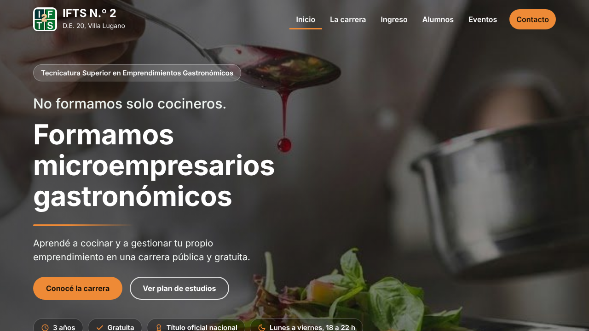
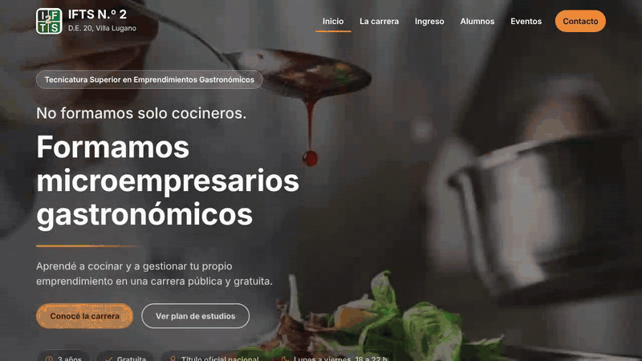
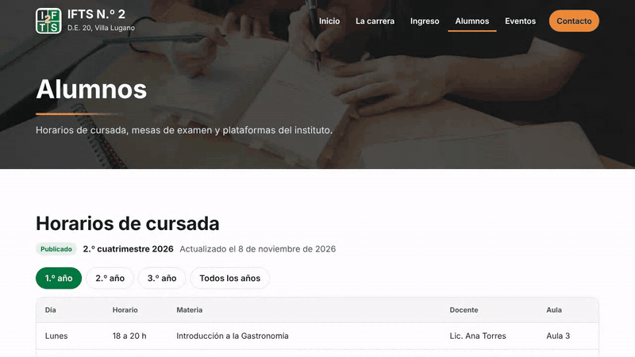
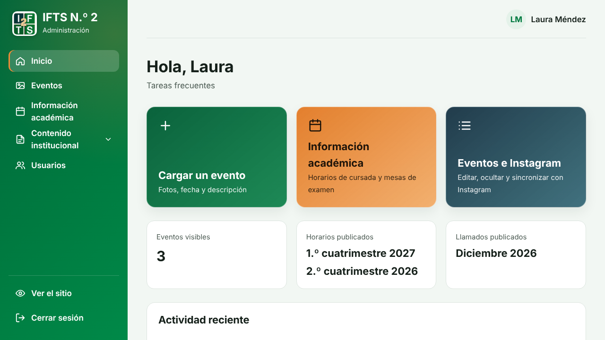
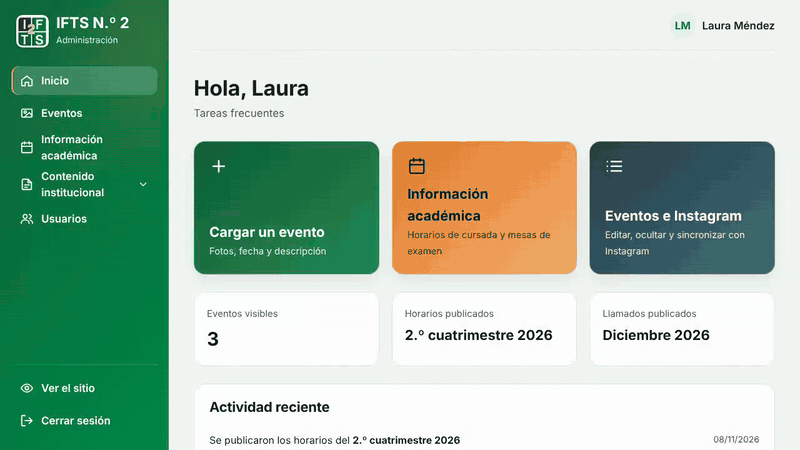
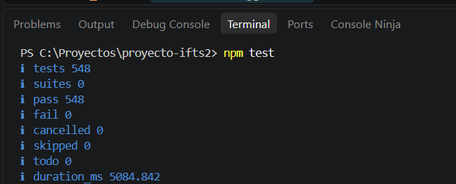

<div align="center">
  <h1>Portal Web Institucional IFTS N.º 2</h1>
  <h2>Proyecto Integrador · Prácticas Profesionalizantes IV · 404-Solutions</h2>
  <br>
  
  
  
  
  
  
</div>

<br>

> **Nota:** esta es la versión de la entrega final de la Etapa 3 (08/11/2026). El estado de cada funcionalidad
> está en la sección «Estado del Desarrollo».

<br>

---

## 📚 Datos del Proyecto

- **Institución:** Instituto de Formación Técnica Superior N.º 29 (IFTS N.º 29)
- **Carrera:** Tecnicatura Superior en Desarrollo de Software
- **Materia:** Prácticas Profesionalizantes IV (Proyecto Integrador) · 2026, 2.º cuatrimestre
- **Docentes:** Lic. Emir García Ontiveros y Lic. Kevin Del Bello
- **Empresa simulada:** 404-Solutions
- **Cliente:** IFTS N.º 2 D.E. 20 · Tecnicatura Superior en Emprendimientos Gastronómicos
- **Tablero:** [Proyecto IFTS2 (GitHub Projects)](https://github.com/orgs/IFTS29/projects/2/views/1)
- **Versión desplegada:** [proyectoifts2.vercel.app](https://proyectoifts2.vercel.app)

> El sitio se publica en Vercel desde la rama `develop`: cada merge a `develop` actualiza la versión
> desplegada.

<br>

---

## 📖 Descripción del Proyecto

El IFTS N.º 2 tenía un sitio en Google Sites que dejó de actualizarse porque mantenerlo llevaba demasiado
tiempo. El **Portal Web Institucional** lo reemplaza con dos partes:

1. **Sitio público:** la carrera, el ingreso, la información para alumnos, los eventos y el contacto, con foco
   en el perfil del egresado (_"formamos microempresarios gastronómicos"_).
2. **Panel de administración:** para que el personal del instituto, sin conocimientos técnicos, actualice el
   contenido sin depender del equipo de desarrollo.

El proyecto prioriza servicios gratuitos, con el objetivo de que el **costo operativo sea cero**.

<br>

---

## 🎯 Objetivos

- Ofrecer un panel simple, con perfiles **Administrador** y **Bedelía**.
- Separar el contenido estable (plan de estudios, autoridades, perfil del egresado, correlatividades) del
  contenido dinámico (eventos, novedades y galería).
- Mostrar solo la información académica vigente (horarios y mesas), archivando lo vencido sin borrarlo.
- Reunir los accesos a SIU Guaraní, Moodle y Mi Argentina.
- Recibir consultas mediante un formulario que llegue por correo a Bedelía.
- Incorporar publicaciones de Instagram cuando el instituto entregue el acceso a la API, con carga manual de respaldo.

<br>

---

## ✨ Funcionalidades Principales

### Sitio público

- **Inicio** con accesos para aspirantes y alumnos, y un carrusel con los eventos más recientes.
- **La carrera:** perfil del egresado, plan de estudios por año o por área, autoridades y documentos oficiales para ver, descargar o compartir.
- **Ingreso:** convocatoria vigente con el estado de la preinscripción, sus etapas y preguntas frecuentes.
- **Alumnos:** horarios de cursada y mesas de examen publicados, con filtro por año y descarga en PDF.
- **Eventos:** galería por año, del más reciente al más antiguo, con detalle y visor de fotos.
- **Contacto:** formulario que envía la consulta por correo a Bedelía o a la casilla institucional, según el motivo.

<p align="center">
  
</p>

<p align="center">
  
</p>

<p align="center">
  
</p>

### Panel de administración

- **Dos perfiles:** Administración (acceso total) y Bedelía (horarios y mesas de examen).
- **Horarios y mesas de examen:** se cargan como datos de trabajo y llegan al sitio recién al publicarlos. Se pueden comparar con lo publicado, actualizar o retirar.
- **Eventos:** carga con fotos o con el enlace de una publicación de Instagram, edición de la galería, ocultar y mostrar, y sincronización con la cuenta del instituto.
- **Contenido institucional:** perfil del egresado, autoridades, datos de contacto, convocatoria de ingreso y preguntas frecuentes, publicados al guardar.
- **Usuarios:** alta, edición y baja de cuentas, con contraseñas guardadas con hash y bloqueo tras 5 intentos fallidos.
- **Archivado por fecha:** lo vencido deja de verse en el sitio sin borrarse.

<p align="center">
  
</p>

<p align="center">
  
</p>

> **Nota:** las capturas y animaciones muestran el sistema con datos de ejemplo. Para los horarios y las mesas se usaron planillas del instituto como referencia, pero el cronograma del 2.º cuatrimestre de 2026 y el llamado de noviembre–diciembre de 2026 son simulados y no constituyen información académica oficial.

El uso paso a paso de cada pantalla está en el [Manual de Usuario](./docs/manual-de-usuario.md).

<br>

---

## ✅ Estado del Desarrollo

| Funcionalidad | Issue | Estado |
| :------------ | :---: | :----: |
| Estructura base del proyecto (React + Express) | #28 | ✅ |
| Modelos de datos y creación del primer administrador | #29 | ✅ |
| Sitio público en React | #32 | ✅ |
| Inicio de sesión con JWT y bloqueo por intentos fallidos | #30 | ✅ |
| Perfiles Administrador y Bedelía | #31 | ✅ Permisos de cada ruta comprobados con pruebas automáticas ([matriz de permisos](./docs/matriz-de-permisos.md)) |
| Gestión de usuarios del panel | #38 | ✅ |
| Formulario de contacto con envío de correo | #37 | ✅ Probado en el sitio desplegado con casillas del equipo. Las casillas definitivas las confirma el instituto |
| Información académica: horarios, aulas y mesas de examen | #33 | ✅ |
| Eventos institucionales con galería | #34 | 🟡 Se cargan con fotos o con el enlace de una publicación de Instagram, y se editan, ocultan y muestran. No tienen baja: un evento se oculta (#81) |
| Archivado de contenidos sin borrado | #35 | ✅ |
| Contenido institucional editable | #36 | ✅ |
| Integración con Instagram o carga manual | #39, #55 | ✅ La sincronización necesita las credenciales de la cuenta. Sin ellas, los eventos se cargan a mano |
| Pruebas automáticas y evidencias | #40, #41 | ✅ 548 pruebas aprobadas ([reporte de pruebas](./docs/reporte-de-pruebas.md)) |
| Manual técnico y manual de usuario | #42, #43 | ✅ |
| Despliegue final y entrega | #44 | 🟡 Sitio desplegado en Vercel. Entrega el 08/11/2026 |

✅ hecho · 🟡 parcial · ⏳ pendiente · 🔬 en revisión (Pull Request abierto)

> Estado al 08/11/2026. Las limitaciones conocidas y el trabajo futuro están en el
> [Manual Técnico](./docs/manual-tecnico.md) (apartado 12).

<br>

---

## 🏗️ Arquitectura y Tecnologías

```text
  Navegador ──► client/  (React + Vite)
                   │
                   │  /api/...
                   ▼
                server/  (Node.js + Express)  ──►  MongoDB Atlas
                   │
                   └──►  Servicios externos: Cloudinary (fotos), Instagram Graph API y correo SMTP
```

| Capa | Tecnologías |
| :--- | :---------- |
| Frontend | React 18, Vite 5, React Router 6 |
| Backend | Node.js, Express 4, JWT, bcryptjs, helmet, express-rate-limit, pdfkit (PDF de horarios y mesas) |
| Base de datos | MongoDB Atlas con Mongoose |
| Fotos de eventos | Cloudinary |
| Correo | Nodemailer con SMTP (por defecto, Gmail) |
| Despliegue | Vercel |
| Pruebas | node:test y supertest |

- **En local**, un solo servidor atiende la API y el cliente en `http://localhost:3000`.
- **En Vercel**, la API corre como función serverless (`api/index.js`) y el cliente compilado se sirve como
  sitio estático.
- **Sin base de datos ni correo configurados**, el proyecto funciona igual en local: los datos se guardan en
  memoria (se pierden al reiniciar) y el formulario de contacto usa un envío simulado.

El detalle de la arquitectura, la base de datos, las variables de entorno y las decisiones técnicas está en el
[Manual Técnico](./docs/manual-tecnico.md).

<br>

---

## 📂 Estructura del Proyecto

```text
proyecto-ifts2/
│
├── client/                   # Frontend (React + Vite)
│   └── src/
│       ├── pages/            # una pantalla por archivo (sitio público y panel)
│       ├── components/       # formularios, tablas, menú del panel, rutas protegidas
│       ├── context/          # sesión y rol del usuario
│       └── api.js            # llamadas a la API
│
├── server/                   # Backend (Node.js + Express)
│   ├── src/                  # rutas, servicios, modelos, acceso a datos y configuración
│   └── test/                 # pruebas automáticas
│
├── api/index.js              # entrada de la API en Vercel
├── server.js                 # entrada para desarrollo local
├── prototipo-html/           # prototipo original (referencia)
├── docs/                     # manuales, plan y reporte de pruebas, registro de cambios y roadmap
├── .env.example              # variables de entorno de ejemplo
└── package.json              # dependencias y scripts de todo el proyecto
```

<br>

---

## 🚀 Instalación y Ejecución

### Requisitos previos

- **Node.js 22 o superior**.
- **Git**.

### Pasos

```powershell
git clone https://github.com/IFTS29/proyecto-ifts2.git
cd proyecto-ifts2
npm install
Copy-Item .env.example .env
```

- En Linux o Mac, en lugar de `Copy-Item`: `cp .env.example .env`.
- Si PowerShell no deja ejecutar npm: `Set-ExecutionPolicy -Scope CurrentUser RemoteSigned`.
- Todas las dependencias están en el `package.json` de la raíz: se instalan con un solo `npm install`.

El `.env.example` ya trae los datos de un primer administrador para desarrollo local (`SEED_ADMIN_NOMBRE`,
`SEED_ADMIN_MAIL` y `SEED_ADMIN_PASSWORD`). Ese administrador se crea al arrancar, solo si todavía no hay
usuarios, y con esos datos se ingresa al panel. Se pueden cambiar en el `.env`; la contraseña tiene que tener al
menos 8 caracteres, con una mayúscula y un número.

> Los valores del `.env.example` son públicos: sirven solo para desarrollo local y no deben usarse en el
> sitio desplegado.

```powershell
npm run dev
```

El sitio queda en `http://localhost:3000` y el panel, en `http://localhost:3000/login`.

### Scripts

| Comando | Descripción |
| :------ | :---------- |
| `npm run dev` | Inicia la API y el cliente en `http://localhost:3000` |
| `npm test` | Pruebas automáticas del servidor |
| `npm run build` | Compila el cliente en `client/dist` |
| `npm start` | Sirve el cliente compilado junto con la API, en modo producción (exige MongoDB) |

### Variables de entorno

Están en `.env.example` y se explican una por una, con lo que pasa si faltan, en el
[Manual Técnico](./docs/manual-tecnico.md). Sin completar nada más que las del administrador, el proyecto
funciona en local con datos en memoria y envío de correo simulado. Para guardar datos hay que cargar
`MONGODB_URI`.

> **Importante:** el `.env` nunca se sube al repositorio. Las claves (base de datos, JWT, correo, Cloudinary,
> Instagram) se cargan solo en el `.env` local y en las variables de entorno de Vercel.

### Credenciales de prueba

Las credenciales del sitio desplegado se entregan a la cátedra por un canal privado. No se publican en este
repositorio.

<br>

---

## 🧪 Pruebas

```powershell
npm test
```

Hay **548 pruebas automáticas en 41 archivos**, todas aprobadas. Se ejecutan con `node:test` y supertest, sobre
datos en memoria: no necesitan base de datos ni conexión a Internet. Cubren el inicio de sesión y el bloqueo por intentos, los
permisos por rol, los usuarios, los eventos y sus fotos, las mesas de examen y los horarios, el archivado por
fecha, el contenido institucional, la sincronización con Instagram y el formulario de contacto.

| Módulo | Pruebas |
| :----- | :-----: |
| Permisos por rol (cada ruta de la API, con cada perfil) | 141 |
| Eventos, fotos y carga con enlace de Instagram | 108 |
| Contacto y correo | 44 |
| Sincronización con Instagram | 44 |
| Contenido institucional, carrera y plan de estudios | 39 |
| Autenticación y usuarios | 33 |
| Ingreso | 31 |
| Horarios de cursada | 28 |
| Mesas de examen | 25 |
| Textos, configuración y arranque | 23 |
| Archivado y avisos de vigencia | 17 |
| Panel e inicio | 15 |
| **Total** | **548** |

<p align="center">
  
</p>

Además, los cambios de pantalla se comprobaron en el navegador durante cada Pull Request, y las operaciones del
panel tienen un recorrido con capturas en la [validación visual de los CRUD](./docs/validacion-visual-cruds.md).

El plan de pruebas está en [docs/plan-de-testing.md](./docs/plan-de-testing.md) y el resultado de la última
ejecución, con la captura de la consola, en [docs/reporte-de-pruebas.md](./docs/reporte-de-pruebas.md).

<br>

---

## 🔀 Organización del Trabajo

- **Metodología:** Scrum simplificado, con tablero Kanban en GitHub Projects.
- **Ramas:** `main` (solo entrega final), `develop` (trabajo diario y versión desplegada) y una rama por tarea
  (`feature/...`, `fix/...`, `docs/...`) que se integra a `develop` con un Pull Request.
- **Issues:** con prefijo según el tipo (`SETUP-`, `US-`, `BUG-`, `QA-`, `DOC-`, `SPIKE-`, `CLIENTE-`,
  `POST-`).
- **Pull Requests:** título con el código del issue y una descripción en presente, por ejemplo
  `[US-08] Agrega el formulario de contacto con envío de consultas por correo`.

<br>

---

## 📄 Documentación

| Documento | Descripción |
| :-------- | :---------- |
| [Manual Técnico](./docs/manual-tecnico.md) | Arquitectura, base de datos, instalación, variables de entorno y decisiones de diseño |
| [Manual de Usuario](./docs/manual-de-usuario.md) | Cómo usar el sitio público y el panel de administración, paso a paso y con capturas |
| [Base de datos en MongoDB Atlas](./docs/documentacion_mongodb.md) | Configuración del clúster y colecciones, con capturas |
| [Decisiones de arquitectura (ADR)](./docs/adr/README.md) | Las siete decisiones de arquitectura, con su contexto y sus consecuencias |
| [Matriz de permisos](./docs/matriz-de-permisos.md) | Qué puede hacer cada rol en la API y en el panel |
| [Plan de testing](./docs/plan-de-testing.md) | Estrategia de pruebas, casos de prueba y su relación con los requerimientos |
| [Reporte de pruebas](./docs/reporte-de-pruebas.md) | Resultado de la última ejecución de las pruebas automáticas |
| [Validación visual de los CRUD](./docs/validacion-visual-cruds.md) | Recorrido con capturas de las operaciones del panel |
| [Registro de cambios](./docs/registro-de-cambios.md) | Qué se cambió en cada etapa y por qué |
| [Roadmap del MVP](./docs/roadmap-mvp.md) | Planificación y estado del MVP al 04/11/2026 |

<br>

---

## 👥 Equipo 404-Solutions

| Integrante | Rol | GitHub |
| :--------- | :-- | :----- |
| **Miguel Ángel Flores Meehan** | Product Owner · Analista de Negocio | [@mikefink22](https://github.com/mikefink22) |
| **Valeria Thomas** | Scrum Master · Gestión del Proyecto | [@Irinath](https://github.com/Irinath) |
| **Raquel Rodriguez Herlein** | Frontend · Diseño UX/UI | [@raquerh](https://github.com/raquerh) |
| **Mario David Gonzalez Benitez** | Backend · Base de Datos | [@elavincho](https://github.com/elavincho) |
| **Mariana Aiello** | QA · Documentación Técnica | [@Aiello-M](https://github.com/Aiello-M) |

<br>

---

<div align="center">
  <p>IFTS N.º 29 · Tecnicatura Superior en Desarrollo de Software · Prácticas Profesionalizantes IV · 2026</p>
</div>
