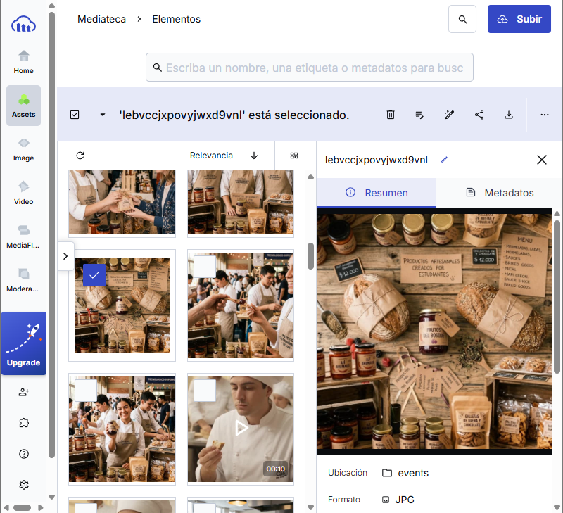
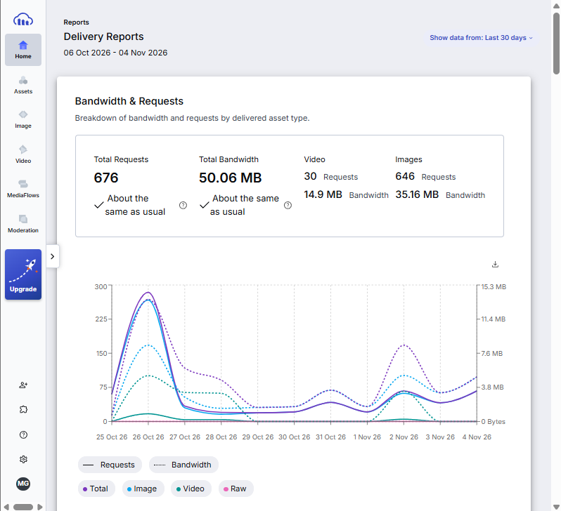

# Integración y Funcionamiento de Cloudinary en la Web App IFTS N° 2

---

## 1. Contexto del Proyecto y Rol de Cloudinary

La Web App del **IFTS N° 2** promociona los emprendimientos gastronónicos, talleres y productos artesanales desarrollados por los estudiantes de la Tecnicatura (panadería artesanal, mermeladas, salsas, conservas y eventos gastronómicos).

Dado que la aplicación incluye fotografías de alta resolución y videos de demostración en cocina, **Cloudinary** se utiliza como el servicio centralizado de media backend. Esto evita sobrecargar la plataforma de despliegue (**Vercel**) y garantiza un tiempo de carga rápido para los usuarios en computadoras y dispositivos móviles.

---

## 2. Gestión de Recursos

Dentro del panel de Cloudinary, los recursos están estructurados para representar el contenido de la web app.

### Organización por Carpetas
* Los archivos de los cursos y talleres se almacenan en la carpeta organizada `/events`.

---

## 3. Integración Técnica en la Web App (Vercel + Cloudinary)

La Web App desplegada en Vercel consume las imágenes y videos directamente desde la CDN de Cloudinary utilizando URLs de transformación dinámica.

## 4. Análisis del Consumo y Métricas del Proyecto

Analizando el dashboard actual de la cuenta. El plan gratuito cubre holgadamente el tráfico del portfolio del IFTS N° 2. El ancho de banda total transferido hacia los visitantes de la web en Vercel. Muestra la carga sostenida de imágenes en la app.

---

