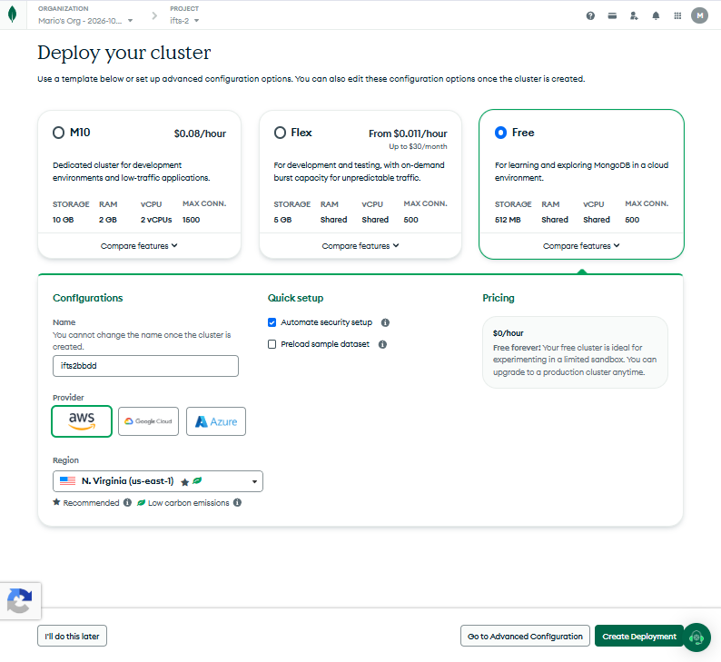
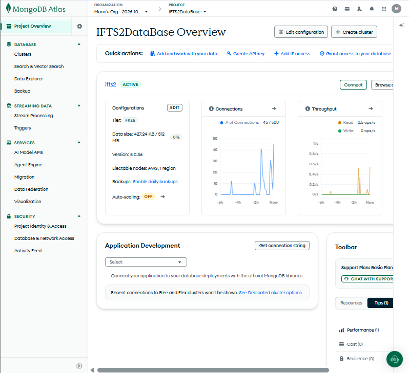
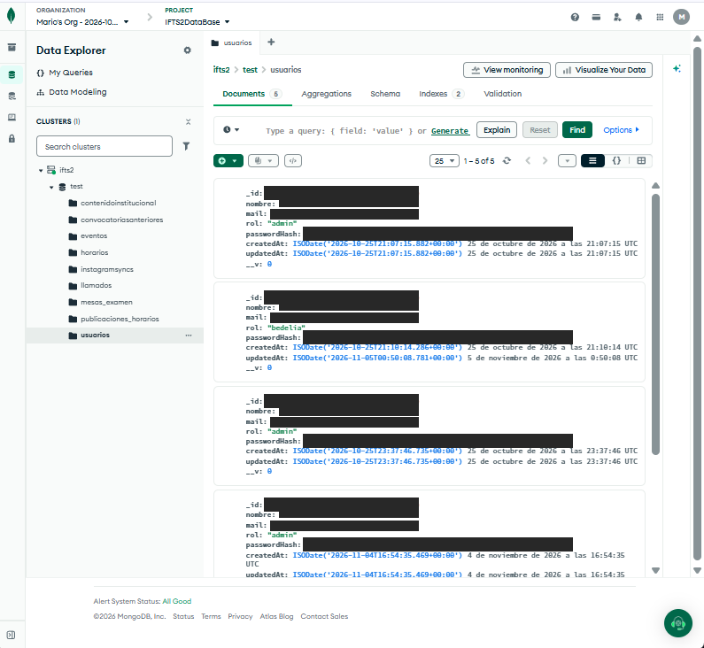
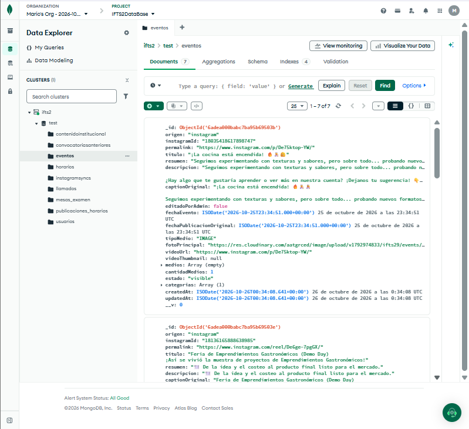
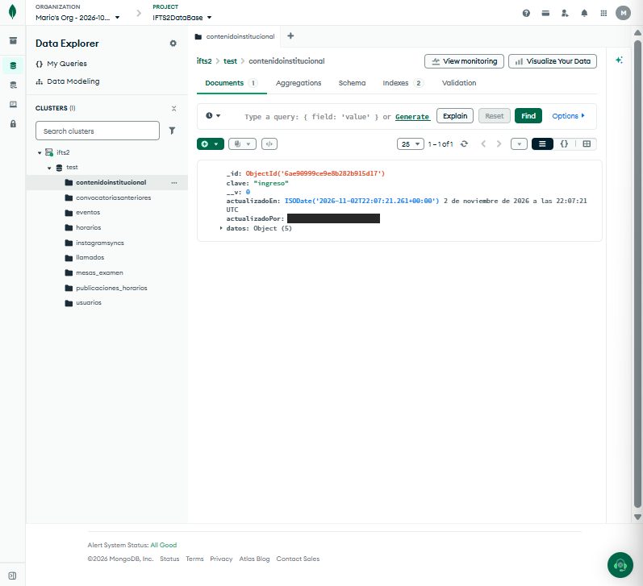

# Base de datos en MongoDB Atlas: Portal Web Institucional IFTS N.º 2

Este documento describe la configuración del clúster de **MongoDB Atlas** que usa el sitio desplegado (producción y vistas previas de Vercel) y la estructura de su base de datos, con capturas de la consola de Atlas. Las capturas se agregaron al repositorio el 4/11/2026 y muestran el estado de la base en ese momento.

El modelo de datos completo (entidades, relaciones y campos de cada colección) está en el [Manual Técnico, apartado 4](./manual-tecnico.md#4-base-de-datos). En desarrollo local el sistema puede funcionar sin esta base, en modo memoria (Manual Técnico, 5.1).

 

---

## 1. Despliegue y configuración del clúster

### 1.1 Configuración inicial

Se eligió el nivel gratuito M0 de Atlas, que permite alojar la base sin costo mientras se respeten los límites del servicio (Manual Técnico, 11).

| Elemento | Valor |
|---|---|
| Nivel de servicio | `Free` (M0) |
| Almacenamiento | 512 MB |
| RAM y vCPU | Compartidas |
| Conexiones máximas | 500 simultáneas |
| Proveedor | Amazon Web Services (AWS) |
| Región | `N. Virginia (us-east-1)`, marcada por Atlas como recomendada y de bajas emisiones |
| Seguridad | Configuración automática de seguridad (`Automate security setup`) |
| Datos de ejemplo | No se cargaron, para empezar con la base vacía |
| Copias de seguridad | No activadas. Para M0, Atlas ofrece respaldos como suscripción paga aparte, en vista previa privada (ver 1.2 y 4) |

La captura muestra el formulario de creación. Los nombres que figuran ahí (`ifts2bbdd` y el proyecto `ifts-2`) no son los definitivos: el clúster en uso se llama `ifts2` y está en el proyecto `IFTS2DataBase` (1.2).

### 1.2 Vista general del clúster

El clúster `ifts2` está en el proyecto `IFTS2DataBase` de la organización `Mario's Org`. La vista general de la consola mostraba, al momento de la captura:

| Elemento | Valor |
|---|---|
| Estado | `ACTIVE` |
| Almacenamiento usado | 427,24 KB de 512 MB (menos del 1 %) |
| Versión de MongoDB | 8.0.36 |
| Conexiones | Picos de alrededor de 45 conexiones, de un máximo de 500 |
| Operaciones | Lecturas de hasta 0,5 operaciones por segundo |
| Copias de seguridad | Sin activar (la consola ofrece «Enable daily backups») |

Estos valores cambian con el uso.

 

---

## 2. Base de datos y colecciones

La base de datos que usa el sitio se llama `test`. Es el nombre que asigna MongoDB cuando la cadena de conexión (`MONGODB_URI`) no indica una base, y así quedó configurado el despliegue. Si en el futuro se agrega un nombre a la cadena de conexión, el sistema empieza a usar una base nueva y vacía: los datos actuales quedan en `test` y hay que copiarlos antes.

Mongoose crea las colecciones y sus índices la primera vez que se usan (Manual Técnico, 4.4). En el **Data Explorer** de Atlas se ven estas nueve:

| Colección | Contenido |
|---|---|
| `usuarios` | Cuentas del panel (Administración o Bedelía) |
| `eventos` | Eventos de la galería, cargados en el panel o traídos de Instagram |
| `horarios` | Horarios de cursada en preparación, por período |
| `publicaciones_horarios` | Horarios publicados: lo que ven los alumnos |
| `llamados` | Llamados de mesas de examen, con su versión publicada |
| `mesas_examen` | Mesas de cada llamado, en preparación |
| `contenidoinstitucional` | Secciones editables: perfil, personas, contacto, ingreso y preguntas de ingreso |
| `convocatoriasanteriores` | Historial de convocatorias de ingreso |
| `instagramsyncs` | Estado de la sincronización con Instagram |

 

---

## 3. Detalle de colecciones

Este apartado muestra tres colecciones tal como se ven en Atlas. Los campos de todas las colecciones están en el Manual Técnico, 4.2.

### 3.1 Colección `usuarios`

Guarda las cuentas que entran al panel y su rol.

| Campo | Tipo | Contenido |
|---|---|---|
| `_id` | `ObjectId` | Identificador que asigna MongoDB |
| `nombre` | `String` | Nombre que muestra el panel |
| `mail` | `String` | Correo con el que se ingresa. Es único y se guarda en minúsculas |
| `rol` | `String` | `admin` o `bedelia` |
| `passwordHash` | `String` | Hash de la contraseña generado con bcrypt. No se almacena la contraseña original |
| `createdAt`, `updatedAt` | `ISODate` | Fecha de creación y de última modificación |
| `__v` | `Number` | Versión del documento que usa Mongoose |

En la captura se ocultaron los valores de `_id`, `nombre`, `mail` y `passwordHash`. Quedan visibles los nombres de los campos y los roles.

### 3.2 Colección `eventos`

Guarda los eventos de la galería: los cargados desde el panel y los traídos de Instagram con **Sincronizar Instagram**.

| Campo | Tipo | Contenido |
|---|---|---|
| `_id` | `ObjectId` | Identificador que asigna MongoDB |
| `origen` | `String` | `manual` o `instagram` |
| `instagramId` | `String` | Identificador de la publicación en Instagram. Único |
| `permalink`, `videoUrl` | `String` | Enlace de la publicación de Instagram. Sirven para no crear eventos repetidos |
| `titulo`, `resumen`, `descripcion` | `String` | Textos del evento |
| `captionOriginal` | `String` | Texto original de la publicación de Instagram |
| `editadoPorAdmin` | `Boolean` | Indica si un evento de Instagram se editó en el panel |
| `fechaEvento`, `fechaPublicacionOriginal` | `ISODate` | Fecha del evento y fecha de la publicación en Instagram |
| `visibleSiempre` | `Boolean` | Permite mostrar un evento archivado por fecha (dos años o más) cuando su estado es `visible`. No cambia el estado guardado |
| `tipoMedio` | `String` | `IMAGE`, `VIDEO` o `CAROUSEL_ALBUM` |
| `fotoPrincipal` | `String` | Dirección de la foto de portada en Cloudinary |
| `medios`, `cantidadMedios` | `Array`, `Number` | Fotos y videos del evento, y su cantidad |
| `mediosQuitados` | `Array` | Registro de las fotos quitadas desde el panel |
| `estado` | `String` | `visible` u `oculto`. El valor `archivado` queda por compatibilidad: el archivo se calcula por fecha |
| `categorias` | `Array` | Categorías del evento |
| `createdAt`, `updatedAt` | `ISODate` | Fecha de creación y de última modificación |

La captura muestra un evento traído de Instagram.

### 3.3 Colección `contenidoinstitucional`

Guarda una sección editable del contenido institucional por documento. Mientras una sección no se edita desde el panel, el sitio muestra los textos por defecto y la colección no tiene ese documento.

| Campo | Tipo | Contenido |
|---|---|---|
| `_id` | `ObjectId` | Identificador que asigna MongoDB |
| `clave` | `String` | Sección: `perfil`, `personas`, `contacto`, `ingreso` o `ingresoPreguntas`. Única |
| `datos` | `Object` | Contenido de la sección, validado antes de guardarse |
| `actualizadoEn` | `ISODate` | Fecha del último cambio |
| `actualizadoPor` | `String` | Nombre de quien guardó el último cambio, tomado de la sesión |

La captura muestra la sección de ingreso, la única editada en ese momento. Se ocultó el valor de `actualizadoPor`.

 

---

## 4. Resumen técnico

| Elemento | Detalle |
|---|---|
| Alojamiento | MongoDB Atlas, nivel gratuito M0, en AWS us-east-1 |
| Tipo de base | Documental (NoSQL), con documentos BSON |
| Acceso | El servidor se conecta con `MONGODB_URI`, guardada en las variables de Vercel |
| Seguridad de las cuentas | Contraseñas almacenadas como hash de bcrypt y roles `admin` y `bedelia` |
| Imágenes | Se guardan en Cloudinary. La base guarda solo sus direcciones |
| Instagram | La colección `instagramsyncs` guarda el estado de la sincronización |
| Copias de seguridad | No hay respaldos automáticos activados. Para respaldos manuales se pueden usar `mongodump` y `mongorestore` (Manual Técnico, 10.1). Todavía no se comprobó una restauración (Manual Técnico, 12.4) |
