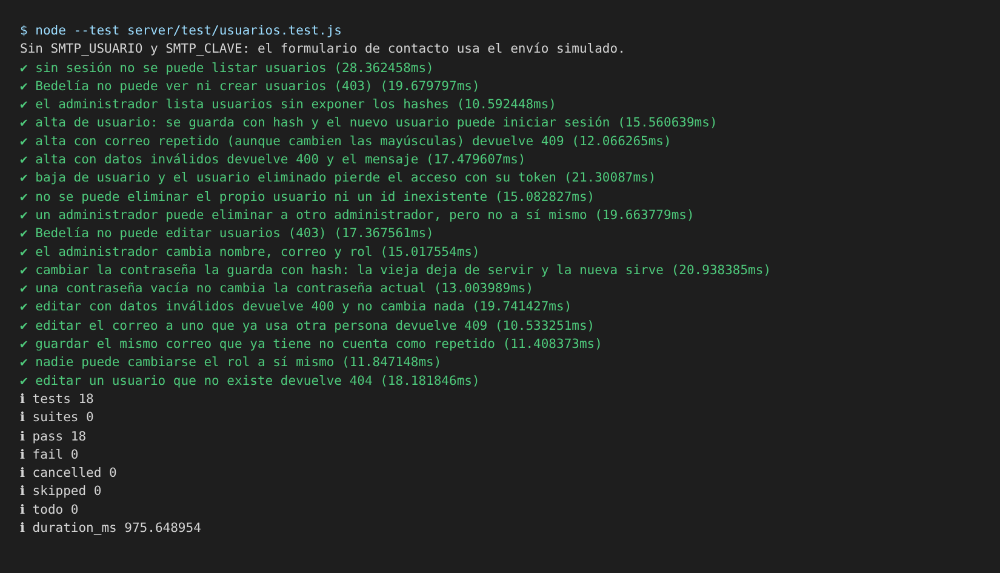

# Evidencia de pruebas de integración

Este documento muestra dos pruebas de integración: los pasos que hace la prueba, el resultado esperado y el obtenido. Salen de `server/test/usuarios.test.js`, que tiene 18 pruebas sobre el alta, la edición y la baja de usuarios; las 18 aprobaron.

Se ejecutaron el 8/11/2026 sobre la rama `develop` (commit `8052352`), con Node.js 22.22.0.

## Qué integran estas pruebas

Cada prueba arma la aplicación completa (`crearApp`) y le hace pedidos HTTP con `supertest`, como lo haría el panel. Así se prueban juntos la ruta de la API, el control de permisos por token, las validaciones, el cifrado de la contraseña y el repositorio de usuarios.

El repositorio es el de memoria (`usuarios.memoria.js`), el mismo que usa la aplicación cuando no hay base configurada. **No usan MongoDB Atlas**: la conexión con la base real no está cubierta por estas pruebas. Los repositorios de memoria y de MongoDB comparten la misma interfaz (ver el [manual técnico](./manual-tecnico.md), apartado 2.2).

## Cómo se ejecutan

```bash
node --test server/test/usuarios.test.js
```



## PI-01. Alta de usuario e inicio de sesión del usuario nuevo

**Qué se probó:** que crear un usuario desde la API lo guarde de forma correcta y que ese usuario pueda entrar después.

**Prueba:** «alta de usuario: se guarda con hash y el nuevo usuario puede iniciar sesión».

| Paso | Resultado esperado | Resultado obtenido |
| :-- | :-- | :-- |
| 1. El administrador inicia sesión y obtiene su token | Token válido | Aprobado |
| 2. Envía `POST /api/users` con nombre «Ana Test», correo `ana@ifts2.edu.ar`, rol `bedelia` y contraseña `Clave1234` | Responde 201 | Aprobado |
| 3. Se busca el usuario guardado en el repositorio | Existe, y su `passwordHash` es distinto de la contraseña | Aprobado |
| 4. Se envía `POST /api/auth/login` con el correo y la contraseña del usuario nuevo | Responde 200 y el usuario devuelto tiene rol `bedelia` | Aprobado |

## PI-02. Baja de usuario y pérdida de acceso

**Qué se probó:** que al eliminar un usuario, su sesión deje de servir aunque el token siga vigente.

**Prueba:** «baja de usuario y el usuario eliminado pierde el acceso con su token».

| Paso | Resultado esperado | Resultado obtenido |
| :-- | :-- | :-- |
| 1. Inician sesión el administrador y Bedelía, cada uno con su token | Dos tokens válidos | Aprobado |
| 2. El administrador pide `GET /api/users` y busca a Bedelía en la lista | La encuentra | Aprobado |
| 3. El administrador envía `DELETE /api/users/:id` con el id de Bedelía | Responde 204 | Aprobado |
| 4. Bedelía usa su token anterior en `GET /api/auth/yo` | Responde 401 | Aprobado |

## Resultado

Las dos pruebas aprobaron, igual que las otras 16 del archivo (permisos, correo repetido, datos inválidos, edición y cambio de contraseña).
