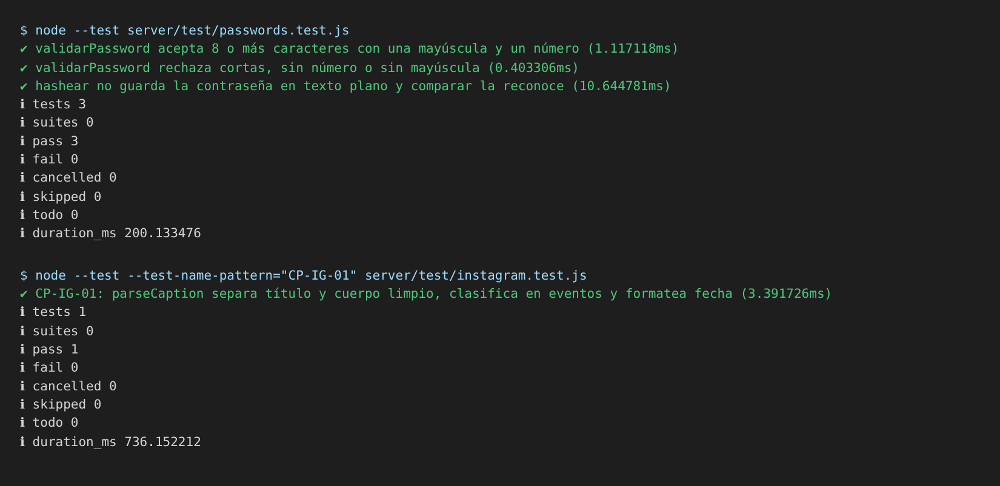

# Evidencia de pruebas unitarias

Este documento muestra tres pruebas unitarias del proyecto: qué se probó, qué resultado se esperaba y cuál se obtuvo. Son una muestra; la suite completa tiene 548 pruebas y se describe en el [reporte de pruebas](./reporte-de-pruebas.md).

Las tres prueban funciones sueltas, sin servidor ni base de datos. Se ejecutaron el 8/11/2026 sobre la rama `develop` (commit `8052352`), con Node.js 22.22.0.

## Cómo se ejecutan

```bash
node --test server/test/passwords.test.js
node --test --test-name-pattern="CP-IG-01" server/test/instagram.test.js
```

Con `npm test` se corre la suite completa.



## PU-01. Reglas de la contraseña

**Qué se probó:** la función `validarPassword` (`server/src/services/passwords.js`), que decide si una contraseña nueva es válida. La regla es: al menos 8 caracteres, una mayúscula y un número.

**Archivo:** `server/test/passwords.test.js`, dos pruebas.

| Entrada | Resultado esperado | Resultado obtenido |
| :-- | :-- | :-- |
| `Clave1234` | Devuelve `null` (es válida) | Aprobado |
| `Ab1`, `Sololetras`, `clave1234`, `12345678`, cadena vacía, `undefined` | Devuelve el mensaje «La contraseña debe tener al menos 8 caracteres, con una mayúscula y un número.» | Aprobado, las seis entradas se rechazan con ese mensaje |

## PU-02. La contraseña no se guarda en texto plano

**Qué se probó:** las funciones `hashear` y `comparar` (mismo archivo), que usan bcrypt.

**Archivo:** `server/test/passwords.test.js`, una prueba.

| Entrada | Resultado esperado | Resultado obtenido |
| :-- | :-- | :-- |
| `hashear("Clave1234")` | El resultado es distinto de la contraseña y tiene formato bcrypt (`$2a$`, `$2b$` o `$2y$`) | Aprobado |
| `comparar("Clave1234", hash)` | `true` | Aprobado |
| `comparar("otra", hash)` | `false` | Aprobado |

## PU-03. Título y descripción de una publicación de Instagram

**Qué se probó:** las funciones `parseCaption`, `classifyPosts` y `formatMonthYear` (`server/src/services/instagram/`), que arman el título, el resumen y la categoría de un evento a partir del texto de una publicación. Corresponde al caso CP-IG-01 del [plan de testing](./plan-de-testing.md).

**Archivo:** `server/test/instagram.test.js`, prueba «CP-IG-01».

**Entrada:** el texto de una publicación con un título en la primera línea, un párrafo y los hashtags `#eventosIFTS2 #gastronomia`; y la fecha `2026-05-25T14:30:00Z`.

| Qué se verifica | Resultado esperado | Resultado obtenido |
| :-- | :-- | :-- |
| Título | `Jornada Gastronómica 2026` | Aprobado |
| Resumen | Contiene «Estudiantes de segundo año» | Aprobado |
| Hashtags | La lista incluye `#eventosIFTS2` y el texto limpio ya no lo tiene | Aprobado |
| Categoría | `["eventos"]` | Aprobado |
| Fecha | «Mayo 2026» | Aprobado |

## Resultado

Las cuatro pruebas aprobaron (3 de contraseñas y 1 de Instagram), sin fallas. Los tiempos de cada una están en la captura.
