# Manual de usuario del panel de administración

Este manual explica cómo usar el panel de administración del sitio del IFTS N.° 2. Está pensado para quienes cargan y actualizan la información del sitio: personal de Bedelía, autoridades y quien administre el sistema. No hace falta saber de programación.

Las capturas se tomaron con datos de prueba. Los nombres, fechas y textos que aparecen en ellas son de ejemplo.

## Qué es el panel y quién puede hacer qué

El panel es la parte privada del sitio. Desde ahí se cambia lo que ven los alumnos y los aspirantes en la parte pública: horarios, mesas de examen, eventos, datos de contacto e información de ingreso.

Hay dos roles:

| Sección del panel | Administrador | Bedelía |
|---|---|---|
| Inicio | Sí | Sí |
| Información académica (horarios y mesas) | Sí | Sí |
| Eventos | Sí | No |
| Contenido institucional | Sí | No |
| Usuarios | Sí | No |

Si una persona con rol Bedelía escribe a mano la dirección de una sección que no le corresponde, el panel la lleva de nuevo al inicio. El menú lateral de Bedelía solo muestra Inicio e Información académica.

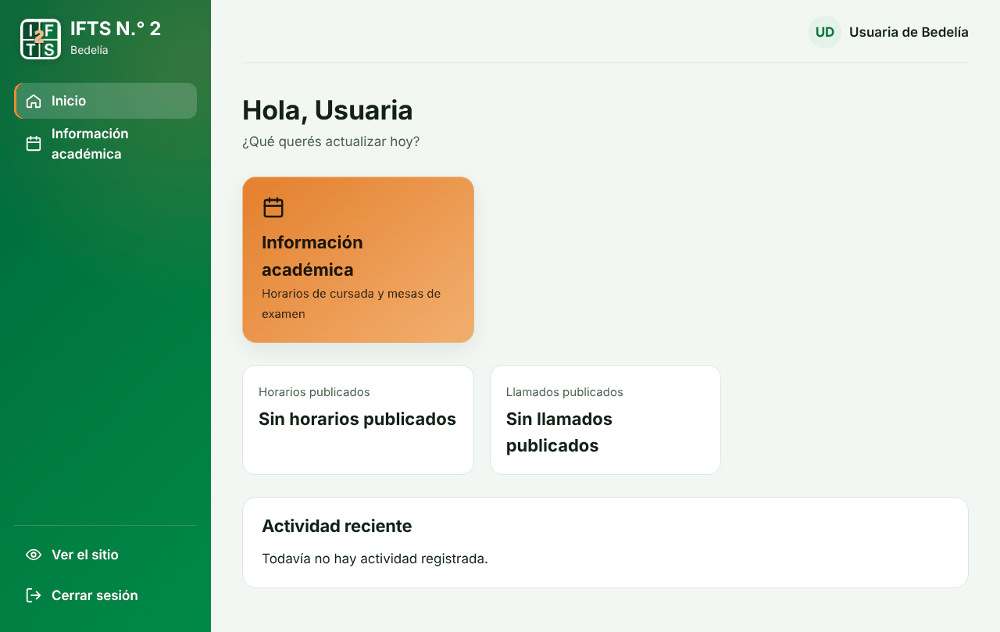

## Ingresar y salir

1. Entrá a la dirección del panel (`/login`).
2. Escribí tu correo electrónico y tu contraseña.
3. Tocá **Ingresar**.

Para salir, usá **Cerrar sesión**, abajo en el menú lateral, o el mismo botón de la caja que se abre sobre el sitio público (ver más abajo). **Ver el sitio** abre la parte pública.

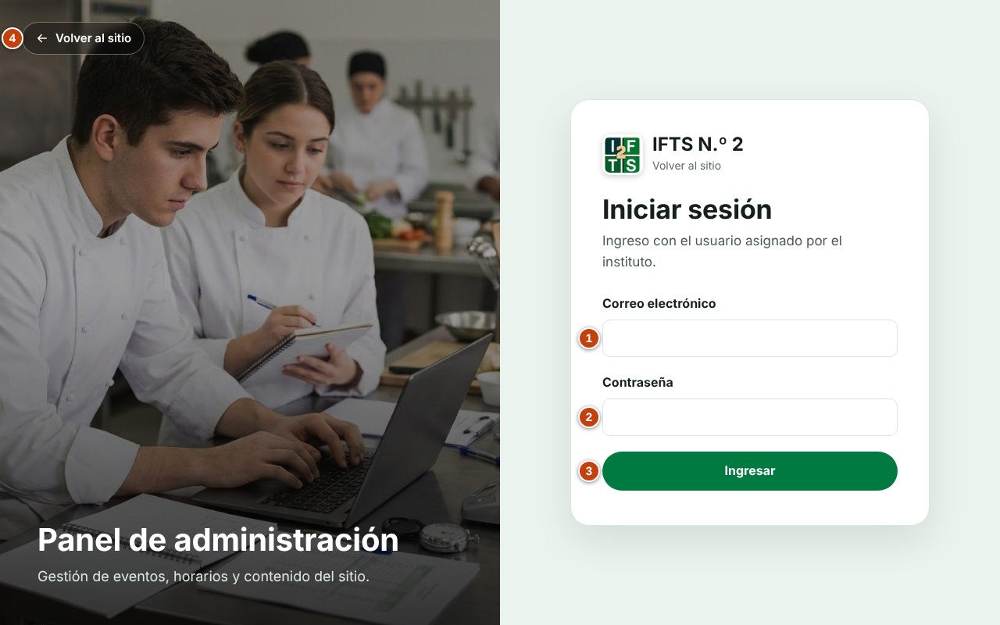

Si el correo o la contraseña no coinciden, el panel avisa «Usuario o contraseña incorrectos» y cuántos intentos te quedan. Después de 5 intentos fallidos el ingreso se bloquea y el panel muestra «Demasiados intentos fallidos. Probá de nuevo en 15 minutos.».

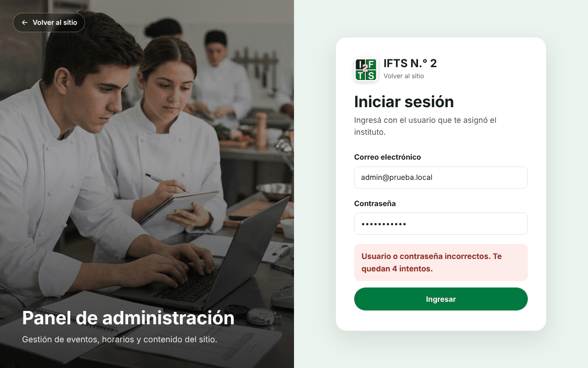

Las cuentas las crea el administrador desde la sección Usuarios. No hay una opción para registrarse solos.

### Mirar el sitio con la sesión iniciada

Mientras tengas la sesión iniciada, el sitio público muestra abajo a la derecha un botón con tus iniciales y el texto «Volver al panel». Sirve para saber con qué usuario estás mirando el sitio y para volver sin escribir la dirección del panel. El botón no aparece si no hay sesión iniciada, ni dentro del panel ni en la pantalla de ingreso.

Al tocarlo se abre una caja que dice «Estás viendo el sitio como Administración» (o «Bedelía», según tu usuario) y tiene dos botones: **Volver al panel** y **Cerrar sesión**. La caja se cierra con el botón **Cerrar**, con la tecla Esc, al tocar afuera o al cambiar de página.

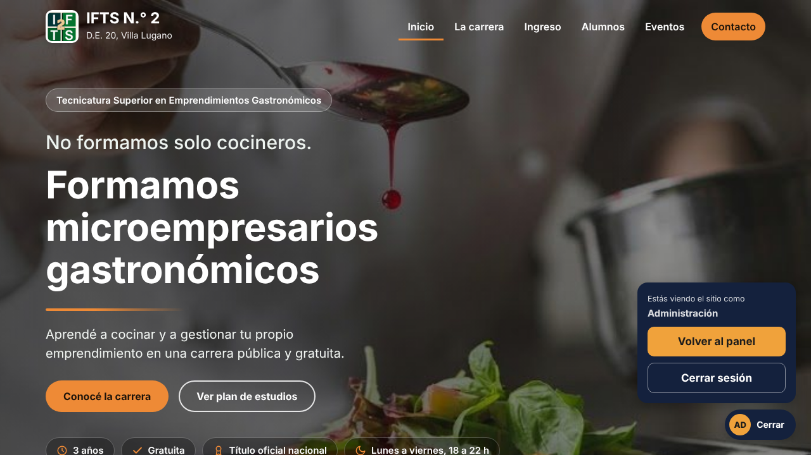

En el celular funciona igual, con el botón un poco más chico.

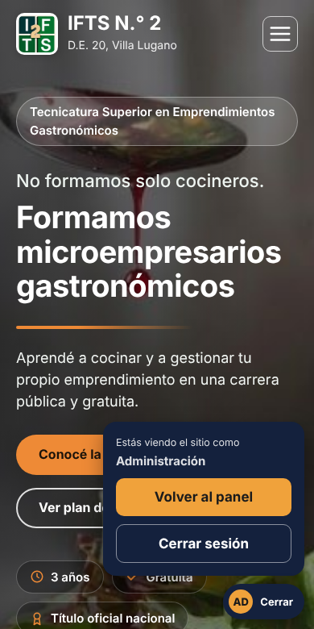

Si entrás a `/login` con la sesión ya iniciada, el panel te lleva directo al inicio.

## Inicio del panel

Al ingresar se ve un saludo y tres accesos directos (cargar un evento, Información académica y Eventos e Instagram). Debajo hay tres tarjetas con lo que está publicado hoy: cantidad de eventos visibles, período de horarios publicado y llamados de mesas publicados. Al final aparece la actividad reciente, por ejemplo «Se publicaron los horarios del 2.º cuatrimestre 2026».

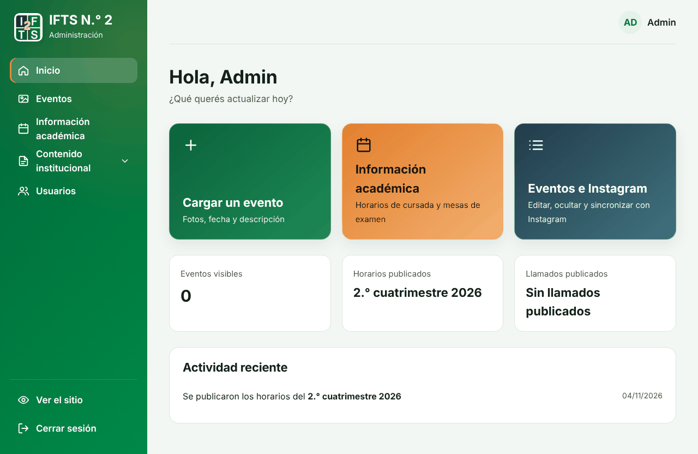

## Información académica

Tiene dos pestañas: **Horarios de cursada** y **Mesas de examen**. En las dos vale la misma regla, que conviene tener presente:

> Guardar no cambia el sitio. Los alumnos ven solo lo que está publicado.

Se puede cargar y corregir todo el tiempo que haga falta sin que nadie lo vea. Los cambios llegan al sitio cuando tocás **Publicar** o **Actualizar publicación**.

### Horarios de cursada

Cada período (por ejemplo, 2.º cuatrimestre 2026) tiene sus propias materias. Se elige en el selector **Período**.

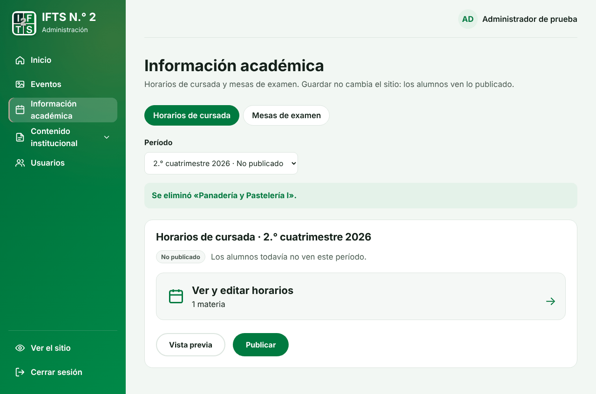

**Cargar una materia**

1. Entrá a **Ver y editar horarios**.
2. Tocá **+ Agregar materia**.
3. Completá año de la carrera, turno y materia. Al escribir el nombre aparecen las materias del plan de estudios.
4. Docente y aula son opcionales. Si no cargás docente, el sitio muestra «A designar».
5. En **Días y horarios** elegí el día y la franja. Con **Agregar otro día u horario** sumás más franjas para la misma materia.
6. Tocá **Guardar**, o **Guardar y agregar otra** para seguir con la siguiente materia.

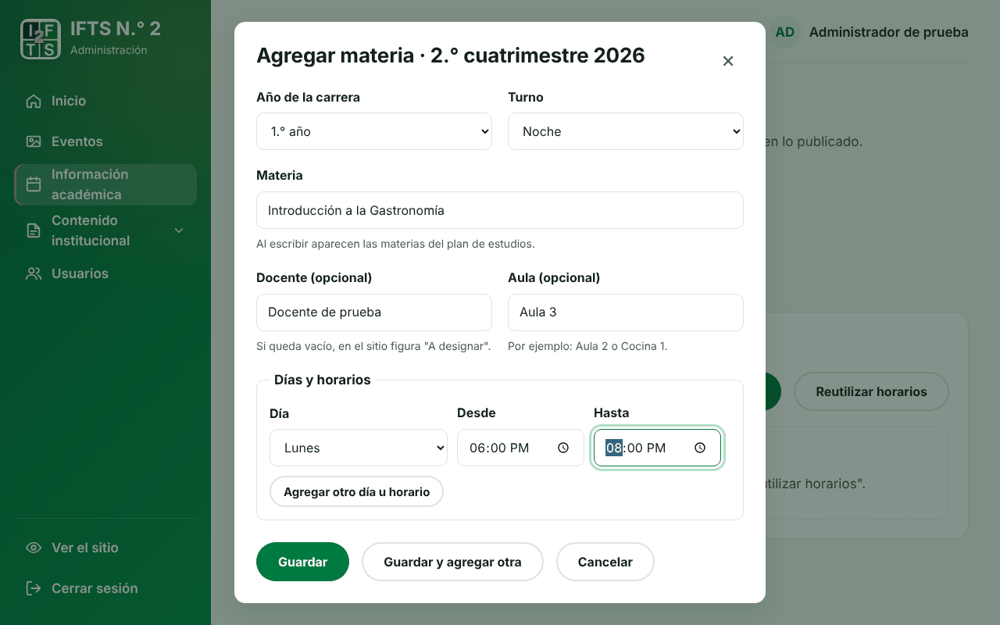

La materia aparece en la tabla del período.

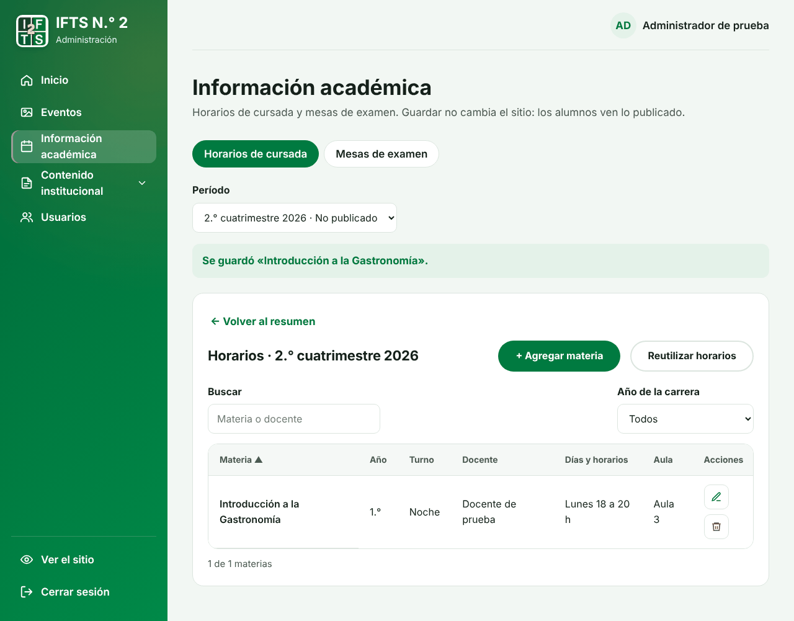

**Editar una materia.** En la tabla, usá el botón de editar de esa fila, cambiá lo que necesites y guardá.

**Eliminar una materia.** Usá el botón de eliminar de la fila. El panel pide confirmación antes de borrar.

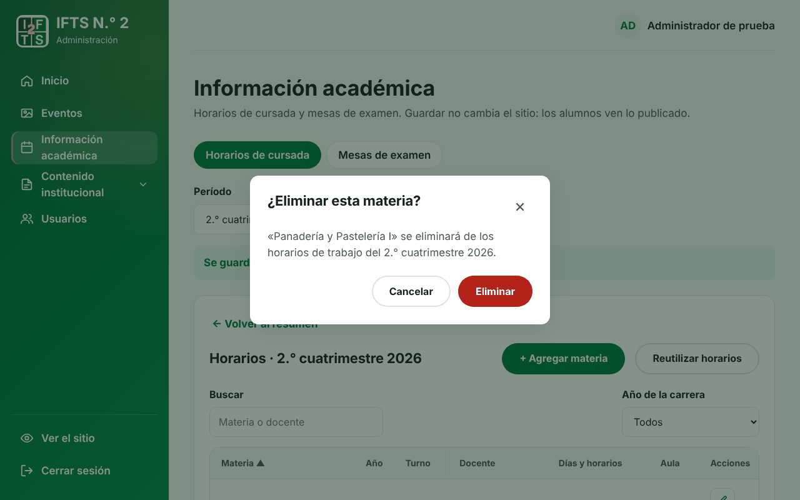

**Reutilizar horarios.** Si el período nuevo se parece a otro, **Reutilizar horarios** trae las materias de otro período para no cargarlas de cero. Después se corrige lo que haya cambiado.

**Vista previa.** Muestra cómo van a ver los alumnos el horario antes de publicarlo.

**Publicar.** Desde el resumen del período, tocá **Publicar**. El panel pide confirmación y avisa qué van a ver los alumnos. Cuando se confirma, el período figura como publicado y aparece en la sección Alumnos del sitio.

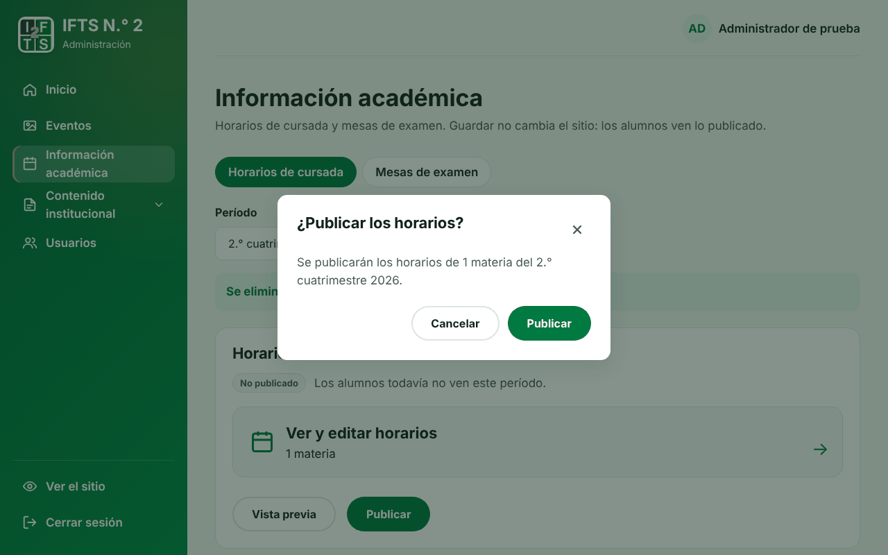

**Cambios guardados sin publicar.** Si editás algo de un período ya publicado, el panel avisa: «Hay cambios guardados sin publicar. Los alumnos todavía ven la versión anterior.». El enlace **Ver cambios** abre una comparación entre lo publicado y lo guardado.

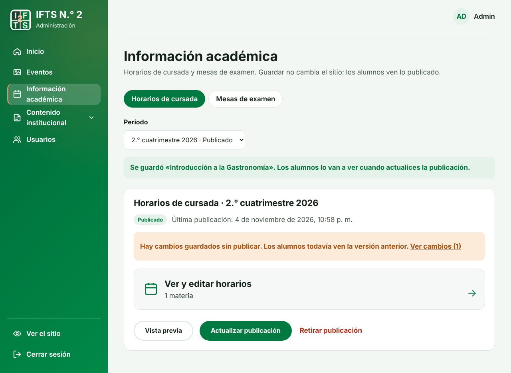

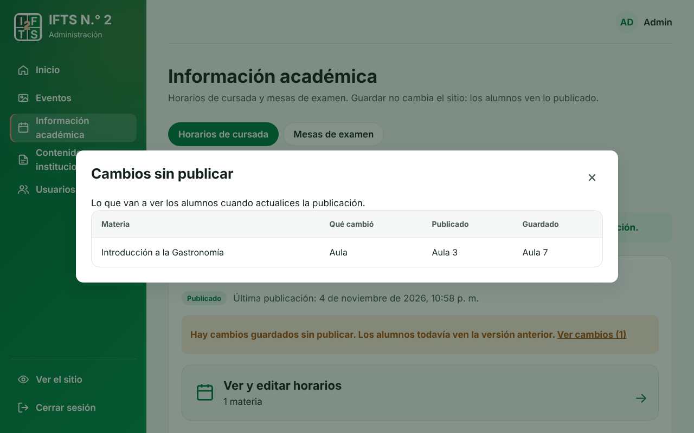

Para que los alumnos vean los cambios, tocá **Actualizar publicación**.

**Retirar publicación.** **Retirar publicación** saca el período del sitio. Los datos se conservan en el panel y se pueden volver a publicar. También pide confirmación.

### Mesas de examen

Las mesas se organizan por **llamado** (por ejemplo, un turno de exámenes con sus fechas). Cada llamado tiene sus mesas.

**Crear un llamado.** Tocá **+ Nuevo llamado**, completá el nombre, las fechas y el aviso para los alumnos, y guardá. El llamado queda como datos de trabajo, sin publicar. Los datos del llamado se pueden cambiar después con **Editar datos del llamado**.

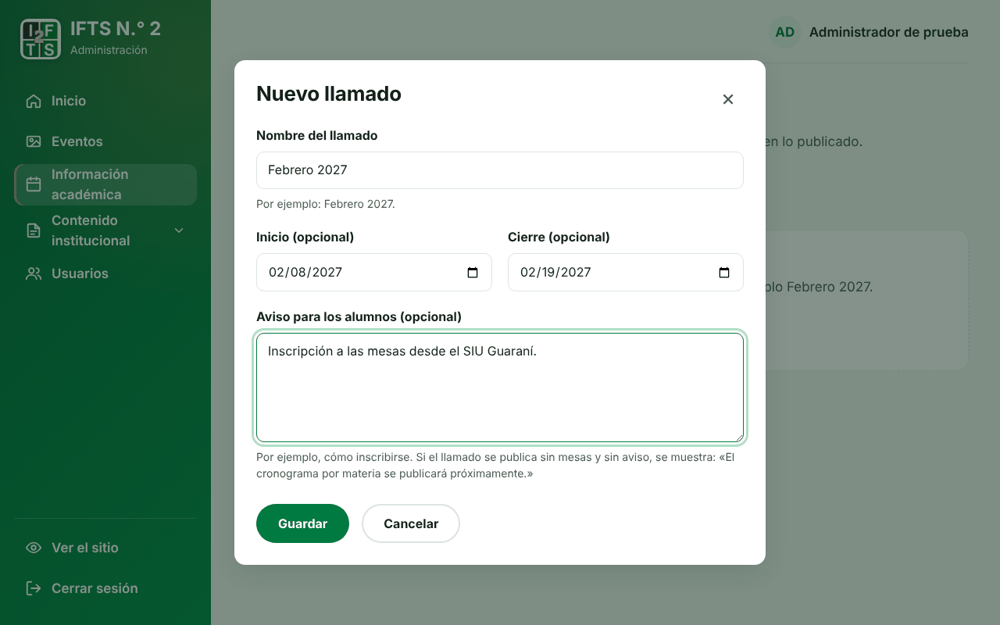

**Cargar una mesa.** Dentro del llamado, tocá **+ Agregar mesa** y completá materia, año, fecha, hora, aula y mesa examinadora.

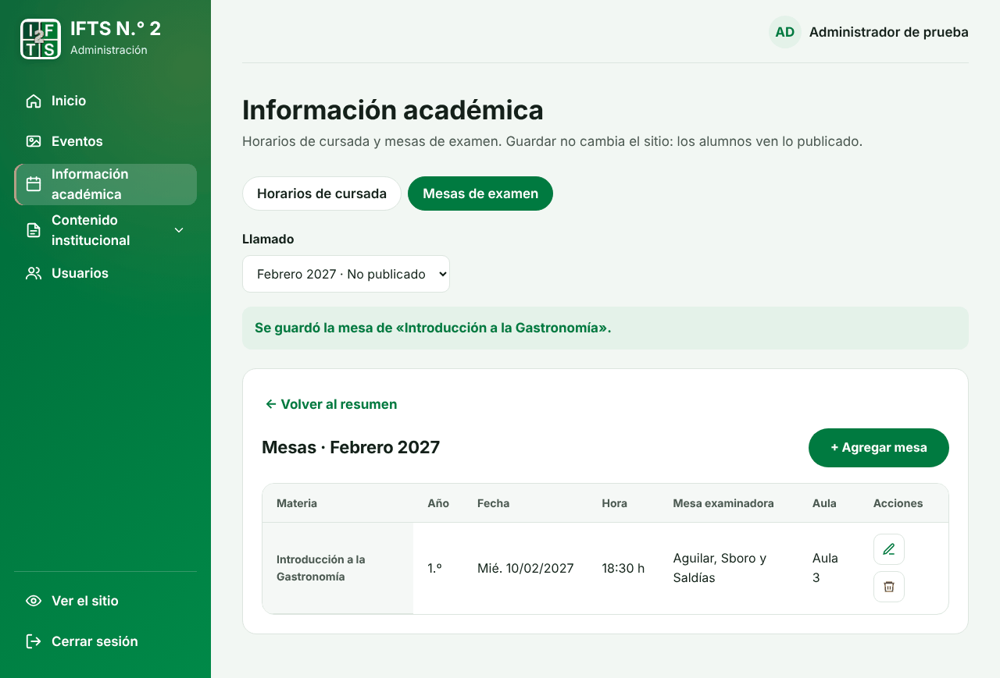

Editar y eliminar mesas funciona igual que con las materias de horarios: botón de la fila y confirmación al eliminar.

**Publicar y retirar.** Se hacen desde el resumen del llamado, con los botones **Publicar** y **Retirar publicación**, y con el mismo cuadro de confirmación. Al retirar, los alumnos dejan de ver el llamado y los datos quedan guardados.

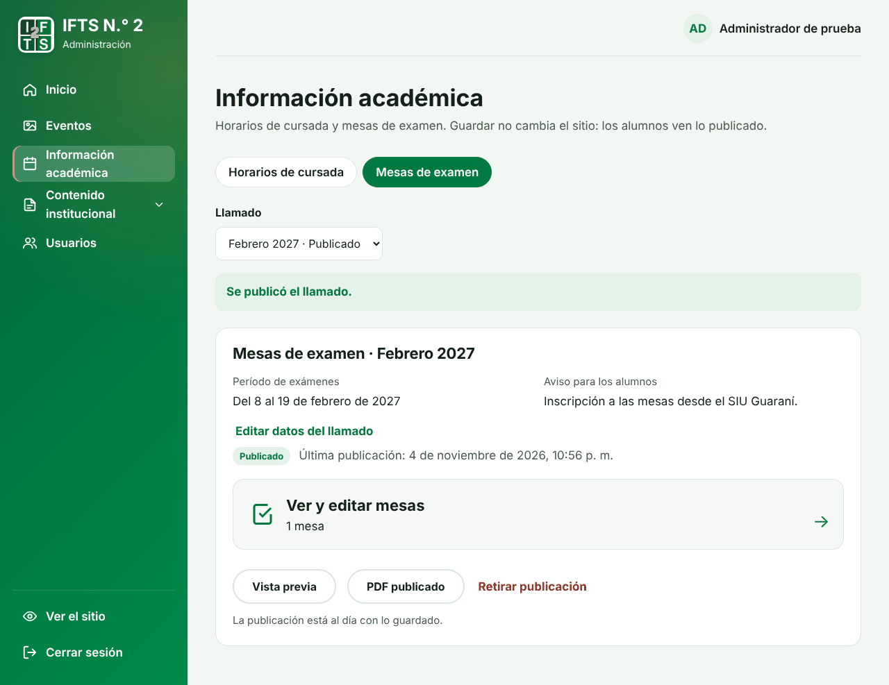

**Eliminar un llamado.** Un llamado que ya estuvo publicado y fue retirado no se puede eliminar. Si no hace falta, alcanza con dejarlo retirado.

## Eventos

Solo el rol Administrador accede a esta sección. La lista tiene pestañas para filtrar: **Todos**, **En el sitio**, **Ocultos** y **Archivo**. En Archivo van los eventos de dos años o más.

**Cargar un evento**

1. Tocá **Cargar evento**.
2. Completá el título y la fecha. El resumen es opcional y se muestra como una línea en la tarjeta de la galería.
3. Escribí la descripción.
4. Si querés, pegá el enlace de una publicación o video de Instagram. Se muestra en el sitio si no subís fotos.
5. Agregá fotos (JPG, PNG o WebP, hasta 20 por evento). La primera es la portada. Con **Usar como portada** elegís otra.
6. Dejá marcado **Visible en el sitio** si querés que se publique ya.
7. Tocá **Publicar evento**.

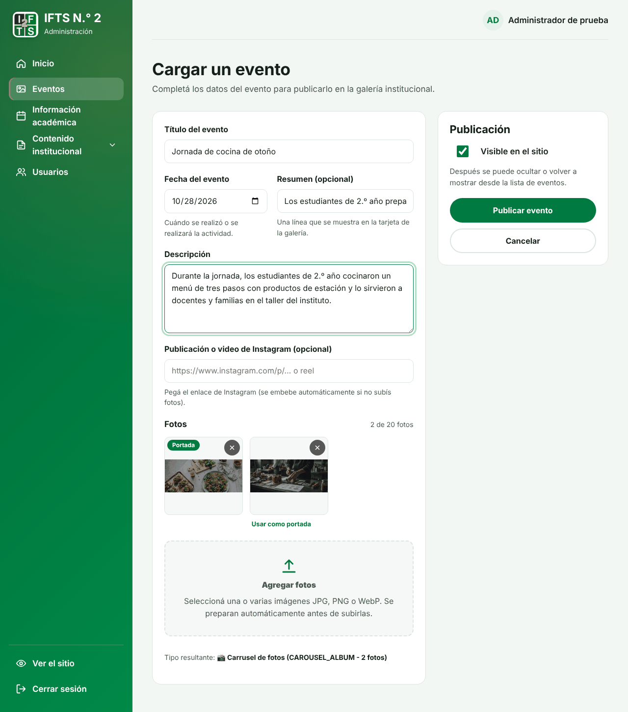

**Editar.** Cada fila de la lista tiene la opción de editar. Se abre el mismo formulario con los datos cargados.

**Ocultar y mostrar.** Ocultar saca el evento del sitio sin borrarlo; el panel pide confirmación. El evento pasa a la pestaña Ocultos y se puede volver a mostrar cuando haga falta.

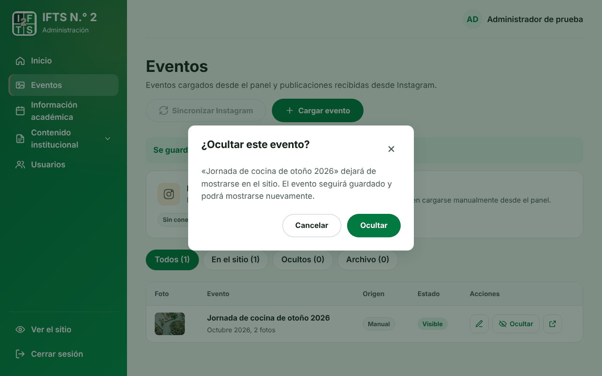

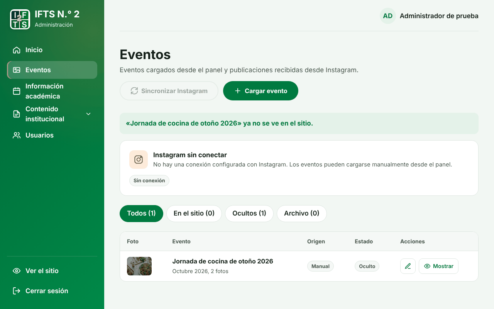

Cada fila también permite ver el evento en el sitio.

**Eliminar eventos.** El panel no tiene por ahora un botón para borrar eventos. Si un evento ya no tiene que verse, se oculta.

**Sincronizar Instagram.** El botón **Sincronizar Instagram** trae publicaciones de la cuenta del instituto. Aparece deshabilitado cuando el sistema no tiene las credenciales de Instagram configuradas; en ese caso hay que pedirle a quien administre el servidor que las configure.

## Contenido institucional

Solo el rol Administrador accede a esta sección. Tiene cinco partes, que se eligen en el submenú que se abre debajo de «Contenido institucional» en el menú lateral. Si todavía no elegiste ninguna, la pantalla pide que elijas una. A diferencia de horarios y mesas, **acá no hay paso de publicar**: al guardar, los cambios se publican enseguida en el sitio. En cada parte, **Ver cómo queda en el sitio** abre la página pública correspondiente.

### Perfil del egresado

Hasta 6 párrafos de texto, sin formato (no admite negritas ni listas). Se agregan y se quitan con los botones de cada párrafo.

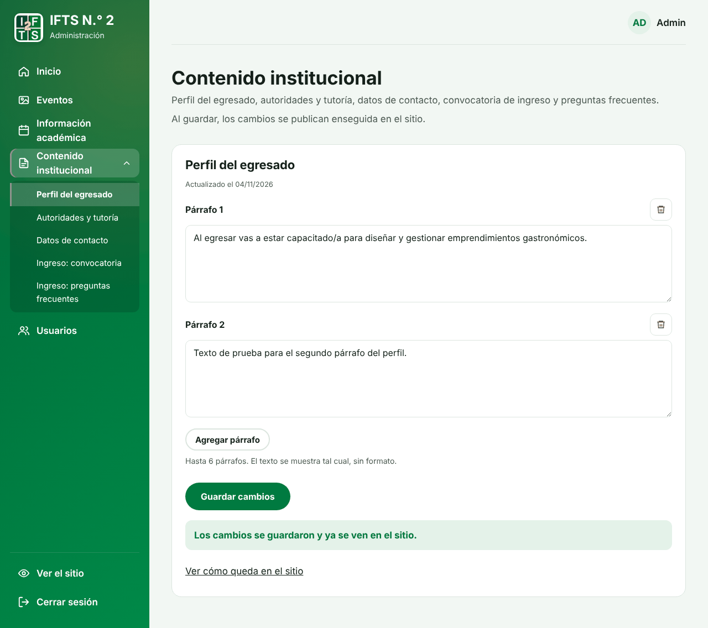

### Autoridades y tutoría

Hasta 12 personas. Por cada una se cargan nombre, cargo y dónde se muestra. La aclaración es opcional.

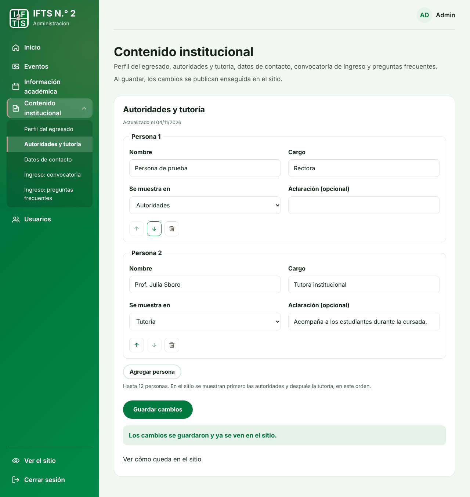

### Datos de contacto

Dirección, barrio y ciudad, y horario son los datos principales. Modalidad, teléfono y correo son opcionales.

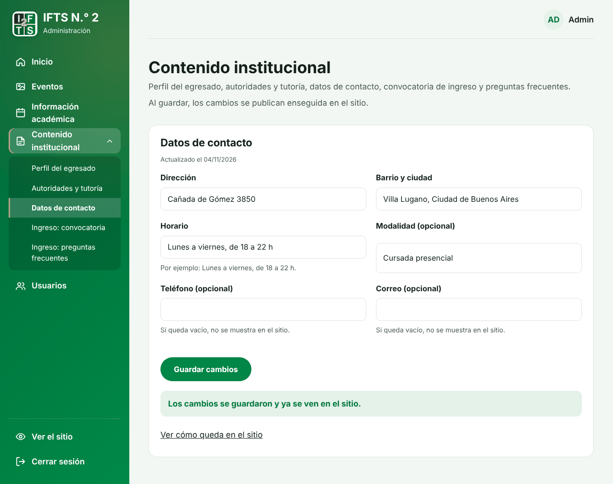

### Ingreso: convocatoria

Es la información de la convocatoria vigente: cuatrimestre y año, fechas de preinscripción, otras etapas (hasta 6), video de YouTube, correo de consultas y convocatorias anteriores.

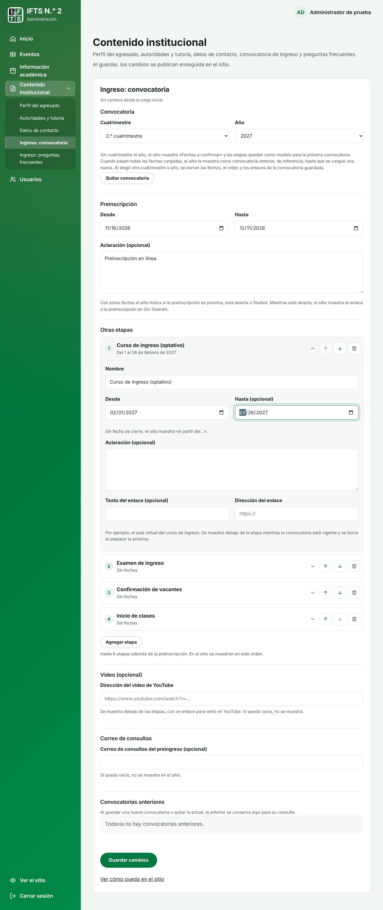

Si hay convocatoria cargada, **todas las etapas necesitan fecha de inicio** («Desde»). Si falta alguna, el panel avisa, por ejemplo «Etapa 2: completar la fecha de inicio», y no guarda.

Con todas las etapas completas, se guarda y el panel lo confirma.

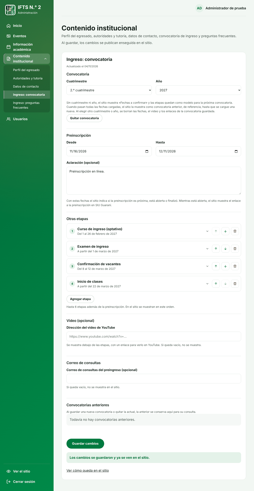

**Quitar convocatoria** borra los datos de la convocatoria, previa confirmación. Sin convocatoria cargada, el sitio muestra «Fechas a confirmar».

### Ingreso: preguntas frecuentes

Hasta 10 preguntas, cada una con su respuesta.

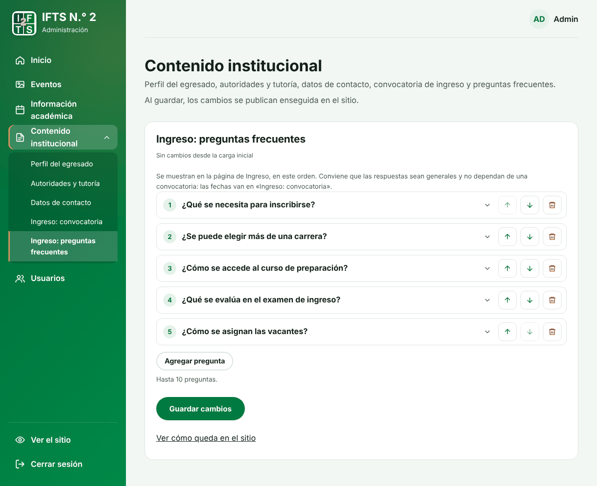

## Usuarios

Solo el rol Administrador accede a esta sección. Desde acá se crean las cuentas del panel.

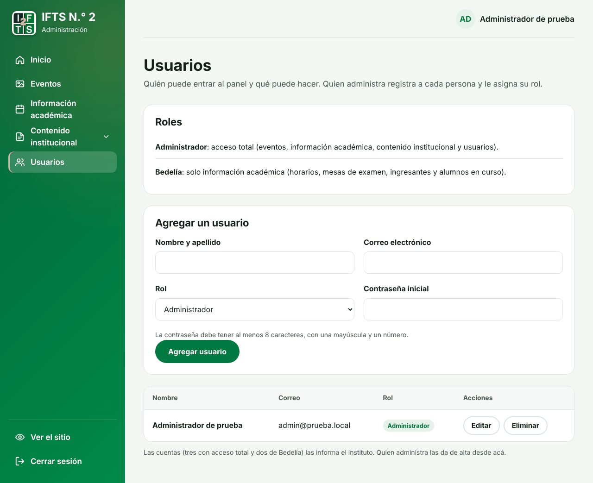

**Crear un usuario**

1. Completá nombre, correo, rol (Administrador o Bedelía) y contraseña.
2. Tocá **Agregar usuario**.

La contraseña tiene que tener al menos 8 caracteres, una mayúscula y un número.

Si el correo ya está registrado, el panel responde «Ya hay un usuario con ese correo.» y no crea la cuenta.

**Editar.** Con **Editar** se cambian los datos de una cuenta. Si dejás la contraseña vacía, se mantiene la actual.

**Eliminar.** Con **Eliminar** se borra la cuenta, previa confirmación.

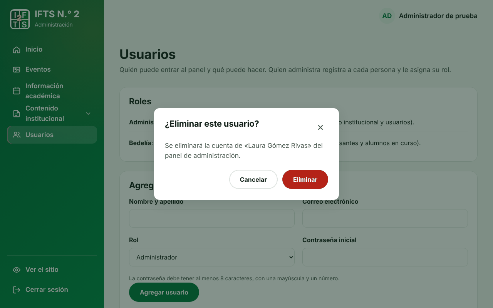

## Mensajes y problemas frecuentes

| Qué pasa | Qué significa | Qué hacer |
|---|---|---|
| «Usuario o contraseña incorrectos. Te quedan N intentos.» | El correo o la contraseña no coinciden. | Revisá los datos. Si no la recordás, pedile al administrador que te cambie la contraseña. |
| «Demasiados intentos fallidos. Probá de nuevo en 15 minutos.» | Hubo 5 intentos fallidos seguidos. | Esperá 15 minutos y volvé a intentar. |
| «Ya hay un usuario con ese correo.» | Ese correo ya tiene una cuenta. | Usá otro correo, o editá la cuenta existente. |
| «Etapa N: completar la fecha de inicio» | Hay una etapa de ingreso sin fecha «Desde». | Completá la fecha de esa etapa o quitá la etapa. |
| Cambié un horario o una mesa y el sitio sigue igual | Guardar no publica. | Tocá **Publicar** o **Actualizar publicación**. |
| Entré a una sección y volví al inicio | Tu rol no tiene acceso a esa sección. | Pedile al administrador que te cambie el rol si lo necesitás. |
| **Sincronizar Instagram** está deshabilitado | El sistema no tiene configuradas las credenciales de Instagram. | Avisá a quien administre el servidor. |
