# Manual de usuario del Portal Web Institucional IFTS N.º 2

**Sistema:** Portal Web Institucional IFTS N.º 2  
**Destinatarios:** visitantes del sitio y personal del instituto que carga y actualiza la información (Administración y Bedelía)  
**Versión:** 8/11/2026

El sistema tiene dos partes:

- **Sitio público:** lo que ve cualquier persona que entra al sitio: la carrera, el ingreso, los horarios y las mesas de examen, los eventos y el formulario de contacto.
- **Panel de administración:** la parte privada, donde el personal del instituto carga y actualiza esa información, sin necesidad de saber de programación.

Este manual explica, paso a paso, cómo usar las dos partes.

**Cómo leer las capturas:**

- Los **círculos naranjas con números** marcan los botones y campos de cada paso. El número de cada círculo coincide con el número del paso explicado junto a la captura.
- Las capturas se tomaron del sistema real, con **datos de ejemplo**: las personas, fechas y eventos del panel son ficticios. Para los horarios y las mesas del sitio público (apartado 1.4) se usaron planillas del instituto como referencia, pero el cronograma del 2.º cuatrimestre de 2026 y el llamado de noviembre–diciembre de 2026 son simulados y no constituyen información académica oficial.

**Requisitos mínimos:**

- **Dispositivo:** una computadora, una tablet o un celular. El sitio se adapta al tamaño de la pantalla (apartado 1.7). El panel de administración se usa mejor en una computadora.
- **Navegador:** un navegador actualizado (por ejemplo Chrome, Edge, Firefox o Safari). No hace falta instalar nada.
- **Conexión a Internet:** necesaria para usar el sitio y el panel, porque la información se guarda en línea. Para cargar eventos con fotos conviene una conexión estable.
- **Para ver los PDF** de horarios, mesas de examen y preingreso: un visor de PDF, que los navegadores actuales ya traen.
- **Para usar el panel:** una cuenta que crea Administración (apartado 9). El correo y la contraseña los da el instituto. El sitio público no necesita cuenta.
- **Para cargar fotos de un evento:** imágenes en formato JPG, PNG o WebP, hasta 20 por evento (apartado 7.2).

**Contenido:**

**Parte 1: sitio público**

1. [Sitio público](#1-sitio-público)

**Parte 2: panel de administración**

2. [Perfiles y permisos](#2-perfiles-y-permisos)
3. [Ingreso al panel](#3-ingreso-al-panel)
4. [Inicio del panel](#4-inicio-del-panel)
5. [Horarios de cursada](#5-horarios-de-cursada)
6. [Mesas de examen](#6-mesas-de-examen)
7. [Eventos](#7-eventos)
8. [Contenido institucional](#8-contenido-institucional)
9. [Usuarios](#9-usuarios)
10. [Mensajes y problemas frecuentes](#10-mensajes-y-problemas-frecuentes)

 

---

## 1. Sitio público

Es la parte del sitio que puede ver cualquier persona, sin iniciar sesión. Los horarios, las mesas, los eventos y el contenido institucional que se cargan desde el panel (apartados 5 a 8) se muestran acá.

### 1.1 Menú e inicio

El menú está arriba en todas las páginas del sitio:

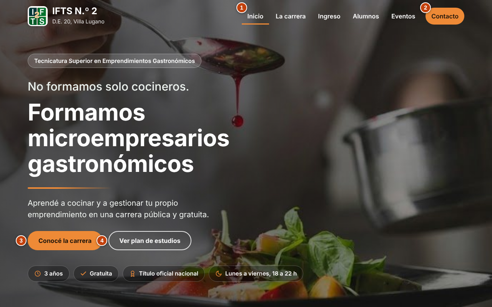

1. **Menú del sitio:** Inicio, La carrera, Ingreso, Alumnos y Eventos.
2. **Contacto:** abre el formulario de consultas (apartado 1.6).
3. **Conocé la carrera:** lleva a la página de la carrera.
4. **Ver plan de estudios:** lleva directo al plan de estudios.

Más abajo, el inicio ofrece accesos rápidos según quién visita el sitio:

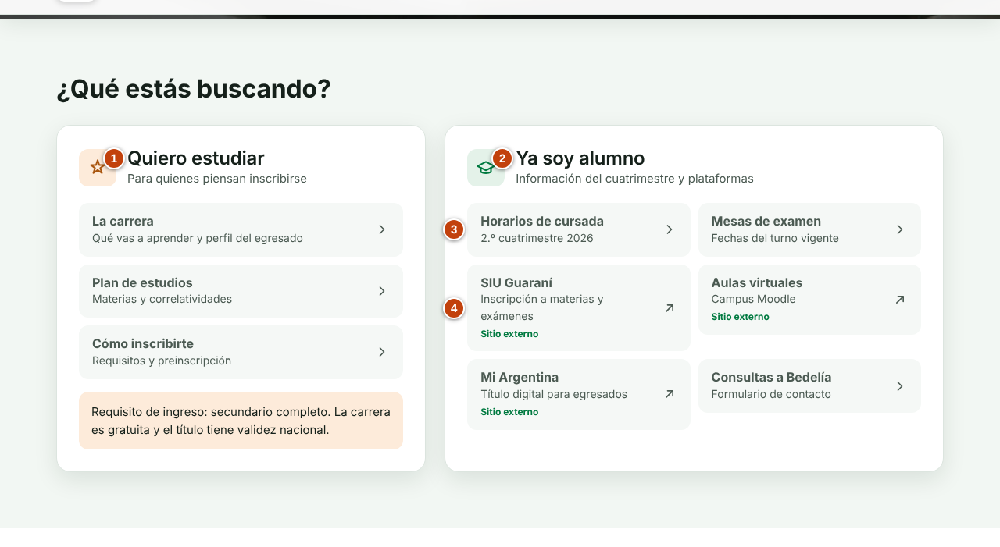

1. **Quiero estudiar:** accesos para quienes piensan inscribirse: la carrera, el plan de estudios y cómo inscribirse.
2. **Ya soy alumno:** información del cuatrimestre y plataformas del instituto.
3. **Horarios de cursada:** muestra el período publicado desde el panel. Lo mismo pasa con las mesas de examen.
4. **Sitios externos** (SIU Guaraní, aulas virtuales y Mi Argentina): se abren en otra pestaña.

Al final del inicio se muestran los eventos más recientes:

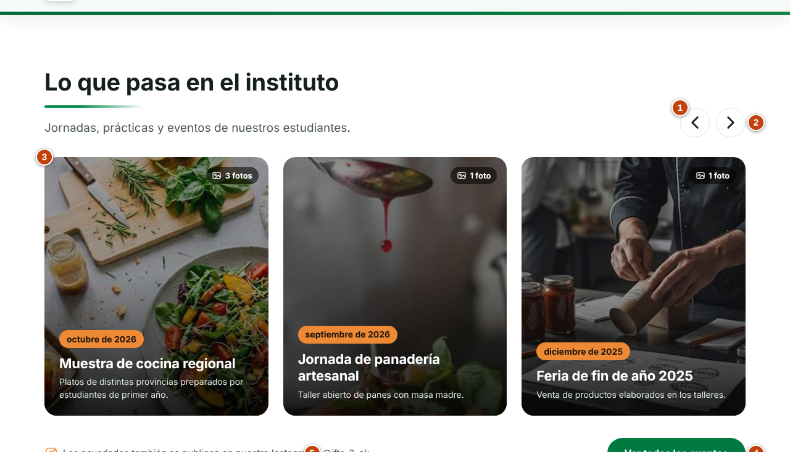

1. y 2. **Flechas:** recorren las tarjetas de eventos.
3. **Tarjeta de un evento:** al tocarla, se abre el detalle del evento (apartado 1.5).
4. **Ver todos los eventos:** abre la galería completa.
5. **Instagram del instituto:** se abre en otra pestaña.

### 1.2 La carrera

La página de la carrera tiene una barra con sus secciones, que queda fija al bajar:

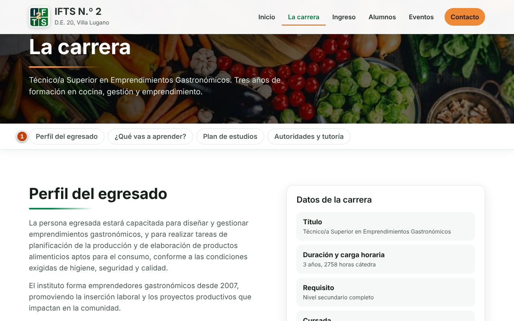

1. **Barra de secciones:** Perfil del egresado, ¿Qué vas a aprender?, Plan de estudios y Autoridades y tutoría. Cada botón lleva a esa parte de la página.

El perfil del egresado y las autoridades se cargan desde el panel, en **Contenido institucional** (apartado 8).

El plan de estudios se puede consultar de dos maneras:

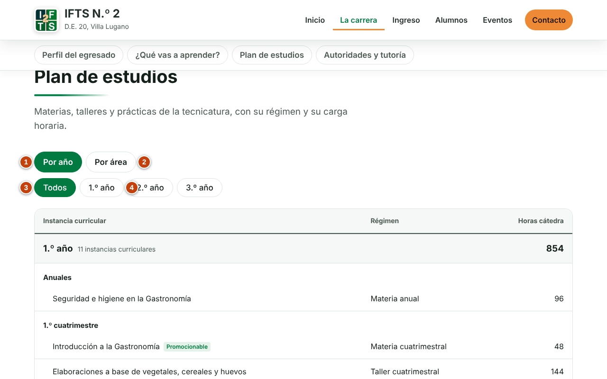

1. **Por año:** las materias de cada año, primero las anuales y después las de cada cuatrimestre.
2. **Por área:** las materias agrupadas por área de formación.
3. **Todos:** muestra los tres años.
4. **Botones de cada año:** muestran solo ese año.

Debajo del plan están los documentos oficiales de la carrera:

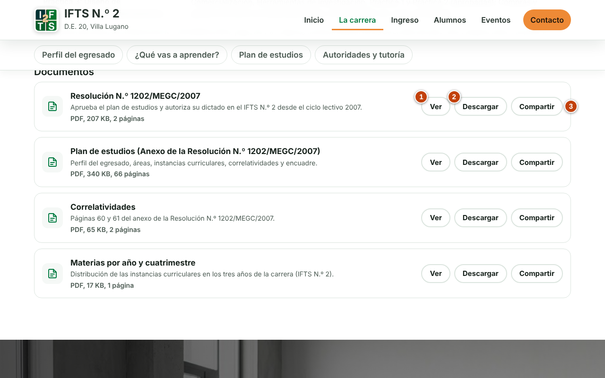

1. **Ver:** abre el PDF en otra pestaña.
2. **Descargar:** guarda el PDF en el dispositivo.
3. **Compartir:** en el celular, abre las opciones para compartir; en la computadora, copia el enlace y muestra «Enlace copiado.».

### 1.3 Ingreso

Muestra la convocatoria de ingreso cargada desde el panel (apartado 8.5):

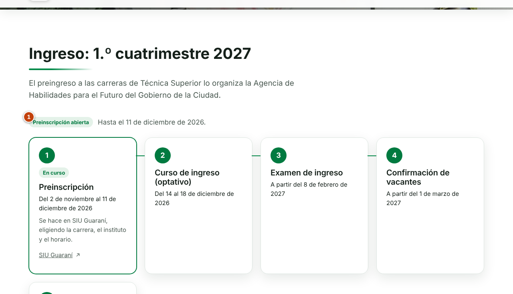

1. **Estado de la preinscripción:** indica si es próxima, si está abierta o si finalizó, según las fechas cargadas. Debajo se muestran las etapas, en orden. Mientras la preinscripción está abierta, aparece el botón para ir a la preinscripción en SIU Guaraní.

Sin convocatoria cargada, la página muestra «Fechas a confirmar».

Más abajo están las preguntas frecuentes y la guía de preingreso:

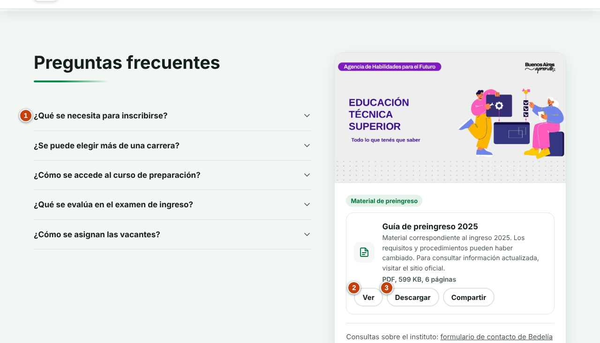

1. **Pregunta:** al tocarla, se despliega la respuesta.
2. **Ver** y 3. **Descargar:** abren o guardan la guía de preingreso en PDF.

### 1.4 Alumnos

Reúne los horarios de cursada y las mesas de examen **publicados** desde el panel (apartados 5 y 6):

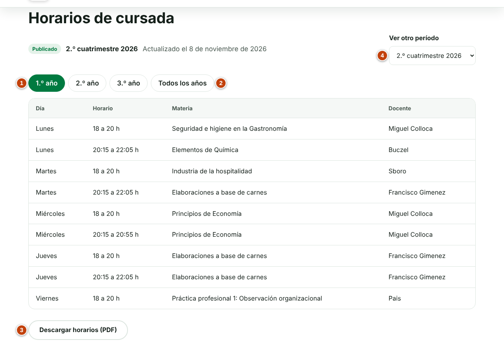

1. **Botones de cada año:** muestran los horarios de ese año.
2. **Todos los años:** muestra los tres años juntos, cada uno debajo de una fila verde con el nombre del año.
3. **Descargar horarios (PDF):** descarga los horarios del período que se está viendo.
4. **Ver otro período:** aparece cuando hay más de un período publicado, por ejemplo el cuatrimestre anterior.

En la computadora, si la tabla tiene muchas filas, se desplaza por dentro y los nombres de las columnas quedan siempre a la vista.

Las mesas de examen se muestran en una franja de otro color. Cada llamado tiene su nombre, sus fechas y una tabla con sus mesas, ordenadas por fecha:

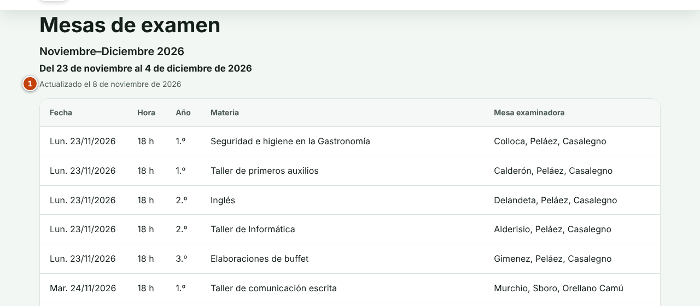

1. **Actualizado el…:** fecha de la última publicación del llamado.
2. **Botones de cada año:** muestran las mesas de ese año. **Todos los años** muestra los tres, cada uno debajo de una fila verde con el nombre del año.

En la computadora, la tabla se desplaza por dentro y mantiene visibles los encabezados de las columnas. Al final está el botón de descarga:

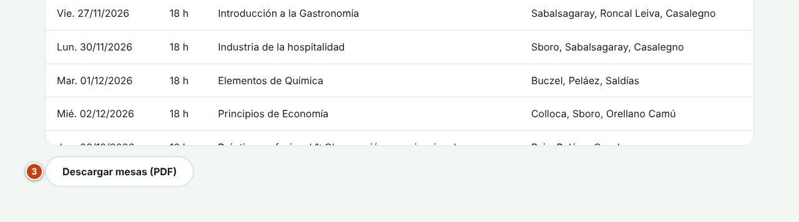

3. **Descargar mesas (PDF):** descarga todas las mesas del llamado, de los tres años, en un solo archivo.

Si una mesa no tiene fecha u hora, el sitio muestra «A confirmar». Debajo están los documentos de prácticas profesionalizantes y los enlaces útiles:

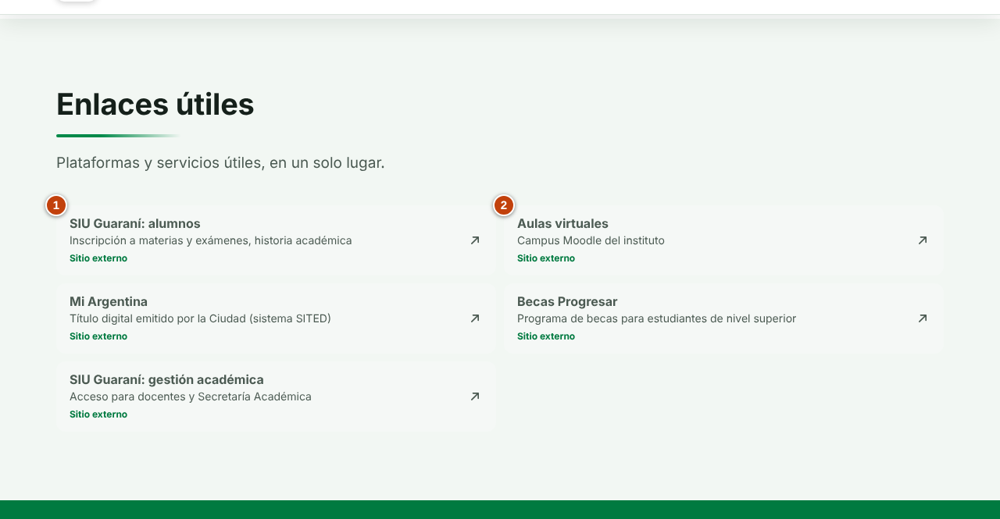

1. **SIU Guaraní** y 2. **Aulas virtuales**, entre otros: se abren en otra pestaña.

### 1.5 Eventos

La galería muestra los eventos visibles, agrupados por año, del más reciente al más antiguo:

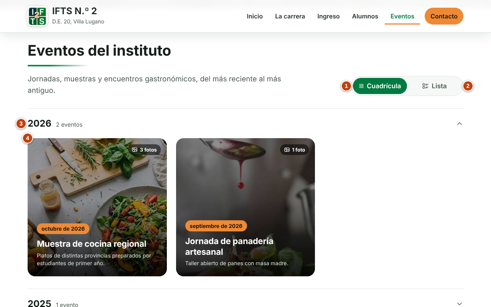

1. **Cuadrícula** y 2. **Lista:** cambian la forma de ver los eventos.
3. **Año:** al tocarlo, se pliega o se despliega. El año más reciente aparece abierto.
4. **Tarjeta de un evento:** abre su detalle.

En el detalle de un evento:

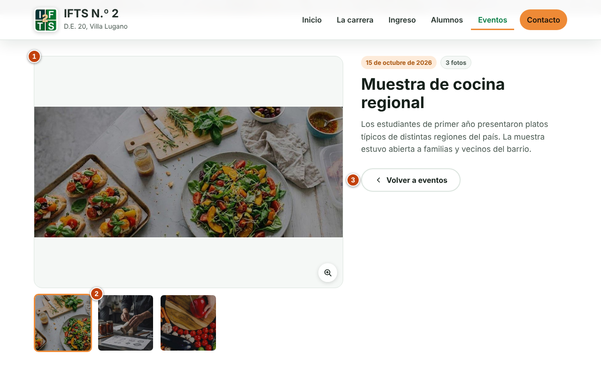

1. **Foto principal:** al tocarla, se amplía.
2. **Miniaturas:** cambian la foto que se muestra.
3. **Volver a eventos:** regresa a la galería.

La foto ampliada se recorre con las flechas, indica la posición (por ejemplo, «1 de 3») y se cierra con la cruz o con la tecla Esc:

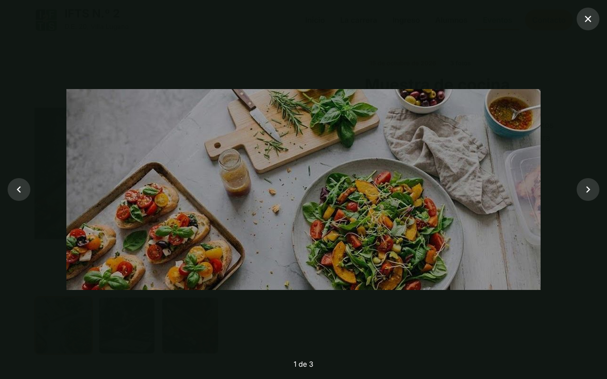

### 1.6 Contacto

El formulario envía la consulta por correo al instituto:

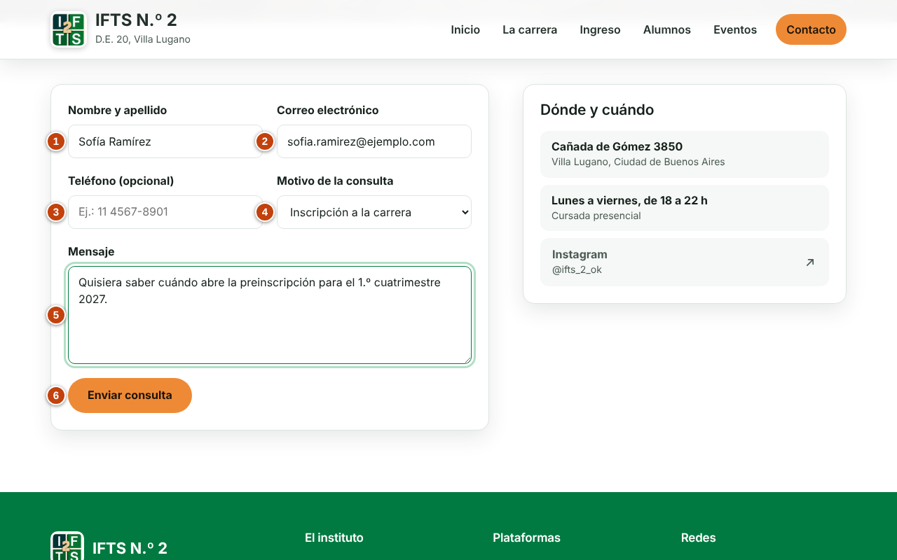

1. **Nombre y apellido.**
2. **Correo electrónico:** la respuesta llega a este correo.
3. **Teléfono (opcional).**
4. **Motivo de la consulta:** según el motivo, la consulta llega a Bedelía o a la casilla institucional, con copia a la otra.
5. **Mensaje.**
6. **Enviar consulta.**

Al enviarla, el sitio lo confirma:

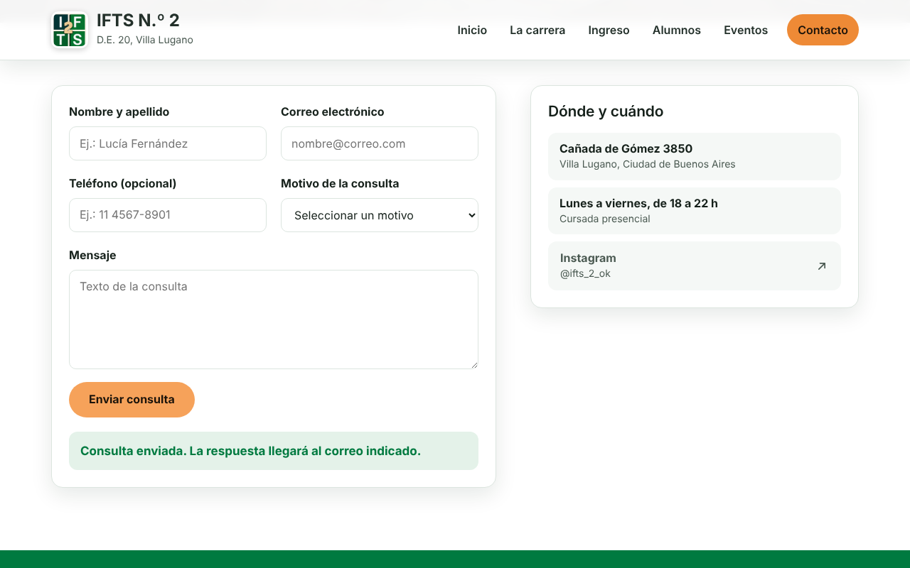

Si el envío falla, el sitio lo avisa y la consulta se puede volver a enviar unos minutos después.

### 1.7 En el celular

En el celular, el menú se abre con el botón de tres líneas, arriba a la derecha:

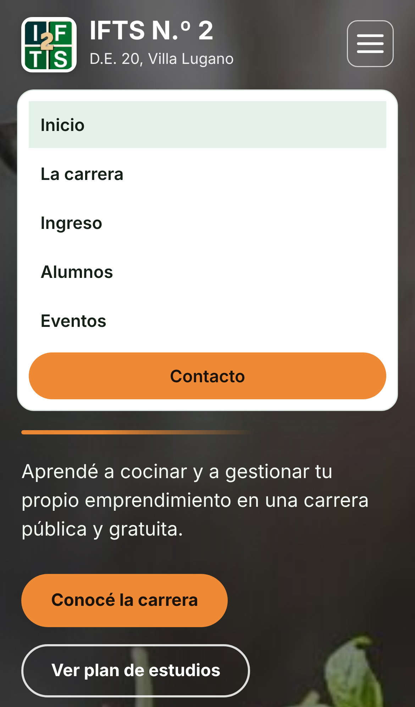

Los horarios y las mesas se muestran como fichas, una debajo de la otra:

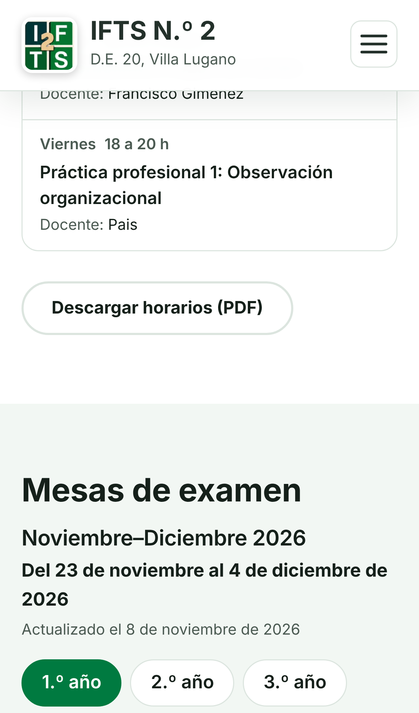

### 1.8 Acceso al panel

Cuando no hay una sesión iniciada, el enlace **Acceso institucional**, al pie de todas las páginas, lleva a la pantalla de ingreso del panel (apartado 3). Con la sesión iniciada, ese enlace no se muestra y en su lugar aparece el botón **Sesión** (apartado 3.4).

 

---

## 2. Perfiles y permisos

El panel es la parte privada del sitio. Desde ahí se cambia lo que ven los alumnos y los aspirantes en el sitio público. Cada cuenta tiene uno de estos dos perfiles:

| Sección del panel | Administración | Bedelía |
|---|:---:|:---:|
| Inicio | Sí | Sí |
| Información académica (horarios y mesas de examen) | Sí | Sí |
| Eventos | Sí | No |
| Contenido institucional | Sí | No |
| Usuarios | Sí | No |

El menú de la izquierda muestra solo las secciones del perfil de la cuenta. Así se ve el panel con una cuenta de Bedelía: solo aparecen **Inicio** e **Información académica**.

Si una cuenta de Bedelía escribe en el navegador la dirección de una sección que no le corresponde, el panel la lleva al inicio.

 

---

## 3. Ingreso al panel

### 3.1 Iniciar sesión

La pantalla de ingreso está en la dirección del sitio seguida de `/login`.

1. **Correo electrónico:** escribir el correo de la cuenta.
2. **Contraseña:** escribir la contraseña.
3. **Ingresar:** abre el inicio del panel.
4. **Volver al sitio:** vuelve al sitio público sin ingresar.

Si la sesión ya está iniciada, la dirección `/login` lleva directo al inicio del panel.

Las cuentas las crea Administración desde la sección **Usuarios** (apartado 9). No existe una opción para registrarse.

### 3.2 Datos incorrectos y bloqueo

Si el correo o la contraseña no coinciden, el panel lo avisa e indica cuántos intentos quedan:

Después de **5 intentos fallidos**, el ingreso de esa cuenta se bloquea durante **15 minutos** y el panel muestra «Demasiados intentos fallidos. Volver a intentarlo en 15 minutos.». Si no se recuerda la contraseña, Administración puede asignar una nueva desde **Usuarios** (apartado 9.3).

### 3.3 Cerrar sesión

La sesión se cierra con **Cerrar sesión**, al final del menú de la izquierda, o al cerrar la pestaña del navegador.

El acceso dura como máximo 8 horas, según la configuración del sistema. Cuando vence, el panel no vuelve solo a la pantalla de ingreso: al intentar una acción muestra «La sesión venció. Iniciar sesión de nuevo.». En ese caso, hay que tocar **Cerrar sesión** e ingresar otra vez.

### 3.4 El sitio público con la sesión iniciada

**Ver el sitio**, en el menú de la izquierda, abre el sitio público. Mientras la sesión está iniciada, el sitio muestra abajo a la derecha un botón con las iniciales de la cuenta:

1. **Sesión:** abre un recuadro con las opciones de la sesión.

El botón no aparece sin sesión iniciada, ni dentro del panel ni en la pantalla de ingreso.

1. **Volver al panel:** regresa al panel sin volver a ingresar.
2. **Cerrar sesión:** cierra la sesión.
3. **Cerrar menú:** cierra el recuadro. También se cierra con la tecla Esc, al hacer clic afuera o al cambiar de página.

En el celular, el botón se muestra más chico y funciona igual:

 

---

## 4. Inicio del panel

Es la primera pantalla después de ingresar. Muestra accesos rápidos y un resumen de lo que está publicado.

1. **Menú de secciones:** lleva a cada parte del panel.
2. **Tareas frecuentes:** accesos directos a cargar un evento, a la información académica y a la lista de eventos.
3. **Resumen de lo publicado:** cantidad de eventos que se ven en el sitio, período de horarios publicado y llamados de mesas publicados.
4. **Actividad reciente:** los últimos cambios hechos en el panel, con su fecha.
5. **Ver el sitio:** abre el sitio público (apartado 3.4).
6. **Cerrar sesión.**
7. **Cuenta con la sesión iniciada:** iniciales y nombre.

Una cuenta de Bedelía ve solo los accesos y datos de la información académica.

 

---

## 5. Horarios de cursada

Se encuentra en **Información académica → Horarios de cursada**.

> **Regla principal:** guardar no cambia el sitio. Los alumnos ven solo lo que está **publicado**. Se puede cargar y corregir todo lo necesario sin que se vea, y los cambios llegan al sitio al usar **Publicar** o **Actualizar publicación**.

### 5.1 Resumen del período

Cada período (por ejemplo, «2.º cuatrimestre 2026») tiene sus propias materias.

1. **Horarios de cursada / Mesas de examen:** cambia entre las dos partes de la información académica.
2. **Período:** elige el período. La opción **Otro período…** crea uno nuevo.
3. **Estado:** indica si el período está publicado y cuándo se publicó por última vez.
4. **Ver y editar horarios:** abre la tabla de materias del período.
5. **Vista previa:** muestra el PDF tal como lo van a ver los alumnos.
6. **Retirar publicación:** saca el período del sitio (apartado 5.6).

### 5.2 Tabla de materias

1. **+ Agregar materia:** abre el formulario de carga (apartado 5.3).
2. **Reutilizar horarios:** copia las materias de otro período (apartado 5.7).
3. **Buscar:** filtra por materia o docente.
4. **Año de la carrera:** muestra solo un año.
5. **Editar** (lápiz): abre la materia para corregirla.
6. **Eliminar** (tacho): quita la materia, previa confirmación.
7. **Volver al resumen:** regresa al resumen del período.

### 5.3 Cargar una materia

1. **Año de la carrera.**
2. **Turno.**
3. **Materia:** al escribir aparecen las materias del plan de estudios para elegir.
4. **Docente (opcional):** si queda vacío, el sitio muestra «A designar».
5. **Aula (opcional).**
6. **Día, Desde y Hasta:** día y franja horaria, en formato de 24 horas.
7. **Agregar otro día u horario:** suma otra franja para la misma materia.
8. **Guardar:** guarda la materia y cierra el formulario.
9. **Guardar y agregar otra:** guarda y deja el formulario listo para la siguiente materia.

La materia queda guardada en el panel, **pero no se ve en el sitio hasta publicar** (apartado 5.5).

### 5.4 Eliminar una materia

Al tocar el tacho de una fila, el panel pide confirmación:

Si el período está publicado, los alumnos siguen viendo la versión publicada hasta que se actualice la publicación.

### 5.5 Publicar y actualizar

En un período sin publicar, el resumen muestra el botón **Publicar**. Al tocarlo, el panel pide confirmación:

Al confirmar, el período aparece en la sección **Alumnos** del sitio.

Si después se modifica una materia de un período publicado, el resumen lo avisa:

1. **Aviso:** los alumnos todavía ven la versión anterior.
2. **Ver cambios:** muestra qué cambió respecto de lo publicado.
3. **Actualizar publicación:** publica los cambios, previa confirmación.

La comparación muestra cada cambio con su valor publicado y su valor guardado:

### 5.6 Retirar la publicación

**Retirar publicación** saca el período del sitio. Las materias quedan guardadas en el panel y el período se puede volver a publicar.

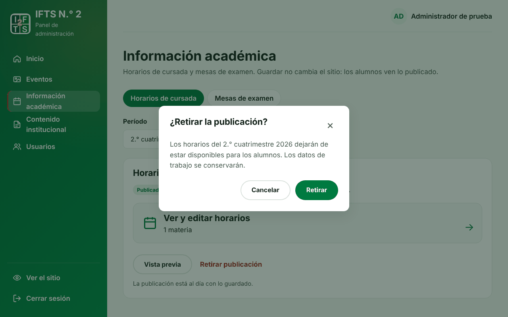

### 5.7 Reutilizar horarios de otro período

Sirve para no cargar desde cero un período parecido a otro. Desde la tabla de materias, **Reutilizar horarios** abre esta ventana:

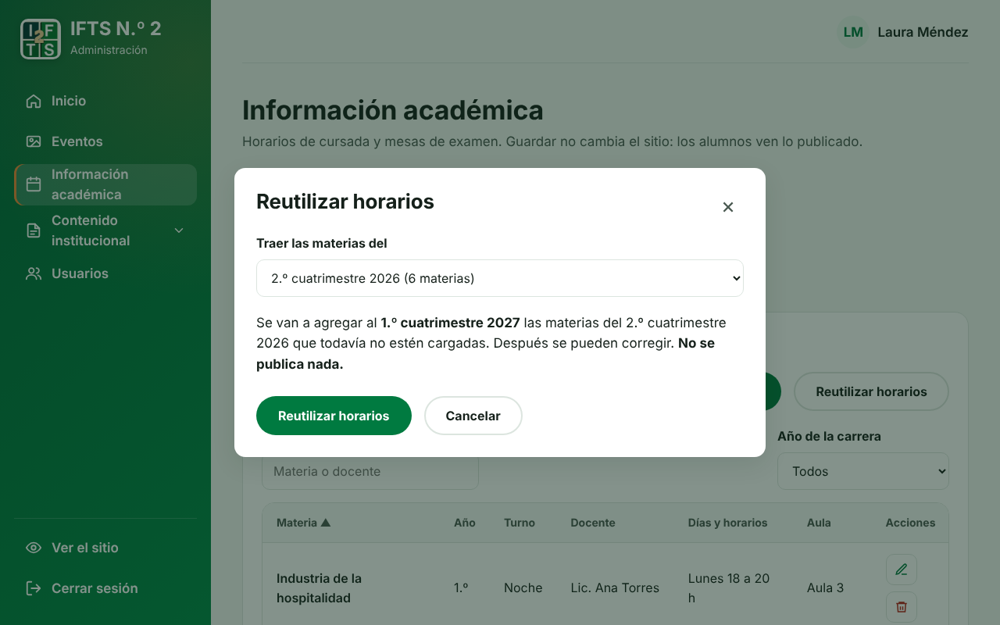

Se elige el período de origen y se confirma con **Reutilizar horarios**. Se agregan solo las materias que todavía no están cargadas, y **no se publica nada**. Después se corrigen las materias que hayan cambiado.

### 5.8 Períodos anteriores

Los períodos no se borran. El sitio muestra los períodos publicados del año actual y el más reciente de todos; los demás pasan al archivo de forma automática y siguen visibles en el panel, marcados como anteriores.

 

---

## 6. Mesas de examen

Se encuentra en **Información académica → Mesas de examen**. Vale la misma regla que en los horarios: **guardar no cambia el sitio**.

Las mesas se organizan por **llamado** (por ejemplo, «Diciembre 2026»). Cada llamado tiene su período de exámenes, un aviso opcional para los alumnos y sus mesas.

Un llamado reúne **todas las materias de ese turno de exámenes**. No se crea un llamado por materia: cada materia es una mesa dentro del llamado (6.3). Así el sitio muestra una sola tabla y un solo PDF.

### 6.1 Resumen del llamado

1. **Llamado:** elige el llamado. La opción **Nuevo llamado…** crea uno nuevo (apartado 6.2).
2. **Editar datos del llamado:** cambia el nombre, las fechas o el aviso.
3. **Ver y editar mesas:** abre la tabla de mesas del llamado.
4. **Vista previa:** muestra el PDF tal como lo van a ver los alumnos.
5. **PDF publicado:** abre el PDF que se ve hoy en el sitio.
6. **Retirar publicación:** saca el llamado del sitio. Las mesas quedan guardadas.

Un llamado sin publicar muestra, en cambio, los botones **Publicar** y **Eliminar llamado**.

### 6.2 Crear un llamado

Completar el **nombre del llamado** (obligatorio y distinto de los demás), las fechas de **inicio** y **cierre**, y el **aviso para los alumnos** (por ejemplo, cómo inscribirse). Las fechas y el aviso son opcionales. Tocar **Guardar**.

Un llamado se puede publicar sin mesas, como anuncio con sus fechas y el aviso. Si no tiene aviso, el sitio muestra «El cronograma por materia se publicará próximamente.».

### 6.3 Cargar una mesa

Desde **Ver y editar mesas**:

1. **+ Agregar mesa:** abre el formulario.
2. **Editar** (lápiz): corrige una mesa.
3. **Eliminar** (tacho): quita una mesa, previa confirmación.

En el formulario se completan la materia, el año de la carrera, la fecha, la hora, el aula y la mesa examinadora:

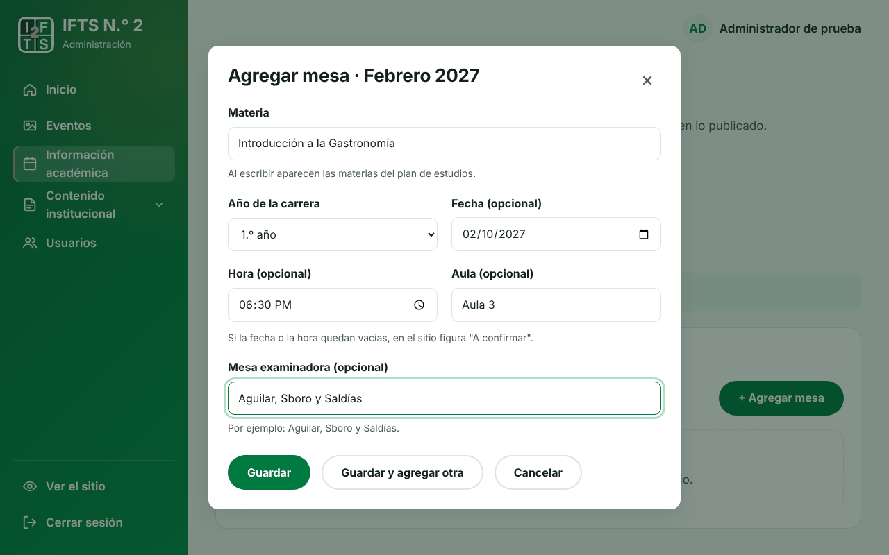

Si la fecha o la hora quedan vacías, el sitio muestra «A confirmar».

### 6.4 Publicar, actualizar y eliminar

- **Publicar** y **Actualizar publicación** funcionan igual que en los horarios (apartado 5.5): piden confirmación y recién entonces el llamado se ve en el sitio.
- **Un llamado que alguna vez se publicó no se puede eliminar.** Si ya no hace falta, se retira la publicación.
- Los llamados anteriores dejan de verse en el sitio de forma automática cuando pasan más de 30 días desde su última fecha. El llamado publicado más reciente sigue visible mientras no se retire su publicación. Ningún llamado se borra: todos siguen en el panel.

 

---

## 7. Eventos

Sección solo para Administración. Reúne los eventos cargados desde el panel y los que llegan desde Instagram.

### 7.1 Lista de eventos

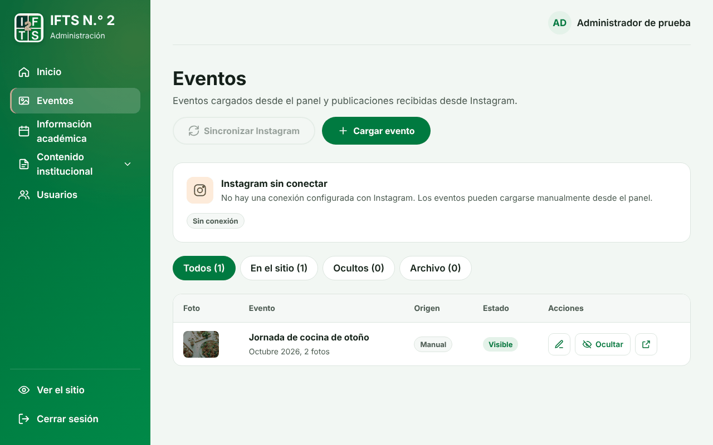

1. **Sincronizar Instagram:** trae las publicaciones de la cuenta del instituto (apartado 7.8). Aparece deshabilitado si el sistema no tiene configurada la conexión con Instagram.
2. **Cargar evento:** abre el formulario de carga (apartado 7.2).
3. **Estado de Instagram:** indica si hay conexión y el resultado de la última sincronización.
4. **Pestañas:** **Todos**, **En el sitio**, **Ocultos** y **Archivo**, con la cantidad de eventos de cada una.
5. **Editar** (lápiz): abre el evento para modificarlo (apartado 7.5).
6. **Ocultar:** saca el evento del sitio sin borrarlo (apartado 7.6).
7. **Ver en el sitio:** abre el evento en el sitio público, en otra pestaña.

### 7.2 Cargar un evento con fotos

1. **Título del evento.**
2. **Fecha del evento:** cuándo se realizó o se realizará la actividad.
3. **Resumen (opcional):** una línea que se muestra en la tarjeta del evento.
4. **Descripción.**
5. **Publicación o video de Instagram (opcional):** ver el apartado 7.3.
6. **Portada:** la foto que se muestra en la tarjeta. Al principio es la primera.
7. **Usar como portada:** elige otra foto como portada.
8. **Quitar foto** (cruz): saca la foto de la lista.
9. **Agregar fotos:** abre la selección de imágenes. Se aceptan JPG, PNG y WebP, hasta 20 fotos por evento. El sistema las achica antes de subirlas.
10. **Visible en el sitio:** si está marcado, el evento se publica al guardar. Si no, queda oculto.
11. **Guardar evento.**

Al guardar, el panel vuelve a la lista y muestra «El evento se guardó correctamente.».

### 7.3 Cargar un evento con el enlace de una publicación de Instagram

En lugar de fotos, se puede pegar en el campo **Publicación o video de Instagram** el enlace de una publicación, un reel o un video de Instagram (direcciones que contienen `/p/`, `/reel/` o `/tv/`).

- **Si no se cargan fotos,** el sistema intenta obtener la imagen de la publicación y la guarda como foto del evento.
- **Si no puede obtenerla,** guarda el evento igual y avisa que en el sitio se intentará mostrar la publicación de Instagram:

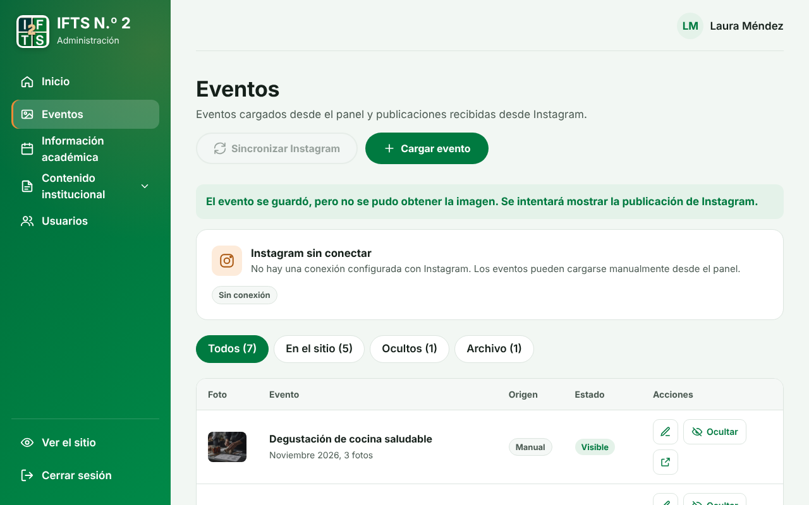

En ese caso, se puede editar el evento y agregarle una foto desde la computadora (apartado 7.5).

El enlace tiene que ser de una publicación. El enlace de un perfil (por ejemplo, `instagram.com/ifts2/`) no se acepta, y el panel muestra este aviso:

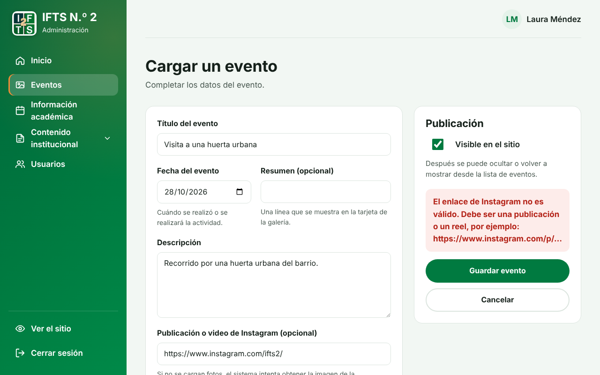

**Una publicación genera un solo evento.** Si ya existe un evento con esa publicación, cargado a mano o traído por la sincronización, el panel no crea otro e indica cuál es, para editarlo desde la lista:

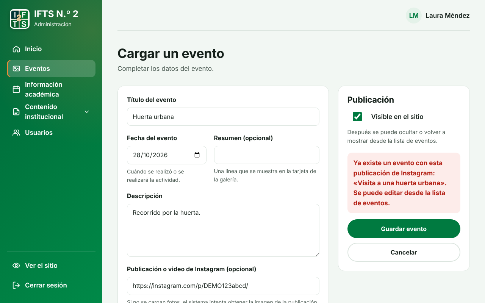

### 7.4 Eventos que aparecen dos veces

El sistema reconoce una misma publicación por su enlace. Un evento cargado **solo con fotos de la computadora**, sin el enlace, no se puede relacionar con su publicación: si después se sincroniza esa misma publicación, quedan dos eventos. En ese caso, se oculta uno de los dos (apartado 7.6). Para evitarlo, conviene cargar el enlace de la publicación cuando existe.

### 7.5 Editar un evento

El lápiz de cada fila abre el mismo formulario con los datos cargados:

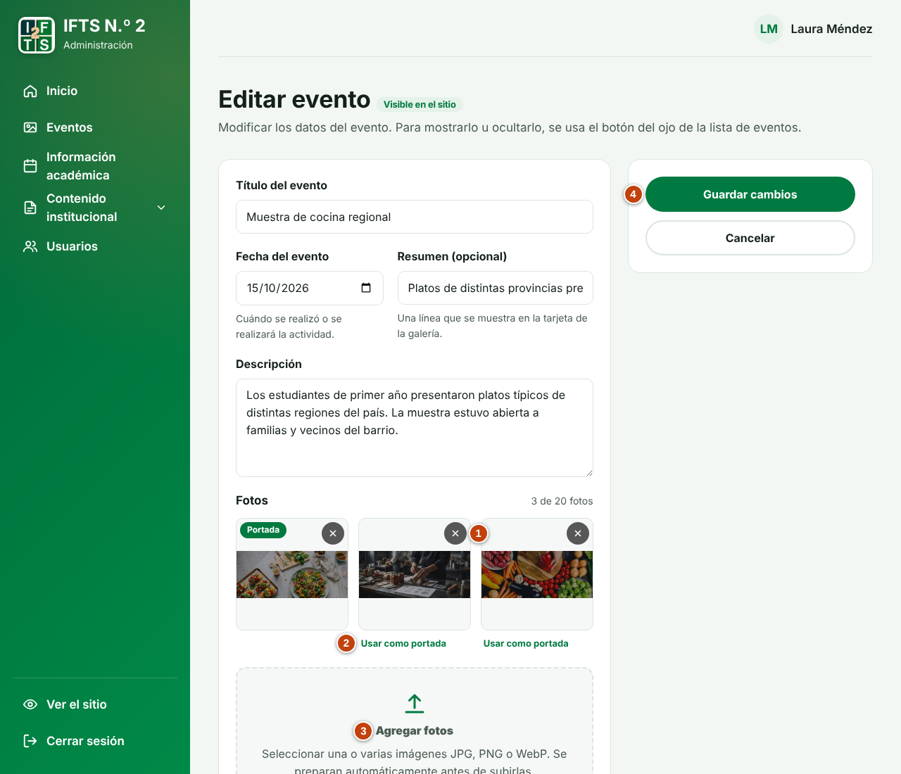

1. **Quitar foto** (cruz): saca la foto del evento.
2. **Usar como portada:** cambia la foto de portada.
3. **Agregar fotos:** suma fotos, hasta completar 20.
4. **Guardar cambios.**

Las fotos que se quitan dejan de verse en el sitio, pero no se borran del almacenamiento de imágenes.

En un evento que vino de Instagram, lo que se edita en el panel se conserva aunque se vuelva a sincronizar.

### 7.6 Ocultar y volver a mostrar

**Ocultar** saca el evento del sitio. El panel pide confirmación:

El evento pasa a la pestaña **Ocultos**, desde donde se vuelve a publicar:

1. **Mostrar:** cambia el estado del evento de «Oculto» a «Visible», previa confirmación. Si el evento es de un año que ya está en el archivo (apartado 7.7), además hay que activar **Mostrar en el sitio** para que vuelva a aparecer.

El panel no tiene un botón para borrar eventos: un evento que ya no tiene que verse se oculta.

### 7.7 Archivo de eventos

El sitio muestra los eventos del año actual y del año anterior. Los de años previos pasan solos a la pestaña **Archivo**, sin borrarse:

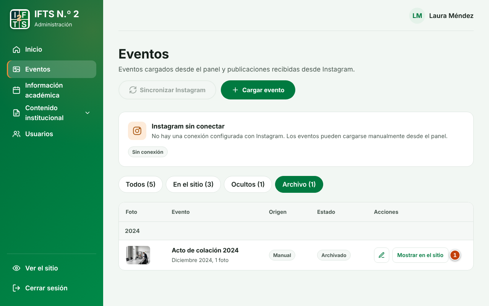

1. **Mostrar en el sitio:** vuelve a mostrar en el sitio un evento archivado. Para quitarlo otra vez, se usa **Volver a archivar**.

Un evento oculto no se muestra en el sitio aunque tenga activado **Mostrar en el sitio**.

### 7.8 Sincronizar con Instagram

**Sincronizar Instagram** trae las publicaciones de la cuenta del instituto que tengan el hashtag **#eventosIFTS2**. Revisa las últimas 20 publicaciones de la cuenta.

**Cómo escribir la publicación en Instagram para que el evento quede bien:**

- Escribir el **título en el primer renglón**, corto (hasta 100 caracteres).
- Escribir la descripción desde el segundo renglón.
- Incluir **#eventosIFTS2** en cualquier parte del texto. Los hashtags no se copian al título ni a la descripción.

**Qué hace la sincronización:**

- Crea un evento por cada publicación nueva. La fecha del evento es la de la publicación; si la actividad fue otro día, se corrige editando el evento.
- No vuelve a importar una publicación que ya tiene evento, aunque ese evento esté oculto.
- Al terminar, muestra el resultado: en verde si terminó bien, en ámbar si quedaron publicaciones para la próxima sincronización y en rojo si hubo un error.

Si aparece un error, la carga manual de eventos sigue funcionando. La conexión con Instagram necesita renovarse aproximadamente cada 60 días: si la sincronización empieza a fallar, avisar a quien administre el sistema.

 

---

## 8. Contenido institucional

Sección solo para Administración. Al tocar **Contenido institucional** en el menú, se despliegan sus cinco partes: **Perfil del egresado**, **Autoridades y tutoría**, **Datos de contacto**, **Ingreso: convocatoria** e **Ingreso: preguntas frecuentes**.

> **A diferencia de los horarios y las mesas, acá no hay un paso de publicar:** al guardar, los cambios se ven enseguida en el sitio.

### 8.1 Funcionamiento común

Mientras no se elige una parte en el menú, la pantalla pide elegir una. Todas las partes funcionan igual; se muestra el ejemplo del perfil del egresado:

1. **Parte que se edita,** elegida en el menú de la izquierda.
2. **Quitar** (tacho): elimina ese párrafo o ese elemento.
3. **Agregar:** suma un párrafo o un elemento nuevo.
4. **Guardar cambios:** publica los cambios en el sitio.
5. **Ver cómo queda en el sitio:** abre la página pública correspondiente.

Si se intenta salir con cambios sin guardar, el panel lo avisa antes.

### 8.2 Perfil del egresado

Hasta 6 párrafos de texto simple, sin negritas ni listas.

### 8.3 Autoridades y tutoría

Hasta 12 personas. Por cada una se cargan el nombre, el cargo y dónde se muestra (Autoridades o Tutoría); la aclaración es opcional. Las flechas cambian el orden.

### 8.4 Datos de contacto

La dirección, el barrio y ciudad y el horario son obligatorios. La modalidad, el teléfono y el correo son opcionales: si quedan vacíos, no se muestran en el sitio.

### 8.5 Ingreso: convocatoria

Es la información de la convocatoria de ingreso: cuatrimestre y año, fechas de preinscripción, otras etapas (hasta 6), video de YouTube y correo de consultas.

1. **Cuatrimestre** de la convocatoria.
2. **Año** de la convocatoria. Sin cuatrimestre ni año, el sitio muestra «Fechas a confirmar».
3. **Quitar convocatoria:** vacía la convocatoria del formulario, previa confirmación. El cambio se aplica al tocar **Guardar cambios**. Si la convocatoria que estaba guardada tenía cuatrimestre, año y alguna fecha, se conserva en **Convocatorias anteriores**.
4. **Preinscripción, Desde y Hasta:** con estas fechas el sitio indica si la preinscripción es próxima, está abierta o finalizó.

Al elegir otro cuatrimestre o año, se borran las fechas, el video y los enlaces de la convocatoria guardada, y el panel lo avisa antes.

Cada etapa se abre tocando su nombre. **Todas las etapas necesitan fecha de inicio** («Desde»); la fecha de cierre es opcional.

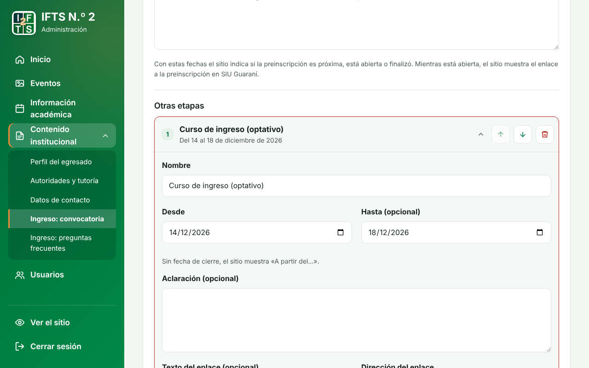

Si falta alguna fecha de inicio, el panel no guarda y lo indica:

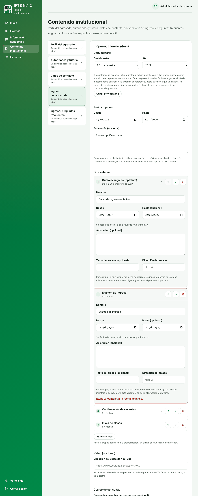

Con todas las fechas completas, el panel guarda y lo confirma:

### 8.6 Ingreso: preguntas frecuentes

Hasta 10 preguntas, cada una con su respuesta. Las flechas cambian el orden en que se muestran en la página de Ingreso.

 

---

## 9. Usuarios

Sección solo para Administración. Desde acá se crean y administran las cuentas del panel.

### 9.1 Crear un usuario

1. **Nombre y apellido.**
2. **Correo electrónico:** con este correo se ingresa al panel. No puede repetirse.
3. **Rol:** Administrador o Bedelía (apartado 2).
4. **Contraseña inicial:** al menos 8 caracteres, con una mayúscula y un número. Se le comunica a la persona por un medio privado.
5. **Agregar usuario.**
6. **Editar:** cambia los datos de una cuenta (apartado 9.3).
7. **Eliminar:** borra una cuenta (apartado 9.4).

Si el correo ya está registrado, el panel no crea la cuenta y lo avisa:

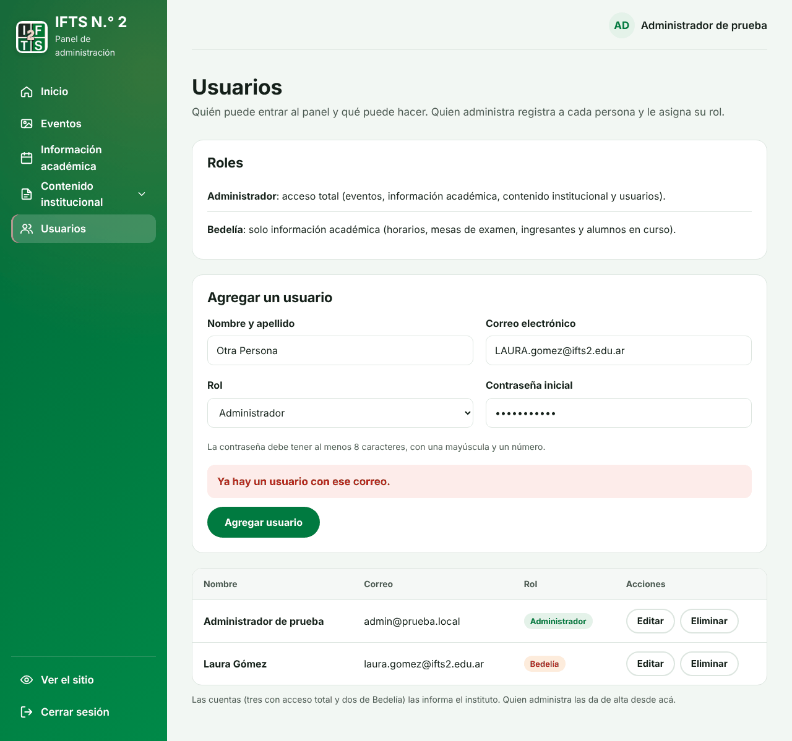

### 9.2 Reglas de las cuentas

- Siempre tiene que quedar al menos una cuenta de Administración.
- Nadie puede eliminar su propia cuenta ni cambiar su propio rol.
- Una cuenta eliminada pierde el acceso en ese momento, aunque tenga la sesión iniciada.

### 9.3 Editar un usuario y cambiar su contraseña

**Editar** abre los datos de la cuenta:

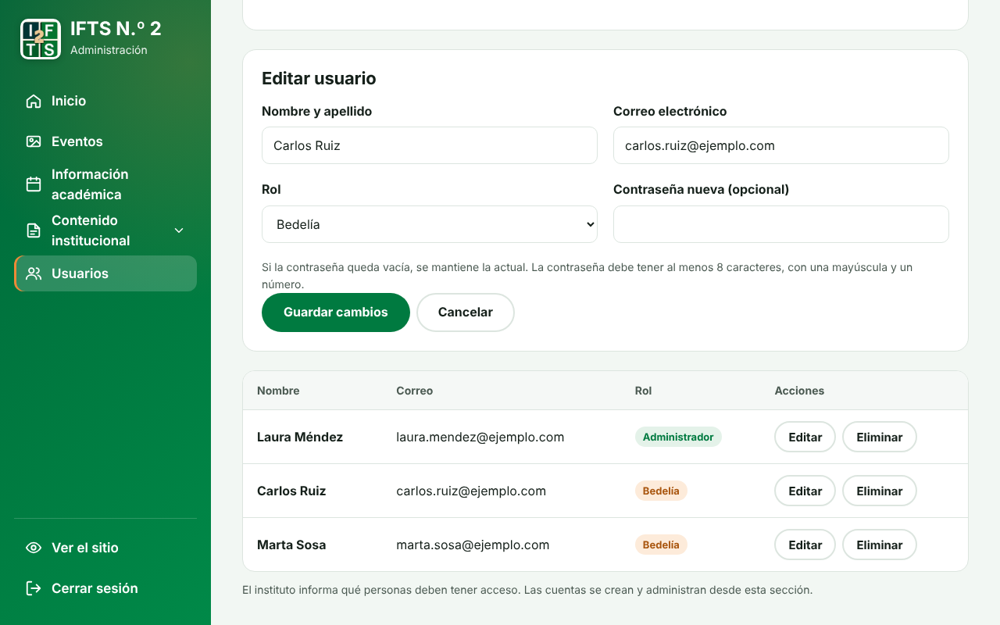

Si **Contraseña nueva** queda vacía, se mantiene la actual. Para asignar una contraseña nueva a quien la olvidó, se escribe en ese campo y se guarda.

### 9.4 Eliminar un usuario

**Eliminar** pide confirmación antes de borrar la cuenta:

 

---

## 10. Mensajes y problemas frecuentes

| Mensaje o situación | Causa | Solución |
|---|---|---|
| «Usuario o contraseña incorrectos. Quedan N intentos antes del bloqueo temporal.» | El correo o la contraseña no coinciden. | Revisar los datos. Si no se recuerda la contraseña, pedir a Administración una nueva (9.3). |
| «Demasiados intentos fallidos. Volver a intentarlo en 15 minutos.» | Hubo 5 intentos fallidos con esa cuenta. | Esperar 15 minutos. |
| «La sesión venció. Iniciar sesión de nuevo.» | Pasó la duración máxima de la sesión. | Tocar **Cerrar sesión** e ingresar otra vez (3.3). |
| Se cambió un horario o una mesa y el sitio sigue igual. | Guardar no publica. | Usar **Publicar** o **Actualizar publicación** (5.5). |
| Al entrar a una sección, el panel vuelve al inicio. | El perfil de la cuenta no tiene acceso a esa sección. | Pedir a Administración el cambio de perfil, si corresponde. |
| «Ya hay un usuario con ese correo.» | Ese correo ya tiene una cuenta. | Usar otro correo o editar la cuenta existente. |
| «Tiene que quedar al menos un administrador.» | Se intentó eliminar la última cuenta de Administración o quitarle ese rol. | Crear antes otra cuenta de Administración. |
| «Etapa N: completar la fecha de inicio.» | Una etapa de ingreso no tiene fecha «Desde». | Completar la fecha o quitar la etapa. |
| «El enlace de Instagram no es válido…» | El enlace no es de una publicación, un reel o un video. | Copiar el enlace de la publicación desde Instagram (7.3). |
| «Ya existe un evento con esta publicación de Instagram…» | Esa publicación ya tiene un evento. | Editar el evento existente desde la lista (7.5). |
| «El evento se guardó, pero no se pudo obtener la imagen…» | Instagram no entregó la imagen de la publicación. | Editar el evento y agregar una foto desde la computadora (7.5). |
| **Sincronizar Instagram** está deshabilitado, o la sincronización termina en error. | No está configurada la conexión con Instagram, o venció. | Avisar a quien administre el sistema. La carga manual sigue funcionando. |
| Un evento aparece dos veces. | Se cargó solo con fotos y después se sincronizó la misma publicación. | Ocultar uno de los dos (7.4). |
