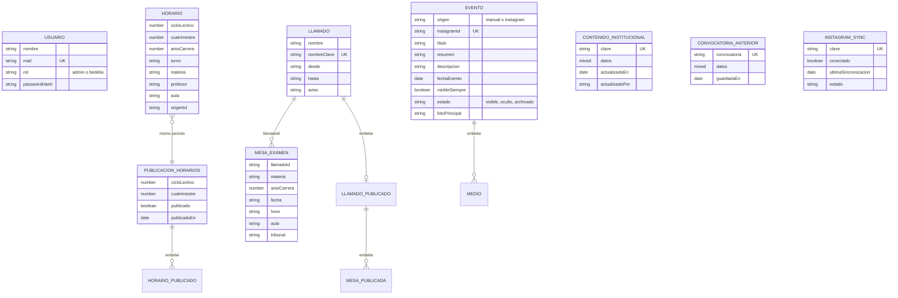

# Manual técnico del Portal Web Institucional IFTS N.° 2

Este documento está dirigido a quien tenga que instalar, mantener o continuar el desarrollo del portal. Describe cómo está construido, cómo se ejecuta y cómo se prueba. Está escrito sobre el código de la rama `develop`. Los puntos que el código no permite afirmar, o en los que el repositorio se contradice, están reunidos al final, en «Puntos a confirmar por el equipo».

## 1. Introducción

El IFTS N.° 2 (Tecnicatura Superior en Emprendimientos Gastronómicos) tenía un sitio en Google Sites que dejó de actualizarse. El portal lo reemplaza con dos partes:

- Un **sitio público**: inicio, carrera, ingreso, información para alumnos (horarios y mesas de examen), eventos y contacto.
- Un **panel de administración**, para que el personal del instituto cargue y actualice ese contenido sin intervención del equipo de desarrollo. Tiene dos perfiles: Administrador y Bedelía.

Lo desarrolló el equipo 404-Solutions del IFTS N.° 29 como proyecto integrador de Prácticas Profesionalizantes IV. Quedan fuera del alcance: reemplazar SIU Guaraní o Moodle, gestionar legajos, resolver trámites dentro del portal, una aplicación móvil nativa y borrar contenido institucional de forma automática (según el análisis de la Etapa 2).

El manual de uso del panel está en [manual-de-usuario.md](./manual-de-usuario.md).

## 2. Arquitectura del sistema

El sistema tiene tres capas:

```text
  Navegador ──► client/  React + Vite (sitio público y panel)
                  │  peticiones a /api/...
                  ▼
               server/  Node.js + Express (rutas, servicios, repositorios)
                  │
                  ├──► MongoDB Atlas (datos)
                  └──► Servicios externos: Cloudinary (fotos), Instagram Graph API,
                       SMTP (correo del formulario de contacto)
```

| Capa | Tecnologías (versiones de `package.json`) |
|---|---|
| Presentación | React 18.3, React Router 6.26, Vite 5.4 |
| Lógica | Node.js, Express 4, JSON Web Token, bcryptjs, helmet, express-rate-limit, pdfkit, nodemailer |
| Datos | MongoDB con Mongoose 8; Cloudinary para las fotos de los eventos |
| Despliegue | Vercel (el cliente compilado como sitio estático y la API como función) |
| Pruebas | `node:test` y supertest |

Tres decisiones de estructura explican gran parte del código:

1. **Inyección de dependencias en `crearApp`.** `server/src/app.js` exporta `crearApp({ config, usuarios, eventos, horarios, ... })`. Recibe los repositorios, el servicio de correo, el limitador y el reloj (`hoy`) por parámetro. En producción se le pasan los de MongoDB. En desarrollo sin base de datos y en las pruebas se le pasan los de memoria.
2. **Repositorios con dos implementaciones.** Cada entidad tiene un `*.memoria.js` y un `*.mongo.js` en `server/src/repos/`, con la misma interfaz. `server/src/arranque.js` elige todos de una fuente: o todos en MongoDB o todos en memoria.
3. **Datos de trabajo y datos publicados.** Los horarios y las mesas se cargan como datos de trabajo, y lo que ven los alumnos es una copia aparte que se genera al publicar. Guardar no cambia el sitio. Los detalles están en el apartado 9.

## 3. Estructura del proyecto

```text
proyecto-ifts2/
├── package.json         # dependencias y scripts de todo el proyecto
├── server.js            # arranque en desarrollo y producción local (puerto 3000)
├── api/index.js         # entrada de la API en Vercel
├── vercel.json          # compilación y reescrituras de Vercel
├── .env.example         # variables de entorno, sin valores
├── client/              # frontend (React + Vite)
│   ├── src/pages/       # una pantalla por archivo (sitio público y panel)
│   ├── src/components/  # formularios, tablas, menú del panel, modales, rutas protegidas
│   ├── src/context/     # AuthContext: sesión y rol
│   ├── src/api.js       # llamadas a /api y manejo del token
│   └── public/docs/     # PDF que publica el sitio (plan de estudios, correlatividades, guía de preingreso)
├── server/
│   ├── src/app.js       # crearApp: arma Express y monta las rutas
│   ├── src/config.js    # lee las variables de entorno
│   ├── src/arranque.js  # elige repositorios (MongoDB o memoria) y crea el primer administrador
│   ├── src/routes/      # una por área: auth, usuarios, eventos, academica, mesas, contenido, instagram, contacto
│   ├── src/services/    # reglas de negocio, correo, archivado, PDF, Instagram, fotos
│   ├── src/repos/       # acceso a datos (memoria y MongoDB)
│   ├── src/models/      # esquemas de Mongoose
│   ├── src/middleware/  # autenticación y control de rol
│   ├── scripts/         # seed-admin.js
│   └── test/            # 39 archivos de prueba
├── docs/                # documentación del equipo
└── prototipo-html/      # prototipo original (referencia, no se publica)
```

## 4. Base de datos

La base es MongoDB, que guarda documentos y no tablas. Por eso las relaciones entre colecciones son lógicas: un campo guarda el identificador de otro documento y MongoDB no lo verifica. Mongoose define los esquemas en `server/src/models/`.

### 4.1 Diagrama entidad-relación



`LLAMADO_PUBLICADO`, `HORARIO_PUBLICADO`, `MESA_PUBLICADA` y `MEDIO` no son colecciones: son subdocumentos que viven dentro de otro documento. Si el visor de Markdown no dibuja el diagrama, la misma imagen está en [der.png](./der.png).

### 4.2 Colecciones

| Colección | Modelo | Qué guarda |
|---|---|---|
| `usuarios` | `Usuario` | Cuentas del panel. `rol` es `admin` o `bedelia`. La contraseña se guarda con hash (bcrypt), nunca en texto. `mail` es único y se guarda en minúsculas. |
| `eventos` | `Evento` | Eventos de la galería. Pueden ser manuales o venir de Instagram (`origen`). `estado` es `visible`, `oculto` o `archivado`. Incluye la lista de fotos (`medios`) y un registro de las fotos quitadas desde el panel (`mediosQuitados`). `instagramId` es único para los eventos que vienen de Instagram. |
| `horarios` | `Horario` | Datos de trabajo: una materia de un período, con docente, aula y una o más franjas (`dias`: día, desde, hasta). `origenId` evita duplicar al reutilizar horarios de otro período. |
| `publicaciones_horarios` | `PublicacionHorarios` | Lo que ven los alumnos: un documento por período (único por `cicloLectivo` y `cuatrimestre`), con una copia de las materias en el momento de publicar. |
| `llamados` | `Llamado` | Un llamado de mesas de examen (por ejemplo, «Febrero 2027»). `nombreClave` impide dos llamados con el mismo nombre. El campo `publicacion` guarda la copia publicada, con sus mesas; vale `null` si nunca se publicó. |
| `mesas_examen` | `MesaExamen` | Datos de trabajo: una mesa de un llamado (`llamadoId`). Fecha y hora pueden quedar vacías («A confirmar»). |
| `contenidoinstitucional` | `ContenidoInstitucional` | Una sección editable del contenido institucional. `clave` es una de `perfil`, `personas`, `contacto`, `ingreso`, `ingresoPreguntas`. `datos` guarda el contenido ya validado. |
| `convocatoriasanteriores` | `ConvocatoriaAnterior` | Historial de convocatorias de ingreso, una copia por convocatoria. Solo de consulta. |
| `instagramsyncs` | `InstagramSync` | Estado de la sincronización con Instagram (un solo documento, `clave: "global"`), las publicaciones descartadas y el feed guardado. |

### 4.3 Relaciones

- **Llamado → MesaExamen** (uno a muchos): la mesa guarda `llamadoId`.
- **Horario → PublicacionHorarios**: no hay un campo que los una. Pertenecen al mismo período cuando coinciden `cicloLectivo` y `cuatrimestre`. Cada materia publicada guarda `horarioId`, que apunta al horario de trabajo del que salió, para poder mostrar qué cambió desde la última publicación.
- **Mesa publicada → MesaExamen**: igual, con `mesaId`.
- **Usuario**: ninguna colección lo referencia. El token de sesión lleva su identificador (`sub`).
- El contenido institucional, las convocatorias anteriores y el estado de Instagram no se relacionan con otras colecciones.

### 4.4 Creación y restauración

No hay scripts de creación de la base. Mongoose crea las colecciones y los índices la primera vez que se usan. El primer administrador se crea al arrancar, si no hay ningún usuario y están cargadas `SEED_ADMIN_MAIL` y `SEED_ADMIN_PASSWORD` (apartado 5.4). Las secciones de contenido institucional no se escriben en la base hasta que alguien las guarda: mientras tanto, el servidor devuelve los valores iniciales definidos en `server/src/services/contenido.js`.

Para restaurar, alcanza con apuntar `MONGODB_URI` a una base nueva. Los datos cargados desde el panel (usuarios, eventos, horarios, mesas, contenido) hay que volver a cargarlos o restaurarlos con las herramientas de MongoDB Atlas. El repositorio no incluye una copia de respaldo ni un procedimiento para hacerla.

## 5. Configuración e instalación

### 5.1 Requisitos

- **Node.js 22** (el README lo recomienda; este manual se verificó con 22.22.0) y npm 10.
- **Git**.
- Opcionales: una base MongoDB Atlas, una cuenta de Cloudinary, credenciales de Instagram y una cuenta SMTP. Sin ellos el proyecto corre en local en modo memoria.

### 5.2 Dependencias

Todas las dependencias del proyecto están en el `package.json` de la raíz (React, Vite, Express, Mongoose, etc.). Se instalan con un solo comando desde la raíz.

### 5.3 Pasos para instalar y ejecutar en local

```bash
git clone https://github.com/IFTS29/proyecto-ifts2.git
cd proyecto-ifts2
npm install
cp .env.example .env      # en PowerShell: Copy-Item .env.example .env
```

Después, abrí `.env` y completá al menos estas tres variables, para poder entrar al panel:

```text
SEED_ADMIN_NOMBRE=Administrador
SEED_ADMIN_MAIL=admin@ejemplo.local
SEED_ADMIN_PASSWORD=UnaClave2026
```

Y ejecutá:

```bash
npm run dev
```

El servidor queda en `http://localhost:3000` y sirve la API (`/api/...`) y el cliente con Vite en el mismo puerto. En este modo el navegador no se recarga solo: hay que actualizar la página después de cada cambio. Con el puerto ocupado, se puede cambiar con la variable `PORT`.

Si `MONGODB_URI` está vacía, el servidor avisa «Sin MONGODB_URI: modo memoria» y los datos se pierden al reiniciarlo. Si tiene valor, se conecta a esa base.

**Producción local.** `npm run build` compila el cliente en `client/dist` y `npm start` lo sirve junto con la API, con `NODE_ENV=production`. En ese modo MongoDB es obligatorio: sin `MONGODB_URI`, o si no se puede conectar, el servidor no arranca.

### 5.4 Variables de entorno

Se leen en `server/src/config.js`. El archivo `.env` no se sube al repositorio.

| Variable | Para qué sirve | Si falta |
|---|---|---|
| `MONGODB_URI` | Conexión a MongoDB Atlas. | Modo memoria en desarrollo. En producción y en Vercel, el servidor no arranca. |
| `JWT_SECRET` | Clave con la que se firma el token de sesión. | Usa una clave fija de desarrollo. **En producción hay que definirla.** |
| `JWT_DURACION` | Duración del token. | `8h`. |
| `BCRYPT_COSTO` | Costo del hash de contraseñas. | `10`. |
| `SEED_ADMIN_NOMBRE`, `SEED_ADMIN_MAIL`, `SEED_ADMIN_PASSWORD` | Datos del primer administrador. Solo se usan si no hay ningún usuario. | Sin mail o contraseña no se crea ningún usuario y nadie puede entrar al panel (el servidor lo avisa). |
| `CLOUDINARY_CLOUD_NAME`, `CLOUDINARY_API_KEY`, `CLOUDINARY_API_SECRET` | Almacenamiento de las fotos de eventos. | Las fotos se guardan en disco, solo en desarrollo local. En producción y en Vercel no se pueden subir fotos nuevas (la ruta responde 503). |
| `INSTAGRAM_TOKEN`, `INSTAGRAM_ACCOUNT_ID`, `INSTAGRAM_HASHTAG` | Sincronización con Instagram. | La sincronización queda deshabilitada y el panel lo indica. El hashtag por defecto es `eventosIFTS2`. |
| `SMTP_HOST`, `SMTP_PUERTO`, `SMTP_USUARIO`, `SMTP_CLAVE` | Cuenta que envía los correos del formulario de contacto. Por defecto `smtp.gmail.com` y puerto 465. | Sin usuario ni clave: envío simulado en desarrollo; en producción el envío falla y el formulario lo informa. Con solo uno de los dos, el envío falla siempre. |
| `CORREO_BEDELIA`, `CORREO_INSTITUCIONAL` | Casillas que reciben las consultas. Tienen que ser distintas. | El envío falla con un mensaje que lo explica. |
| `SITIO_URL` | Dirección pública del sitio, para el enlace a Contacto que llevan los PDF. | En Vercel usa las variables propias de Vercel; en local, `http://localhost:<puerto>`. |
| `CLIENT_URL` | Dirección del cliente. | `http://localhost:5173`. |
| `PORT` | Puerto del servidor. | `3000`. |

### 5.5 Despliegue en Vercel

- `vercel.json` define `npm run build` como comando de compilación y `client/dist` como carpeta de salida.
- Toda petición a `/api/...` se reescribe a la función `api/index.js`, que arma la aplicación una sola vez por instancia. Cualquier otra ruta que no sea un archivo estático devuelve `index.html`, y de ahí sigue React Router.
- La función incluye las fuentes de `pdfkit` (`includeFiles`), necesarias para generar los PDF.
- Las variables de entorno se cargan en el panel de Vercel, no en el repositorio.
- Si MongoDB no responde, la API contesta 503 con «El servicio no está disponible en este momento» y lo intenta de nuevo en la petición siguiente.

### 5.6 Credenciales de prueba

El repositorio no incluye credenciales. Para una instalación local nueva se definen con las variables `SEED_ADMIN_*` (apartado 5.3). Para el sitio desplegado, el README indica que se comparten con la cátedra por un canal privado.

## 6. Componentes principales

### 6.1 Servidor

**Arranque.** `server.js` lee la configuración (`leerConfig`), llama a `prepararDatos` (`arranque.js`) y crea la app con `crearApp`. En desarrollo monta Vite como middleware, y en producción sirve `client/dist`. En Vercel, `api/index.js` hace lo mismo pero devuelve la app a través de una función que atiende cada petición.

**Autenticación y roles** (`middleware/auth.js`).
- `autenticar` exige un token `Bearer`, lo verifica y busca al usuario. Si el usuario fue eliminado, el token deja de valer aunque no haya vencido.
- `requiereRol("admin")` o `requiereRol("admin", "bedelia")` limita la ruta a esos perfiles y responde 403 al resto.
- El login (`routes/auth.js`) compara la contraseña aun cuando el correo no exista, contra un hash de relleno, para que la demora no revele qué correos están registrados.

**Limitadores** (`express-rate-limit`).
- Login: 5 intentos fallidos por correo y 15 minutos de bloqueo. Cuenta por correo y no por IP, porque la IP se puede falsear. El contador vive en memoria: con varias instancias en Vercel, cada una lleva el suyo.
- Contacto: 10 envíos por visitante en 15 minutos.

**Rutas.** El prefijo es `/api`.

| Prefijo | Quién accede | Qué hace |
|---|---|---|
| `GET /salud` | Público | Responde `{"estado":"ok"}`. |
| `/auth` (`POST /login`, `GET /yo`) | Login público; `/yo` con sesión | Inicia sesión y devuelve el usuario de la sesión. |
| `/users` | Administrador | Alta, edición y baja de usuarios. |
| `/events` | Público: `GET /` y `GET /:id`. Administrador: el resto | Alta, edición, cambio de estado (mostrar u ocultar) y de «visible siempre». No hay baja. |
| `/academic` (horarios) | Público: `GET /vigente` y `GET /vigente/horarios.pdf`. Administrador y Bedelía: el resto | Períodos, horarios, reutilización, publicar, retirar y vista previa en PDF. |
| `/academic` (mesas) | Público: `GET /vigente/mesas.pdf`. Administrador y Bedelía: el resto | Llamados y mesas: alta, edición, baja, publicar, retirar y vista previa en PDF. |
| `/content` | Público: `GET /`. Administrador: `PUT /:clave` y `GET /ingreso/historial` | Lee y guarda las cinco secciones de contenido institucional. |
| `/instagram` | Público: `GET /status` y `GET /feed`. Administrador: `POST /sync` | Estado y feed de Instagram; sincronización manual. |
| `POST /contact` | Público, con límite de envíos | Valida la consulta y la envía por correo. |

**Servicios** (`server/src/services/`).
- `academica.js` y `mesas.js`: reglas de horarios, mesas y llamados. Validan los datos y devuelven mensajes en español.
- `archivo.js`: calcula qué contenido se ve y cuál pasa al archivo (apartado 9).
- `contenido.js`: límites y validación de las cinco secciones, y los valores iniciales.
- `academica.pdf.js` y `routes/pdf.js`: generan los PDF de horarios y mesas con `pdfkit`.
- `correo.smtp.js`, `correo.mensaje.js`, `correo.memoria.js`: arman y envían los correos del formulario. Si el servidor SMTP rechaza una de las dos casillas, el mensaje igual llegó a la otra: se registra la advertencia y no se reintenta para no duplicarlo.
- `instagram/`: sincronización con la API (`meta.js`), interpretación de los textos de cada publicación (`parser.js`) y almacenamiento del feed (`feed.js`).
- `media/`: guarda las fotos en Cloudinary (`cloudinary.js`, `fotosEventos.js`) o en disco en desarrollo (`local.js`). `galeriaEvento.js` valida la lista de fotos de un evento (máximo 20).
- `limitador.js`, `limitador.contacto.js`, `passwords.js` (regla de contraseñas y hash), `seed.js` (primer administrador).

### 6.2 Cliente

- `App.jsx` define las rutas. Las del sitio público usan `Layout` (encabezado y pie). Las del panel van dentro de `SoloAutenticados`, y las de Eventos, Contenido y Usuarios, además, dentro de `SoloAdministrador`.
- `context/AuthContext.jsx` guarda el usuario y su rol. Al abrir la página verifica el token guardado con `GET /api/auth/yo`.
- `api.js` hace las llamadas a `/api`, agrega el token y convierte los errores del servidor en `Error` con el mensaje que mostró la API. El token se guarda en `sessionStorage`, así que se pierde al cerrar la pestaña.
- El panel está en `pages/Admin*.jsx`. Los formularios y tablas reutilizables están en `components/` (por ejemplo `FormHorario`, `TablaMesas`, `FormIngreso`).
- Los controles de rol del cliente (`SoloAdministrador`, el menú `AdminLateral`) son solo de comodidad. El servidor valida el rol en cada ruta.

## 7. Gestión de errores y validaciones

**Códigos de respuesta.** La API devuelve siempre un JSON con el campo `error` y un mensaje en español que el panel muestra tal cual.

| Código | Cuándo |
|---|---|
| 400 | Datos inválidos o campos obligatorios vacíos. |
| 401 | Sin sesión, token inválido o vencido, o usuario eliminado. En el login, credenciales incorrectas. |
| 403 | La sesión no tiene el rol que pide la ruta. |
| 404 | El recurso no existe, o una ruta `/api` que no existe. |
| 409 | Duplicado (por ejemplo, un correo ya registrado). |
| 413 | El pedido supera los 15 MB (fotos o contenido). |
| 429 | Demasiados intentos de login o de contacto. |
| 503 | La base no responde en Vercel o producción, no hay dónde guardar las fotos, o el correo no está configurado. |
| 500 | Error no previsto. Se registra en el servidor y el cliente recibe un mensaje genérico. |

**Validaciones de negocio** (se hacen en el servidor, en los servicios y rutas, y los modelos de Mongoose actúan como segundo control):
- Usuarios: nombre y correo obligatorios, formato de correo, rol válido, contraseña de al menos 8 caracteres con una mayúscula y un número, correo único. No se puede cambiar el propio rol ni eliminar el propio usuario, y siempre tiene que quedar al menos un administrador.
- Horarios: ciclo lectivo, cuatrimestre, año de la carrera, turno y horas con formato válido (`HH:MM`, 24 h). Docente y aula son opcionales.
- Mesas y llamados: nombre de llamado único sin distinguir mayúsculas ni espacios. Un llamado que se publicó alguna vez no se puede eliminar.
- Eventos: título y descripción obligatorios, fecha válida, hasta 20 fotos, tipos JPG, PNG o WebP, 4 MB por foto. Los enlaces a fotos solo pueden ser `http(s)` o rutas del propio sitio.
- Contenido institucional: cada sección tiene límites de cantidad y de largo (`LIMITES` en `services/contenido.js`). Con convocatoria de ingreso cargada, todas las etapas necesitan fecha de inicio.
- Contacto: nombre, correo y mensaje obligatorios, teléfono con formato válido si se completa, y motivo de una lista fija.

**Fallas de conexión.**
- Sin MongoDB en desarrollo, el servidor pasa a modo memoria y lo avisa por consola. En producción o en Vercel no lo hace: falla, para no guardar datos en un lugar donde se perderían.
- En Vercel, si la preparación falla, la función responde 503 y no guarda el fallo: reintenta en la petición siguiente.
- Instagram: si una publicación no se puede descargar completa, queda pendiente y se reintenta en otra sincronización mientras siga entre las últimas 20. Sin credenciales, la sincronización no corre y el panel muestra el botón deshabilitado.

**En el cliente.** Las eliminaciones y los cambios que afectan al sitio piden confirmación en ventanas propias. Los formularios avisan si se intenta salir con cambios sin guardar. Si no se puede conectar con el servidor, `api.js` muestra «No se pudo conectar con el servidor. Probá de nuevo en unos minutos.».

## 8. Pruebas implementadas

Hay **516 pruebas automáticas, todas aprobadas**, en 39 archivos de `server/test/`. Usan `node:test` y supertest. Corren sobre los repositorios en memoria, así que no necesitan base de datos ni conexión a Internet. Se ejecutan con:

```bash
npm test
```

La corrida completa tarda desde unos 25 segundos hasta un par de minutos, según el equipo.

| Área | Archivos | Qué cubren |
|---|---|---|
| Acceso y usuarios | `auth`, `permisos`, `usuarios`, `passwords`, `seed`, `arranque`, `config` | Login, bloqueo por intentos, permisos por rol, reglas de contraseña, alta/edición/baja de usuarios, creación del primer administrador, elección de repositorios según el entorno. `permisos` recorre 45 rutas de la API como visitante, Bedelía y Administrador; la matriz está en [matriz-de-permisos.md](./matriz-de-permisos.md). |
| Horarios y archivado | `academica`, `publicacion`, `plan`, `archivo`, `alumnos`, `finalizados` | Alta, edición y baja de materias, reutilización, publicar y retirar, comparación de cambios, reglas de archivado por fecha en los bordes del calendario. |
| Mesas de examen | `mesas`, `mesas.panel`, `mesas.celular` | Llamados y mesas, publicación, retiro y reglas de eliminación. |
| Eventos | `eventos`, `eventos.formulario`, `eventos.edicion`, `eventos.fotos`, `eventos.galeria`, `eventos.sitio` | Alta, edición, mostrar y ocultar, galería, límites de fotos, lo que ve el sitio público. |
| Instagram | `instagram`, `instagram.bloque`, `instagram.sin-conexion`, `instagram.sincronizacion` | Interpretación de textos, sincronización, estados sin conexión. |
| Contenido institucional | `contenido`, `contenido.cliente`, `ingreso`, `ingreso.historial` | Validación de las cinco secciones y el historial de convocatorias. |
| Contacto y correo | `contacto`, `contacto.limite`, `correo.mensaje`, `correo.smtp` | Validación del formulario, límite de envíos, reparto entre casillas, envío por SMTP. |
| Otros | `admin.inicio`, `confirmaciones`, `enlaces`, `visor`, `salud` | Inicio del panel, confirmaciones, enlaces, visor de fotos, estado del servicio. |

Los casos de prueba y su relación con los requerimientos están en [plan-de-testing.md](./plan-de-testing.md). Las pruebas cubren el servidor y las funciones de apoyo del cliente que se ejecutan sin navegador (por ejemplo `client/src/academica.js` o `client/src/confirmaciones.js`). No hay pruebas automáticas de la interfaz dentro del navegador.

## 9. Decisiones de diseño

Cada decisión se tomó del código o de los documentos del proyecto. Donde la razón no consta en ninguno de los dos, se indica.

**Publicar es un paso aparte de guardar (horarios y mesas).** Los datos de trabajo (`horarios`, `mesas_examen`) y lo que ven los alumnos (`publicaciones_horarios`, `llamados.publicacion`) son documentos distintos. Publicar o actualizar reemplaza la copia entera en una sola escritura, y así nunca se ve una mezcla de la versión anterior y la nueva. Retirar marca la copia como no publicada y la conserva. La razón de fondo es que Bedelía pueda preparar un período completo sin que se vea a medio cargar (se desprende de los comentarios del código).

**El contenido institucional se publica al guardar.** Es una sección editable por vez, guardada entera. No usa copia aparte.

**Archivado calculado, no guardado.** Nada se borra ni se mueve: el servidor calcula al responder qué está vigente y qué pasó al archivo (`services/archivo.js`). Eventos: se ven los del año actual y el anterior. Horarios: los períodos publicados del año actual y el más reciente de todos los publicados. Mesas: un llamado pasa al archivo 30 días después de su fecha más tardía. Las acciones manuales tienen prioridad: un evento oculto sigue oculto aunque sea «visible siempre». Las fechas se comparan en el calendario de Argentina y no con la zona horaria del servidor, y «hoy» se recibe por parámetro para poder probar los límites.

**Repositorios intercambiables.** Permiten trabajar y probar sin base de datos. El costo es mantener dos implementaciones por entidad.

**Límite de login por correo.** Se cuenta por correo y no por IP, porque la IP se puede falsear con el encabezado `X-Forwarded-For`.

**Validar en el servidor y también en el cliente.** El servidor es la autoridad: valida datos y roles aunque el cliente ya lo haga.

**Eventos sin baja.** El panel permite ocultar un evento pero no eliminarlo. Es consistente con el alcance (no se elimina contenido institucional automáticamente), pero la cátedra pide el ciclo CRUD completo y el issue #81 está abierto para agregarlo.

**Fotos fuera de la base.** Las fotos se suben a Cloudinary y en MongoDB queda solo el enlace. Las fotos quitadas desde el panel no se borran de Cloudinary: quedan registradas en `mediosQuitados`.

## 10. Qué hacer si algo falla

Cada ítem sale de cómo se comporta el código hoy.

| Síntoma | Causa probable | Qué hacer |
|---|---|---|
| El sitio desplegado devuelve «El servicio no está disponible en este momento» | MongoDB Atlas no responde o `MONGODB_URI` es incorrecta. | Revisar el estado del clúster y la variable en Vercel. La API reintenta sola en la petición siguiente. |
| El servidor no arranca con «Falta MONGODB_URI» | Se ejecutó en producción sin la variable. | Definir `MONGODB_URI`. Solo en desarrollo se permite trabajar sin base. |
| Nadie puede entrar al panel | No hay usuarios y faltan `SEED_ADMIN_MAIL` o `SEED_ADMIN_PASSWORD`; o se perdió la contraseña del único administrador. | Cargar las variables `SEED_ADMIN_*` y reiniciar con la colección `usuarios` vacía, o crear el usuario con `npm run seed:admin --prefix server` (ver «Puntos a confirmar»). |
| Un usuario queda bloqueado | 5 intentos fallidos. | Esperar 15 minutos. El bloqueo está en memoria: reiniciar el servidor lo borra. |
| El formulario de contacto devuelve error | Faltan las variables de correo, hay solo una de las dos credenciales SMTP, o las casillas son iguales. | Revisar `SMTP_*`, `CORREO_BEDELIA` y `CORREO_INSTITUCIONAL` (apartado 5.4). |
| No se pueden subir fotos de eventos | Faltan las credenciales de Cloudinary en producción. | Cargar `CLOUDINARY_*`. |
| «Sincronizar Instagram» está deshabilitado, o la sincronización termina con error | Faltan las credenciales o el token venció. | Cargar o renovar `INSTAGRAM_TOKEN` e `INSTAGRAM_ACCOUNT_ID`. El token de Instagram dura unos 60 días (según `.env.example`). |
| Los alumnos no ven un cambio | El cambio está guardado pero sin publicar. | En el panel, Información académica: Publicar o Actualizar publicación. |
| Los PDF no se generan en Vercel | Faltan las fuentes de `pdfkit` en la función. | Verificar `includeFiles` en `vercel.json`. |

**Respaldo.** El repositorio no tiene una política de copias de seguridad. MongoDB Atlas ofrece copias según el plan del clúster, y las fotos están en Cloudinary. Qué plan se usa y quién administra esas cuentas son decisiones que el equipo todavía tiene que dejar escritas.

## Puntos a confirmar por el equipo

Esta sección reúne lo que este manual no pudo afirmar o donde el repositorio se contradice. Hay que resolver cada punto y quitar la sección antes de la entrega.

1. **Cómo instalar y ejecutar.** El README manda a hacer `npm ci --prefix server` y `npm ci --prefix client`, y a ejecutar `npm run dev --prefix server` (puerto 4000) y `npm run dev --prefix client` (puerto 5173). Este manual documenta `npm install` y `npm run dev` en la raíz (puerto 3000), que es lo que usa el despliegue y lo que se verificó. Hay que decidir cuál es el camino oficial y corregir el README (#60).
2. **Entrada alternativa `server/src/index.js`.** El comando `npm run dev --prefix server` arranca este archivo, que solo conecta usuarios y eventos a MongoDB: horarios, mesas y contenido quedarían en memoria aunque haya `MONGODB_URI`. No usa `prepararDatos`. ¿Se conserva o se elimina?
3. **`npm ci` falla en la raíz.** El `package-lock.json` no coincide con el `package.json` (faltan cloudinary y pdfkit en el lock). Por eso este manual usa `npm install`. Hay que regenerar y subir el lock.
4. **`server/package.json` y `client/package.json`.** Tienen sus propias dependencias y locks, y el de `server/` no incluye `pdfkit`. No parecen usarse en el despliegue. ¿Siguen haciendo falta?
5. **`server/scripts/seed-admin.js`.** Si no hay variables de entorno, crea un administrador con `admin@ifts2.edu.ar` y la contraseña `Admin1234!`, que quedan escritas en el código. Conviene definir si el script se mantiene y si esa contraseña por defecto es aceptable.
6. **Renovación del token de Instagram.** `.env.example` dice que se renueva con «la tarea programada», y el análisis de la Etapa 2 habla de renovación automática. En el código y en `vercel.json` no hay ninguna tarea programada ni llamada de renovación. Hay que aclarar cómo se renueva, o quitar la frase.
7. **Respaldo y plan de contingencia.** El apartado 10 describe los fallos que el código contempla. Un plan de contingencia completo (respaldos de MongoDB, quién tiene acceso a Vercel, Atlas, Cloudinary y la cuenta de Instagram, qué pasa si el equipo ya no está) requiere decisiones del equipo y del instituto que no constan en el repositorio.
8. **Decisiones de diseño.** La razón de cada decisión del apartado 9 se dedujo del código y de los documentos. Conviene que quien las tomó confirme que son correctas, y agregar otras si las hubo.
9. **Credenciales de prueba para la cátedra.** El README las deja pendientes («a completar antes de la entrega»).
10. **Base de datos para la entrega.** La consigna pide base de datos o scripts de creación «si corresponde». Como Mongoose crea las colecciones solo, no hay scripts. Si la cátedra espera un volcado con datos de ejemplo, hay que generarlo.
