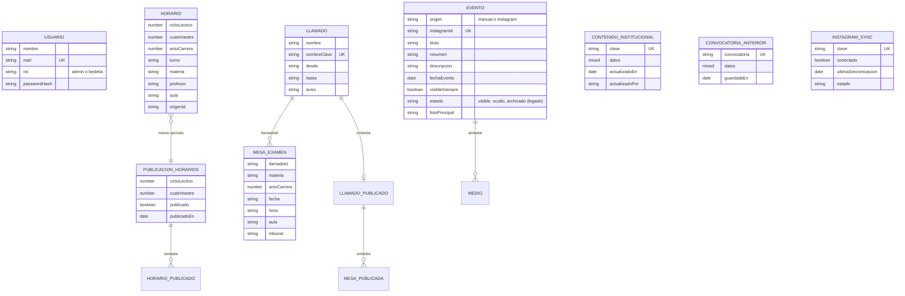
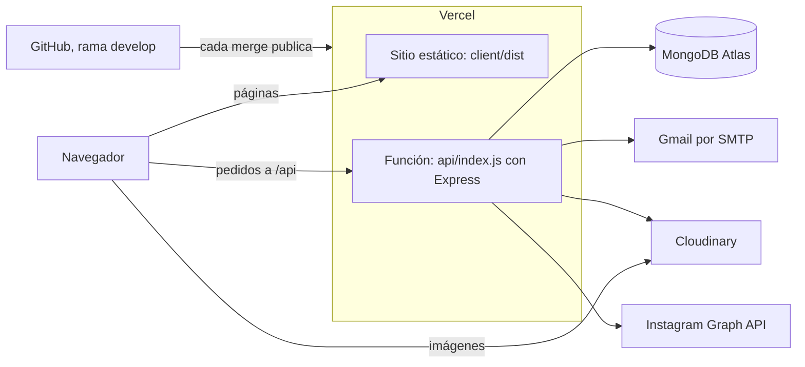
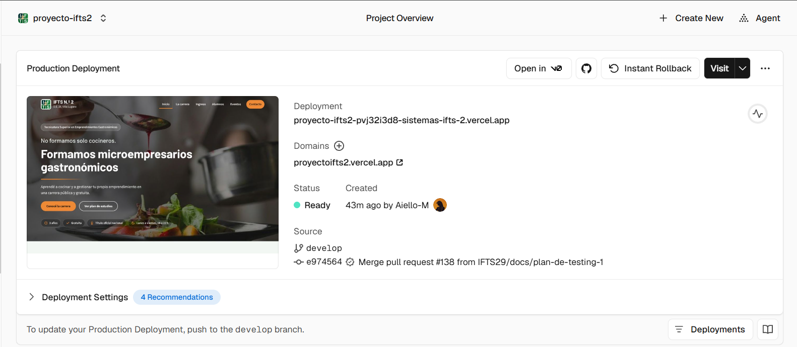
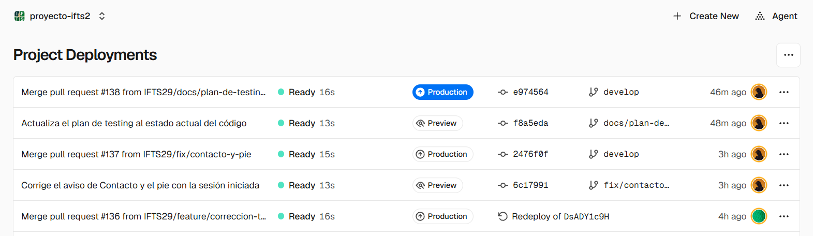
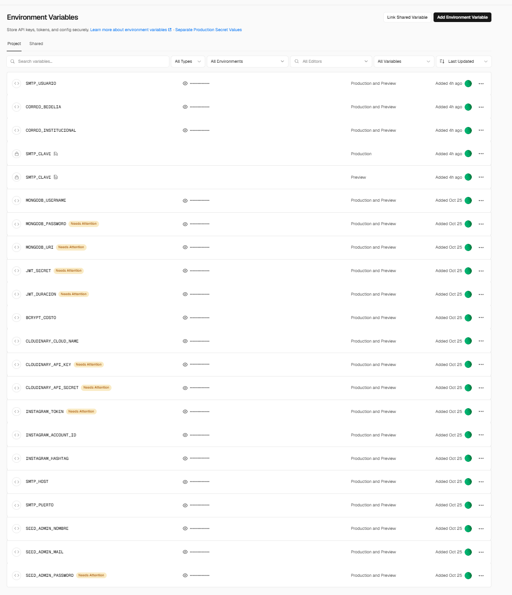
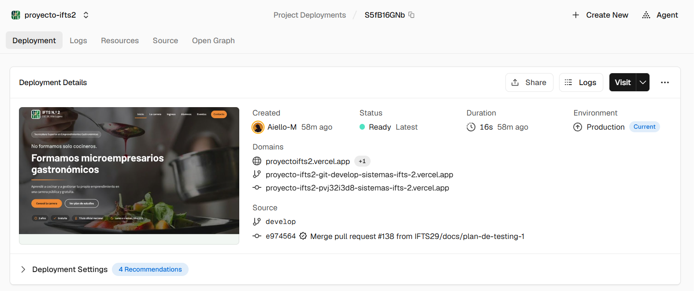
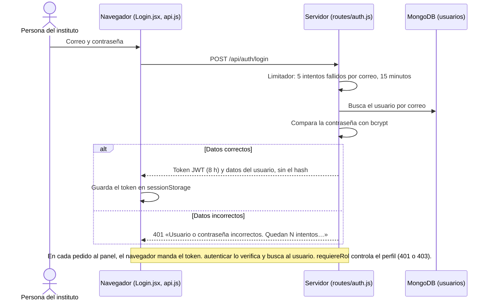
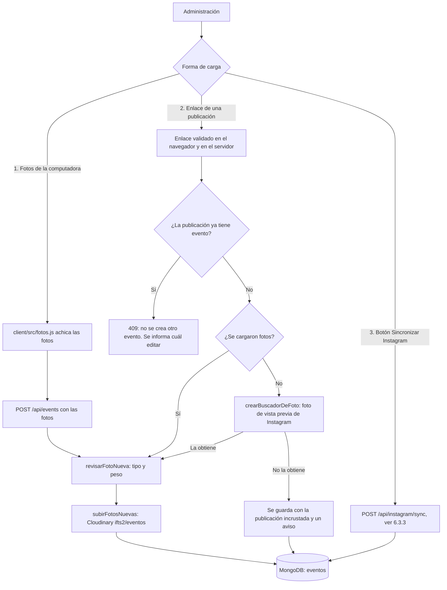
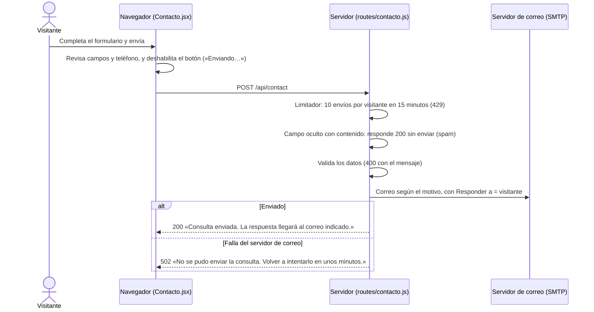
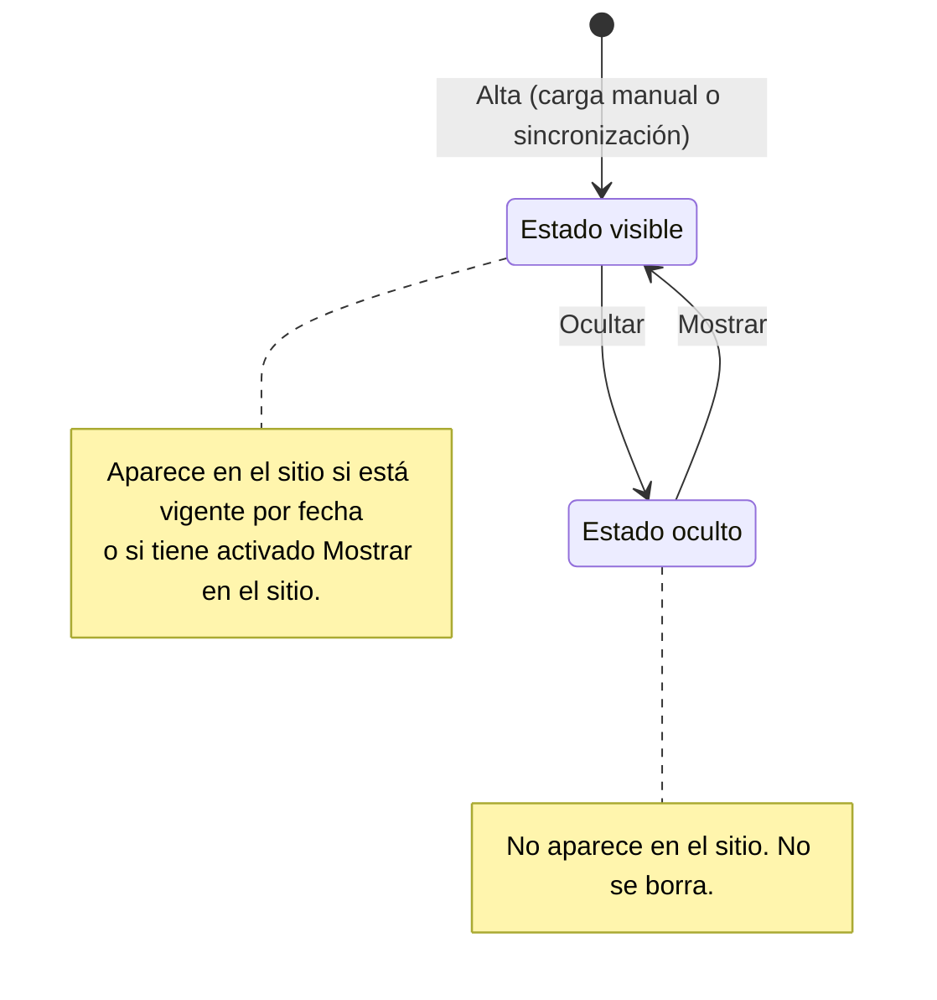

# Manual técnico del Portal Web Institucional IFTS N.º 2

Este documento está dirigido a quien tenga que instalar, mantener o continuar el desarrollo del portal. Describe cómo está construido, cómo se ejecuta y cómo se prueba. Está escrito sobre la versión definitiva de la rama `develop` para la entrega final de la Etapa 3.

## 1. Introducción

El IFTS N.º 2 (Tecnicatura Superior en Emprendimientos Gastronómicos) tenía un sitio en Google Sites que dejó de actualizarse. El portal lo reemplaza con dos partes:

- Un **sitio público**: inicio, carrera, ingreso, información para alumnos (horarios y mesas de examen), eventos y contacto.
- Un **panel de administración**, para que el personal del instituto cargue y actualice ese contenido sin intervención del equipo de desarrollo. Cuenta exclusivamente con dos perfiles operativos: Administrador y Bedelía (descartando perfiles adicionales como superadministrador por definición institucional).

Lo desarrolló el equipo 404-Solutions del IFTS N.º 29 como proyecto integrador de Prácticas Profesionalizantes IV. Quedan fuera del alcance: reemplazar SIU Guaraní o Moodle, gestionar legajos, resolver trámites dentro del portal, una aplicación móvil nativa y borrar contenido institucional de forma automática (según el análisis de la Etapa 2).

El manual de uso del panel está en [manual-de-usuario.md](./manual-de-usuario.md).

**Documentación relacionada:**

| Documento | Contenido |
|---|---|
| [README](../README.md) | Presentación del proyecto, instalación rápida y equipo. |
| [Manual de usuario](./manual-de-usuario.md) | Uso del panel, paso a paso y con capturas. |
| [Base de datos en MongoDB Atlas](./documentacion_mongodb.md) | Configuración del clúster y colecciones, con capturas. |
| [Matriz de permisos](./matriz-de-permisos.md) | Qué puede hacer cada perfil en cada ruta y pantalla. |
| [Plan de testing](./plan-de-testing.md), [Reporte de pruebas](./reporte-de-pruebas.md) y [Validación visual de los CRUD](./validacion-visual-cruds.md) | Estrategia de pruebas, resultados y evidencias. |
| [Registros de decisiones de arquitectura (ADR)](./adr/README.md) | Las siete decisiones de arquitectura, con su contexto y sus consecuencias. |
| [Registro de cambios](./registro-de-cambios.md) y [Roadmap del MVP](./roadmap-mvp.md) | Historia de los cambios y planificación. |

**Recorrido sugerido para una presentación técnica:** arquitectura y herramientas (apartado 2), cómo funciona cada parte (6.3), decisiones de diseño (9), pruebas (8) y limitaciones y trabajo futuro (12).

## 2. Arquitectura del sistema

El sistema tiene tres capas:

```text
  Navegador ──► client/  React + Vite (sitio público y panel)
                  │  peticiones a /api/...
                  ▼
               server/  Node.js + Express (rutas, servicios, repositorios)
                  │
                  ├──► MongoDB Atlas (datos)
                  └──► Servicios externos: Cloudinary (fotos), Instagram Graph API,
                       SMTP (correo del formulario de contacto)
```

| Capa | Tecnologías (versiones de `package.json`) |
|---|---|
| Presentación | React 18.3, React Router 6.26, Vite 5.4 |
| Lógica | Node.js 22, Express 4, JSON Web Token, bcryptjs, helmet, express-rate-limit, pdfkit, nodemailer |
| Datos | MongoDB con Mongoose 8; Cloudinary para las fotos de los eventos |
| Despliegue | Vercel (el cliente compilado como sitio estático y la API como función) |
| Pruebas | `node:test` y supertest |

**Para qué se usa cada herramienta:**

| Herramienta | Para qué se usa en el portal | Decisión relacionada |
|---|---|---|
| React + Vite | Sitio público y panel en una sola aplicación; Vite compila el cliente y, en desarrollo, lo sirve desde el mismo servidor. | [ADR-001](./adr/ADR-001-arquitectura-serverless-desacoplada.md) |
| Express | API REST con rutas separadas por área (`server/src/routes/`). | [ADR-001](./adr/ADR-001-arquitectura-serverless-desacoplada.md) |
| MongoDB Atlas + Mongoose | Datos del portal. El contenido institucional tiene estructuras distintas por sección y se guarda como documento. Plan gratuito (apartado 11). | [ADR-002](./adr/ADR-002-repositorios-intercambiables-e-inyeccion-de-dependencias.md), [ADR-004](./adr/ADR-004-separacion-de-datos-de-trabajo-y-publicados.md) |
| Cloudinary | Fotos de los eventos, fuera de la base de datos. Plan gratuito (apartado 11). | [ADR-005](./adr/ADR-005-almacenamiento-multimedia-hibrido-con-cloudinary.md) |
| Vercel | Publica el sitio y la API desde GitHub. Plan gratuito (apartado 11). | [ADR-001](./adr/ADR-001-arquitectura-serverless-desacoplada.md) |
| JSON Web Token + bcryptjs | Sesión sin estado en el servidor (cada pedido lleva su token) y contraseñas guardadas con hash. | [ADR-006](./adr/ADR-006-control-de-acceso-rbac-y-descarte-de-superadministrador.md) |
| helmet y express-rate-limit | Encabezados de seguridad y límite de intentos de inicio de sesión y de envíos del formulario. | — |
| Nodemailer | Envío por SMTP de las consultas del formulario de contacto (apartado 6.3.5). | — |
| PDFKit | PDF de horarios y mesas, generados en memoria al pedirlos. | [ADR-003](./adr/ADR-003-generacion-de-pdfs-on-the-fly-en-memoria.md) |
| Instagram Graph API | Sincronización de las publicaciones con `#eventosIFTS2` (apartado 6.3.3). | [ADR-007](./adr/ADR-007-sincronizacion-a-demanda-de-instagram-graph-api.md) |
| `node:test` + supertest | Pruebas automáticas sin dependencias de prueba extra (apartado 8). | — |

Tres decisiones de estructura explican gran parte del código:

1. **Inyección de dependencias en `crearApp`.** `server/src/app.js` exporta `crearApp({ config, usuarios, eventos, horarios, ... })`. Recibe los repositorios, el servicio de correo, el limitador y el reloj (`hoy`) por parámetro. En producción se le pasan los de MongoDB. En desarrollo sin base de datos y en las pruebas se le pasan los de memoria.
2. **Repositorios con dos implementaciones.** Cada entidad tiene un `*.memoria.js` y un `*.mongo.js` en `server/src/repos/`, con la misma interfaz. `server/src/arranque.js` elige todos de una fuente: o todos en MongoDB o todos en memoria.
3. **Datos de trabajo y datos publicados.** Los horarios y las mesas se cargan como datos de trabajo, y lo que ven los alumnos es una copia aparte que se genera al publicar. Guardar no cambia el sitio. Los detalles están en el apartado 9.

## 3. Estructura del proyecto

```text
proyecto-ifts2/
├── package.json         # dependencias y scripts de todo el proyecto
├── server.js            # arranque en desarrollo y producción local (puerto 3000)
├── api/index.js         # entrada de la API en Vercel
├── vercel.json          # compilación y reescrituras de Vercel
├── .env.example         # variables de entorno, con valores de ejemplo para desarrollo local
├── client/              # frontend (React + Vite)
│   ├── src/pages/       # una pantalla por archivo (sitio público y panel)
│   ├── src/components/  # formularios, tablas, menú del panel, modales, rutas protegidas
│   ├── src/context/     # AuthContext: sesión y rol
│   ├── src/api.js       # llamadas a /api y manejo del token
│   ├── src/fotos.js     # achica las fotos en el navegador antes de enviarlas
│   └── public/docs/     # PDF que publica el sitio (plan de estudios, correlatividades, guía de preingreso)
├── server/
│   ├── src/app.js       # crearApp: arma Express y monta las rutas
│   ├── src/index.js     # entrada antigua de la API (solo usuarios y eventos); no se usa (12.4)
│   ├── src/config.js    # lee las variables de entorno
│   ├── src/arranque.js  # elige repositorios (MongoDB o memoria) y crea el primer administrador
│   ├── src/routes/      # una por área: auth, usuarios, eventos, academica, mesas, contenido, instagram, contacto
│   ├── src/services/    # reglas de negocio, correo, archivado, PDF, Instagram, fotos
│   ├── src/repos/       # acceso a datos (memoria y MongoDB)
│   ├── src/models/      # esquemas de Mongoose
│   ├── src/middleware/  # autenticación y control de rol
│   ├── scripts/         # seed-admin.js
│   └── test/            # 41 archivos de prueba
├── docs/                # documentación del equipo
└── prototipo-html/      # prototipo original (referencia, no se publica)
```

## 4. Base de datos

La base es MongoDB, que guarda documentos y no tablas. Por eso las relaciones entre colecciones son lógicas: un campo guarda el identificador de otro documento y MongoDB no lo verifica. Mongoose define los esquemas en `server/src/models/`.

### 4.1 Diagrama entidad-relación



`LLAMADO_PUBLICADO`, `HORARIO_PUBLICADO`, `MESA_PUBLICADA` y `MEDIO` no son colecciones: son subdocumentos que viven dentro de otro documento. Si el visor de Markdown no dibuja el diagrama, la misma imagen está en [der.png](./der.png).

El diagrama muestra las entidades, sus relaciones y los campos principales. La definición completa de cada colección está en los modelos de `server/src/models/` y se resume en la tabla 4.2. La configuración del clúster en MongoDB Atlas, con capturas, está en [documentacion_mongodb.md](./documentacion_mongodb.md).

### 4.2 Colecciones

| Colección | Modelo | Qué guarda |
|---|---|---|
| `usuarios` | `Usuario` | Cuentas del panel. `rol` es `admin` o `bedelia`. La contraseña se guarda con hash (bcrypt), nunca en texto. `mail` es único y se guarda en minúsculas. |
| `eventos` | `Evento` | Eventos de la galería. Pueden ser manuales o venir de Instagram (`origen`). El panel permite mostrar u ocultar eventos mediante el campo `estado`. El modelo conserva el valor `archivado` por compatibilidad con versiones anteriores; el archivado actual se calcula por fecha (ver apartado 9). Incluye la lista de fotos (`medios`) y un registro de las fotos quitadas desde el panel (`mediosQuitados`). `instagramId` es único para los eventos que vienen de Instagram. `permalink` y `videoUrl` guardan el enlace de la publicación de Instagram y se usan para no crear eventos repetidos (6.3.2). `tipoMedio` es `IMAGE`, `VIDEO` o `CAROUSEL_ALBUM`. `captionOriginal` conserva el texto original de la publicación y `editadoPorAdmin` marca los eventos de Instagram editados desde el panel. El título y la descripción no tienen largo máximo (12.1). |
| `horarios` | `Horario` | Datos de trabajo: una materia de un período, con docente, aula y una o más franjas (`dias`: día, desde, hasta). `origenId` evita duplicar al reutilizar horarios de otro período. |
| `publicaciones_horarios` | `PublicacionHorarios` | Lo que ven los alumnos: un documento por período (único por `cicloLectivo` y `cuatrimestre`), con una copia de las materias en el momento de publicar. |
| `llamados` | `Llamado` | Un llamado de mesas de examen (por ejemplo, «Febrero 2027»). `nombreClave` impide dos llamados con el mismo nombre. El campo `publicacion` guarda la copia publicada, con sus mesas; vale `null` si nunca se publicó. |
| `mesas_examen` | `MesaExamen` | Datos de trabajo: una mesa de un llamado (`llamadoId`). Fecha y hora pueden quedar vacías («A confirmar»). |
| `contenidoinstitucional` | `ContenidoInstitucional` | Una sección editable del contenido institucional. `clave` es una de `perfil`, `personas`, `contacto`, `ingreso`, `ingresoPreguntas`. `datos` guarda el contenido ya validado. |
| `convocatoriasanteriores` | `ConvocatoriaAnterior` | Historial de convocatorias de ingreso, una copia por convocatoria. Solo de consulta. |
| `instagramsyncs` | `InstagramSync` | Estado de la sincronización con Instagram (un solo documento, `clave: "global"`), las publicaciones descartadas y el feed guardado. |

### 4.3 Relaciones

- **Llamado → MesaExamen** (uno a muchos): la mesa guarda `llamadoId`.
- **Horario → PublicacionHorarios**: no hay un campo que los una. Pertenecen al mismo período cuando coinciden `cicloLectivo` y `cuatrimestre`. Cada materia publicada guarda `horarioId`, que apunta al horario de trabajo del que salió, para poder mostrar qué cambió desde la última publicación.
- **Mesa publicada → MesaExamen**: igual, con `mesaId`.
- **Usuario**: ninguna colección lo referencia. El token de sesión lleva su identificador (`sub`).
- El contenido institucional, las convocatorias anteriores y el estado de Instagram no se relacionan con otras colecciones.

### 4.4 Creación y restauración

No hay scripts SQL ni procedimientos manuales para la creación de la base: Mongoose define los esquemas y crea las colecciones e índices automáticamente la primera vez que interactúa con ellas.

- **Administrador inicial:** se crea de forma automática al arrancar (`server/src/arranque.js` y `server/src/services/seed.js`), siempre que la colección `usuarios` esté vacía y estén definidas las variables `SEED_ADMIN_MAIL` y `SEED_ADMIN_PASSWORD`; sin ellas no se crea ningún usuario. También puede crearse con el script `npm run seed:admin --prefix server` (`server/scripts/seed-admin.js`), que agrega el administrador si su correo no existe. **Atención:** si faltan las variables, el script usa el correo y la contraseña de ejemplo de `.env.example` y muestra la contraseña en la consola. Antes de usarlo contra la base real, hay que definir las dos variables (12.1).
- **Contenido institucional:** las secciones editables no requieren precarga en base de datos; mientras no hayan sido modificadas desde el panel, el servidor provee los valores institucionales por defecto definidos en `server/src/services/contenido.js`.
- **Restauración y respaldo:** `MONGODB_URI` define a qué clúster se conecta el servidor; cambiarla permite usar otra instancia, pero no recupera datos. El clúster utilizado no cuenta con copias de seguridad automáticas de MongoDB Atlas. Para los clústeres gratuitos, Atlas ofrece respaldos como una suscripción paga aparte, en vista previa privada (apartado 11). El procedimiento disponible para respaldar y restaurar los datos son las herramientas `mongodump` y `mongorestore` (ver apartado 10.1). Todavía no se hizo un respaldo con restauración comprobada (12.4). Las imágenes se guardan en Cloudinary, de forma independiente de la base de datos.

## 5. Configuración e instalación

### 5.1 Requisitos

- **Node.js 22** (LTS recomendado; verificado con Node.js 22.x) y npm 10+.
- **Git**.
- **Opcionales para desarrollo local:** clúster de MongoDB Atlas, cuenta de Cloudinary, credenciales de Instagram Graph API y servidor SMTP. Sin estos servicios, el portal funciona en modo memoria: el sitio y el panel se pueden usar completos, las fotos se guardan en el disco local, el formulario de contacto simula el envío (lo informa en la consola) y la sincronización con Instagram queda deshabilitada. Los datos se pierden al reiniciar el servidor.

### 5.2 Dependencias

Todas las dependencias del proyecto están centralizadas en el `package.json` de la raíz (React, Vite, Express, Mongoose, Nodemailer, PDFKit, etc.). Se instalan con un solo comando desde la raíz:

```bash
npm install
```

*(Nota: `server/` y `client/` conservan sus propios `package.json` de etapas anteriores del proyecto. El arranque completo es `npm run dev` desde la raíz. `npm run dev --prefix server` inicia `server/src/index.js`, una entrada antigua que solo monta usuarios y eventos (12.4). `npm run seed:admin --prefix server` sí se usa (4.4)).*

### 5.3 Pasos para instalación y ejecución en desarrollo local

El proyecto cuenta con un archivo `.env.example` preparado con valores funcionales por defecto para que cualquier desarrollador o evaluador pueda clonar, inicializar y comenzar a probar inmediatamente sin configurar servicios externos:

```bash
git clone https://github.com/IFTS29/proyecto-ifts2.git
cd proyecto-ifts2
npm install
cp .env.example .env      # en PowerShell: Copy-Item .env.example .env
```

El archivo `.env.example` de la raíz trae valores de ejemplo para desarrollo local, entre ellos el correo y la contraseña del administrador inicial (`SEED_ADMIN_MAIL` y `SEED_ADMIN_PASSWORD`). Con esos valores y sin `MONGODB_URI`, al arrancar se crea ese administrador en memoria y se puede entrar al panel con ellos. El puerto es `3000` (configurable mediante `PORT`).

> **Esos valores son públicos:** deben usarse solo en desarrollo local. No deben usarse en producción ni contra la base institucional.

Hay otro archivo, `server/.env.example`, más corto, de una etapa anterior: el que se usa es el de la raíz.

Para iniciar la aplicación completa (sitio público + API + panel):

```bash
npm run dev
```

El servidor integrado inicia en `http://localhost:3000` ejecutando Express y sirviendo el cliente React mediante Vite en modo middleware. El panel administrativo se encuentra disponible directamente en `http://localhost:3000/login`.

**Producción local:**
Para simular el entorno de producción localmente:
```bash
npm run build
npm start
```
`npm run build` genera el paquete compilado en `client/dist`, y `npm start` lo sirve junto con la API en modo producción (`NODE_ENV=production`). En este modo, la conexión a MongoDB Atlas es obligatoria (`MONGODB_URI`).

### 5.4 Variables de entorno

Se leen de forma centralizada en `server/src/config.js`. El archivo `.env` nunca debe subirse al repositorio.

| Variable | Para qué sirve | Valor por defecto en `.env.example` / Comportamiento si falta |
|---|---|---|
| `PORT` | Puerto de escucha del servidor local integrado. | `3000`. |
| `MONGODB_URI` | Cadena de conexión a MongoDB Atlas. | Si falta en local: modo memoria temporal. En producción/Vercel: el servidor no arranca. |
| `JWT_SECRET` | Clave secreta para firmar las sesiones del panel (JSON Web Tokens). Quien la conoce puede fabricar una sesión válida, así que en producción tiene que ser un valor aleatorio y privado. | `.env.example`: un valor de ejemplo, solo para desarrollo local. Si falta, el código usa una clave de reserva escrita en `server/src/config.js`, también en producción: el servidor no la exige. Ver el riesgo en 12.1. |
| `JWT_DURACION` | Tiempo de expiración del token de sesión. | `8h`. |
| `BCRYPT_COSTO` | Rondas de sal para el algoritmo bcryptjs. | `10`. |
| `SEED_ADMIN_NOMBRE` | Nombre del administrador inicial generado automáticamente. | `Administrador`. |
| `SEED_ADMIN_MAIL` | Correo de acceso del administrador inicial. | `.env.example`: `admin@ifts2.edu.ar`. Sin valor por defecto en `config.js`. |
| `SEED_ADMIN_PASSWORD` | Contraseña de acceso del administrador inicial. | `.env.example`: una contraseña de ejemplo, solo para desarrollo local. Sin valor por defecto en `config.js`; el script `seed-admin.js` sí tiene una de reserva (4.4). |
| `SITIO_URL` | Dirección pública del portal utilizada en los enlaces de los PDF. | En desarrollo local: `http://localhost:3000`. En Vercel, se detecta automáticamente si no se configura. Si se define, debe contener la dirección pública real del portal. |
| `CLOUDINARY_CLOUD_NAME`, `CLOUDINARY_API_KEY`, `CLOUDINARY_API_SECRET` | Credenciales para subida persistente de fotos de eventos. | Si faltan en local: guarda temporalmente en disco. En producción/Vercel: deshabilita carga de fotos nuevas (503). |
| `INSTAGRAM_TOKEN`, `INSTAGRAM_ACCOUNT_ID` | Credenciales para sincronizar con la API de Meta (Graph API). Se importan solo las publicaciones con el hashtag `#eventosIFTS2`, que está definido en el código. | Si faltan: el botón «Sincronizar Instagram» se deshabilita en el panel y los eventos se cargan manualmente. |
| `SMTP_HOST`, `SMTP_PUERTO`, `SMTP_USUARIO`, `SMTP_CLAVE` | Cuenta que envía los correos del formulario de contacto. Con Gmail, `SMTP_CLAVE` es una contraseña de aplicación, no la contraseña de la cuenta. | `SMTP_HOST` es `smtp.gmail.com` y `SMTP_PUERTO` es `465` si faltan. Sin `SMTP_USUARIO` ni `SMTP_CLAVE`, en local el envío se simula en la consola y en producción el formulario responde error. Con una sola de las dos, el envío falla siempre. |
| `CORREO_BEDELIA`, `CORREO_INSTITUCIONAL` | Casillas destinatarias según el motivo de consulta (6.3.5). | Obligatorias y distintas entre sí: si faltan o son iguales, el envío falla. |
| `NODE_ENV` | Modo de ejecución. | No está en `.env.example`: si falta, el servidor trabaja en modo desarrollo. `npm start` la fija en `production`. |
| `CLIENT_URL`, `INSTAGRAM_HASHTAG` | Están en `.env.example`, pero el código no las usa: el hashtag `#eventosIFTS2` está fijo en el código. | Se pueden quitar (12.4). |

### 5.5 Despliegue en Vercel

A diferencia de la ejecución local donde `server.js` unifica Express y Vite en un único proceso Node.js, en la plataforma Serverless de Vercel la arquitectura opera desacoplada:




1. **Frontend estático:** `vercel.json` ejecuta `npm run build`, compilando la aplicación React en assets estáticos bajo `client/dist`, distribuidos globalmente a través de la red Edge de Vercel.
2. **API Serverless:** cada petición con prefijo `/api/...` se enruta hacia la función serverless en `api/index.js`, la cual instancia la aplicación Express reutilizando conexiones en memoria entre invocaciones cálidas (*warm starts*).
3. **Generación de PDFs en la nube:** `vercel.json` incorpora `"includeFiles": "node_modules/pdfkit/js/standard-fonts/**"` para empaquetar las fuentes tipográficas estándar que requiere `pdfkit` dentro del entorno de ejecución serverless de AWS Lambda/Vercel.
4. **Configuración de entorno:** las variables de entorno se definen directamente en el panel de control de Vercel (*Project Settings -> Environment Variables*), así los valores reales no se guardan en el repositorio. Excepción: la clave de sesión de reserva está escrita en el código (12.1).
5. **Tolerancia a fallas:** si la base de datos MongoDB Atlas experimenta una indisponibilidad momentánea, la función serverless responde `503 Service Unavailable` («El servicio no está disponible en este momento») sin almacenar un estado fallido permanente, reintentando automáticamente en la petición subsiguiente.
6. **Rama de producción:** el sitio de producción (`proyectoifts2.vercel.app`) se publica desde la rama `develop`. Cada merge a `develop` genera un despliegue nuevo de producción. Las otras ramas generan despliegues de prueba (*Preview*).
7. **Entornos:** cada variable se carga para *Production*, *Preview* o los dos. La *Preview* usa las mismas variables que producción, o sea, **la misma base de datos real**: en una *Preview* no se publican horarios ni mesas, no se cargan eventos ni se sincroniza Instagram.
8. **Tipos de variable:** las de tipo *Config* se pueden volver a leer; las de tipo *Secret* no se pueden ver después de guardarlas, solo reemplazar, y aparecen una vez por entorno. Para las contraseñas y claves se recomienda el tipo *Secret*. Hoy solo `SMTP_CLAVE` está guardada así (12.4).
9. **Cambios de variables:** un cambio solo se aplica en un despliegue nuevo. Después de cargar o cambiar una variable hay que hacer un *Redeploy* (Deployments → menú **⋯** del despliegue de producción → **Redeploy**). Vuelve a publicar el mismo código: no cambia datos ni cierra sesiones, salvo que la variable cambiada sea `JWT_SECRET`.
10. **Tamaño de los pedidos:** Vercel acepta pedidos de hasta 4,5 MB y responde 413 si se supera (apartado 11). Por eso el navegador achica las fotos antes de enviarlas (6.3.4).

Capturas del proyecto en Vercel (sin valores de variables):

**Página principal del proyecto**, con el dominio y el último despliegue:



**Lista de despliegues** de producción y de prueba:



**Variables de entorno**, solo con sus nombres:



**Despliegue de producción**, publicado desde la rama `develop`:



### 5.6 Credenciales de prueba

- **Desarrollo local:** el administrador inicial se crea con los valores de ejemplo de `.env.example` (apartado 5.3). Esos valores no deben usarse en producción.
- **Entorno desplegado en producción (Vercel):** por estrictas razones de seguridad y buenas prácticas, las cuentas y contraseñas de los entornos públicos no se publican en el repositorio abierto y se remiten a la cátedra evaluadora a través de los canales de comunicación privados designados.

## 6. Componentes principales

### 6.1 Servidor

**Arranque.** `server.js` lee la configuración (`leerConfig`), llama a `prepararDatos` (`arranque.js`) y crea la app con `crearApp`. En desarrollo monta Vite como middleware, y en producción sirve `client/dist`. En Vercel, `api/index.js` hace lo mismo pero devuelve la app a través de una función que atiende cada petición.

**Autenticación y roles** (`middleware/auth.js`).
- `autenticar` exige un token `Bearer`, lo verifica y busca al usuario. Si el usuario fue eliminado, el token deja de valer aunque no haya vencido.
- `requiereRol("admin")` o `requiereRol("admin", "bedelia")` limita la ruta a esos perfiles y responde 403 al resto.
- El login (`routes/auth.js`) compara la contraseña aun cuando el correo no exista, contra un hash de relleno, para que la demora no revele qué correos están registrados.

**Limitadores** (`express-rate-limit`).
- Login: 5 intentos fallidos por correo y 15 minutos de bloqueo. Cuenta por correo y no por IP, porque la IP se puede falsear. El contador vive en memoria: con varias instancias en Vercel, cada una lleva el suyo.
- Contacto: 10 envíos por visitante en 15 minutos.

**Rutas.** El prefijo es `/api`.

| Prefijo | Quién accede | Qué hace |
|---|---|---|
| `GET /salud` | Público | Responde `{"estado":"ok"}`. |
| `/auth` (`POST /login`, `GET /yo`) | Login público; `/yo` con sesión | Inicia sesión y devuelve el usuario de la sesión. |
| `/users` | Administrador | Alta, edición y baja de usuarios. |
| `/events` | Público: `GET /` y `GET /:id`. Administrador: el resto | Alta (con fotos o con el enlace de una publicación de Instagram, 6.3.2), edición, cambio de estado (mostrar u ocultar) y de «visible siempre». No hay baja. |
| `/academic` (horarios) | Público: `GET /vigente` y `GET /vigente/horarios.pdf`. Administrador y Bedelía: el resto | Períodos, horarios, reutilización, publicar, retirar y vista previa en PDF. |
| `/academic` (mesas) | Público: `GET /vigente/mesas.pdf`. Administrador y Bedelía: el resto | Llamados y mesas: alta, edición, baja, publicar, retirar y vista previa en PDF. |
| `/content` | Público: `GET /`. Administrador: `PUT /:clave` y `GET /ingreso/historial` | Lee y guarda las cinco secciones de contenido institucional. |
| `/instagram` | Público: `GET /status` y `GET /feed`. Administrador: `POST /sync` | Estado y feed de Instagram; sincronización manual. El sitio no usa `GET /feed` y `GET /status` muestra sin sesión el detalle del último error de Meta (12.1). |
| `POST /contact` | Público, con límite de envíos | Valida la consulta y la envía por correo. |

**Servicios** (`server/src/services/`).
- `academica.js` y `mesas.js`: reglas de horarios, mesas y llamados. Validan los datos y devuelven mensajes en español.
- `archivo.js`: calcula qué contenido se ve y cuál pasa al archivo (apartado 9).
- `contenido.js`: límites y validación de las cinco secciones, y los valores iniciales.
- `academica.pdf.js` y `routes/pdf.js`: generan los PDF de horarios y mesas con `pdfkit`.
- `correo.smtp.js`, `correo.mensaje.js`, `correo.memoria.js`: arman y envían los correos del formulario. Si el servidor SMTP rechaza una de las dos casillas, el mensaje igual llegó a la otra: se registra la advertencia y no se reintenta para no duplicarlo.
- `instagram/`: sincronización con la API (`meta.js`), interpretación de los textos de cada publicación (`parser.js`), almacenamiento del feed (`feed.js`), validación de los enlaces de publicaciones (`enlace.js`) y búsqueda de la foto de una publicación cargada con su enlace (`fotoDePublicacion.js`). Cómo funciona cada uno: 6.3.2 y 6.3.3.
- `media/`: guarda las fotos en Cloudinary (`cloudinary.js` para la sincronización, `fotosEventos.js` para las fotos del panel y la del enlace) o en disco en desarrollo (`local.js`). `galeriaEvento.js` valida la lista de fotos de un evento (máximo 20).
- `limitador.js`, `limitador.contacto.js`, `passwords.js` (regla de contraseñas y hash), `seed.js` (primer administrador).

### 6.2 Cliente

- `App.jsx` define las rutas. Las del sitio público usan `Layout` (encabezado y pie). Las del panel van dentro de `SoloAutenticados`, y las de Eventos, Contenido y Usuarios, además, dentro de `SoloAdministrador`.
- `context/AuthContext.jsx` guarda el usuario y su rol. Al abrir la página verifica el token guardado con `GET /api/auth/yo`.
- `SesionFlotante.jsx`: con la sesión iniciada, muestra en el sitio público un botón con las iniciales del usuario. Al tocarlo, indica el rol, lleva al panel y permite cerrar la sesión. Mientras está visible, el pie oculta «Acceso institucional», porque el botón ocupa su lugar.
- `api.js` hace las llamadas a `/api`, agrega el token y convierte los errores del servidor en `Error` con el mensaje que mostró la API. El token se guarda en `sessionStorage`, así que se pierde al cerrar la pestaña.
- El panel está en `pages/Admin*.jsx`. Los formularios y tablas reutilizables están en `components/` (por ejemplo `FormHorario`, `TablaMesas`, `FormIngreso`).
- Los controles de rol del cliente (`SoloAdministrador`, el menú `AdminLateral`) son solo de comodidad. El servidor valida el rol en cada ruta.

### 6.3 Cómo funciona cada parte

Este apartado recorre los flujos principales del portal: qué pasa desde que una persona usa una pantalla hasta que el dato se guarda o se envía, y en qué archivos está cada paso.

#### 6.3.1 Inicio de sesión y permisos



- **Contraseñas:** se guardan con hash (`bcryptjs`), nunca en texto. Si el correo no existe, se compara igual contra un hash de relleno (`HASH_FALSO`), para que la demora de la respuesta no revele qué correos están registrados.
- **Sesión:** el token dura lo que indica `JWT_DURACION` (8 horas por defecto) y se guarda en `sessionStorage`, así que se pierde al cerrar la pestaña. Al abrir la página, `AuthContext.jsx` lo verifica con `GET /api/auth/yo`.
- **Usuario eliminado:** su token deja de valer en el pedido siguiente, aunque no haya vencido.
- **Perfiles:** Administración y Bedelía. El servidor controla el perfil en cada ruta; los controles del cliente son solo de comodidad. El detalle está en la [matriz de permisos](./matriz-de-permisos.md).

#### 6.3.2 Las tres formas de cargar un evento



| Forma | Desde dónde | Qué hace el sistema |
|---|---|---|
| **1. Carga manual con fotos de la computadora** | Panel → Eventos → Nuevo evento | El navegador achica las fotos (6.3.4) y las envía con el formulario. El servidor revisa cada foto (`revisarFotoNueva`: JPG, PNG o WebP, hasta 4 MB) y la sube a Cloudinary, carpeta `ifts2/eventos` (`subirFotosNuevas`). Si falla una subida, borra las que ya había subido, responde 502 y no guarda el evento. |
| **2. Carga manual con el enlace de una publicación** | El mismo formulario, campo del enlace de Instagram | El título y la descripción se escriben a mano. El enlace tiene que ser de una publicación, un reel o un video (`instagram.com/p/…`, `/reel/…` o `/tv/…`); el navegador (`client/src/eventos.js`) y el servidor (`server/src/services/instagram/enlace.js`) aplican la misma regla y el mismo mensaje, y el servidor responde 400 si no la cumple. Se guarda sin parámetros (`?igsh=…`). Si no se cargaron fotos, el servidor busca la imagen de vista previa de la publicación y la guarda como una foto del panel. Si no puede obtenerla, guarda el evento con la publicación incrustada y muestra un aviso. |
| **3. Sincronización con Instagram** | Panel → Eventos → **Sincronizar Instagram** (solo Administración) | Importa las publicaciones con `#eventosIFTS2` (6.3.3). |

**Búsqueda de la foto de una publicación** (`server/src/services/instagram/fotoDePublicacion.js`). El servidor lee la página pública de la publicación y toma la imagen de vista previa (`og:image`). Como el servidor pide una dirección que escribió una persona, la búsqueda tiene límites de seguridad:

- solo pide páginas de `instagram.com` e imágenes de los servidores de imágenes de Instagram (`cdninstagram.com` y `fbcdn.net`);
- revisa cada redirección antes de seguirla, como máximo 3;
- corta a los 8 segundos en total;
- acepta páginas de hasta 3 MB y fotos de hasta 4 MB;
- reconoce JPG, PNG y WebP por los primeros bytes del archivo, no por lo que dice la respuesta;
- ante cualquier falla devuelve `null` y el alta sigue con la publicación incrustada.

Se identifica como el lector de vistas previas de Meta (`facebookexternalhit`), que es al que Instagram le entrega esa imagen. Depende de que Instagram responda: desde Vercel puede no hacerlo (12.3).

**Eventos repetidos.** Una misma publicación genera un solo evento, la cargue una persona con su enlace o la traiga la sincronización:

- los dos repositorios buscan por `instagramId` y por enlace (`buscarPorEnlaceDeInstagram`, en `permalink` y `videoUrl`);
- el enlace se compara con `patronDeLaPublicacion` (`enlace.js`), que reconoce la misma publicación con o sin `www`, con parámetros, como `/p/`, `/reel/` o `/tv/`, y con el usuario en la ruta. Distingue mayúsculas, porque en Instagram «ABC» y «abc» son publicaciones distintas;
- la carga con enlace responde 409 con el título del evento existente, sin descargar ni subir fotos;
- la sincronización no vuelve a importar la publicación, aunque el evento esté oculto.

Límites: un evento cargado solo con fotos de la computadora no se puede relacionar con su publicación, y dos cargas exactamente simultáneas de la misma publicación podrían crear dos eventos (12.3).

**Tipo de medio.** El servidor calcula `tipoMedio` a partir de las fotos guardadas: `IMAGE` con una foto y `CAROUSEL_ALBUM` con varias. El panel no puede marcar un evento como `VIDEO`.

#### 6.3.3 Sincronización con Instagram

Se hace a demanda, con el botón del panel; no hay tareas programadas ([ADR-007](./adr/ADR-007-sincronizacion-a-demanda-de-instagram-graph-api.md)). El código está en `server/src/services/instagram/meta.js`.

1. **Permisos y credenciales.** Solo Administración. Sin `INSTAGRAM_TOKEN` o `INSTAGRAM_ACCOUNT_ID`, el botón queda deshabilitado y la ruta responde 503 sin consultar Instagram.
2. **Pedido a Meta.** Pide a la Graph API (`v26.0`) las últimas 20 publicaciones de la cuenta.
3. **Filtro.** Descarta las publicaciones de la lista de excluidas del feed y las que no tienen `#eventosIFTS2` (sin distinguir mayúsculas).
4. **Repetidos.** Si la publicación ya tiene evento (por `instagramId` o por enlace), no descarga nada ni modifica el evento: lo que se editó desde el panel se conserva.
5. **Archivos.** Descarga cada foto, video y miniatura y lo sube a Cloudinary, carpeta `ifts2/instagram`, con un nombre fijo (`<id>_<n>_<idHijo>`), sin recomprimir. Si falla un archivo, la publicación no se importa incompleta: queda pendiente y la sincronización siguiente sube solo lo que faltaba, mientras siga entre las últimas 20. Un video que Instagram no deja descargar se importa como publicación incrustada.
6. **Título y descripción** (`parser.js`, `parseCaption`):
   - el título es el primer renglón, si mide hasta 100 caracteres; si no, la primera oración, sin cortar en abreviaturas como «Lic.» ni en puntos suspensivos seguidos de minúscula; si tampoco, se acorta a 100 caracteres en una palabra, con «…» y sin partir emojis;
   - se quitan del final del título el punto, los dos puntos y el emoji; se conservan «!», «?» y «...»;
   - la descripción conserva el texto completo, sin hashtags, y el resumen de las tarjetas tiene 110 caracteres;
   - se ignoran los caracteres invisibles y los renglones que solo tienen separadores o emojis;
   - sin texto, el título es «Publicación Institucional»;
   - el texto original queda en `captionOriginal`, y el título se puede corregir desde la edición del evento.
7. **Estado.** Se guarda en la colección `instagramsyncs`: si hay conexión, la última sincronización correcta y el último error. El panel muestra el resultado en verde (correcta), ámbar (quedaron publicaciones pendientes) o rojo (error).

El token de Instagram dura unos 60 días. Para renovarlo se carga uno nuevo en `INSTAGRAM_TOKEN` y se hace un *Redeploy* (5.5). Mientras tanto, los eventos ya publicados siguen visibles y la carga manual funciona.

#### 6.3.4 Fotos: dónde se reduce el tamaño

| Origen de la foto | Dónde se reduce | Dónde se guarda | Límites |
|---|---|---|---|
| Computadora (formulario del panel) | En el navegador (`client/src/fotos.js`): el lado mayor queda en 1600 px como máximo; las JPG se guardan como JPG (calidad 0,8) y las PNG y WebP como WebP. Una foto de hasta 1600 px y 500 KB se envía tal cual. | Cloudinary, `ifts2/eventos` | Hasta 20 fotos por evento y 4 MB por foto. El navegador no envía pedidos de más de 4 MB, con margen bajo el límite de 4,5 MB de Vercel. |
| Enlace de una publicación | La reduce Instagram: es su imagen de vista previa. | Cloudinary, `ifts2/eventos` | 4 MB. |
| Sincronización | Los archivos llegan como los entrega la API de Instagram. | Cloudinary, `ifts2/instagram` | — |

Cloudinary guarda los archivos tal como llegan, y el sitio muestra la dirección original (`secure_url`), sin las transformaciones de Cloudinary (`q_auto`, `f_auto`). Los comentarios de `fotosEventos.js` y `cloudinary.js` dicen que la compresión se aplica al mostrar, y no es así (12.4).

Las fotos que se quitan desde el panel no se borran de Cloudinary: quedan registradas en `mediosQuitados` (apartado 9).

#### 6.3.5 Formulario de contacto



Decisiones del formulario:

- **Envío:** Nodemailer por SMTP (`correo.smtp.js`). Con Gmail, la cuenta que envía usa una contraseña de aplicación y el puerto 465 con conexión segura. Si el servidor de correo no responde, el envío se corta (10 segundos para conectar y 15 para enviar) y el visitante ve el error enseguida.
- **Reparto entre casillas** (`correo.mensaje.js`): el motivo «Otro» va a la casilla institucional con copia a Bedelía; inscripción, equivalencias, horarios y mesas, y trámites van a Bedelía con copia a la casilla institucional. La copia sirve de respaldo ante ausencias.
- **Respuesta directa:** el correo del visitante va en «Responder a», así el instituto le contesta directamente. El visitante no recibe copia.
- **Asunto:** «[Portal IFTS 2] Motivo - Nombre», sin saltos de línea, para que un nombre con saltos no pueda agregar encabezados al correo.
- **Contra el spam:** un campo oculto (`sitioWeb`) que una persona no ve; si llega completo, el servidor responde como si hubiera enviado, sin enviar. Además, el límite de envíos cuenta también los intentos rechazados. En Vercel, el visitante se identifica por la IP que informa Vercel (`x-real-ip`), que no se puede falsear.
- **Prevención de envíos duplicados:** el botón queda deshabilitado mientras se envía. Si el servidor de correo rechaza una de las dos casillas, el correo igual llegó a la otra: se registra en el servidor y no se reintenta, para no duplicarlo.
- **Sin confirmaciones falsas:** en producción, sin la cuenta de envío configurada, el formulario responde error en lugar de confirmar una consulta que no salió.
- **Aviso:** el aviso de consulta enviada se quita cuando la persona empieza a escribir otra; los avisos de error se mantienen hasta el próximo envío.
- **Configuración actual:** la cuenta que envía es una cuenta Gmail provisoria con contraseña de aplicación, y las consultas llegan a casillas del equipo. Las casillas definitivas las confirma el instituto (12.4).

#### 6.3.6 Criterio de los textos

- Los textos públicos que presentan la carrera e invitan al visitante usan voseo («¿Querés estudiar con nosotros?»). Están en la lista `VOSEO_PERMITIDO` de `server/test/textos.test.js`.
- Los mensajes del sistema (errores, avisos, validaciones) y todo el panel van en tono neutro, con infinitivo: «Volver a intentarlo en unos minutos.».
- «N.º» y los ordinales se escriben con «º» («1.º cuatrimestre»), no con el signo de grado.
- La hora se muestra en formato de 24 h.
- La prueba `textos.test.js` revisa `client/src`, `server/src` y `client/index.html`. Un texto nuevo con voseo tiene que ser de presentación y sumarse a la lista.

## 7. Gestión de errores y validaciones

**Códigos de respuesta.** Ante un error, las rutas de la API responden un JSON con el campo `error` y un mensaje en español que el cliente muestra tal cual. Las respuestas correctas tienen su propio formato y los PDF se devuelven como archivo. Un error que genera Vercel antes de llegar a la aplicación (por ejemplo, un pedido de más de 4,5 MB) puede tener otro formato.

| Código | Cuándo |
|---|---|
| 400 | Datos inválidos o campos obligatorios vacíos. |
| 401 | Sin sesión, token inválido o vencido, o usuario eliminado. En el login, credenciales incorrectas. |
| 403 | La sesión no tiene el rol que pide la ruta. |
| 404 | El recurso no existe, o una ruta `/api` que no existe. |
| 409 | Duplicado: un correo ya registrado, un llamado con el mismo nombre o una publicación de Instagram que ya tiene evento. También, intentar eliminar un llamado que ya se publicó. |
| 413 | El pedido supera los 15 MB que acepta el servidor (fotos o contenido). En Vercel el límite es menor, 4,5 MB por pedido, y lo aplica Vercel antes de llegar al servidor. |
| 429 | Demasiados intentos de login o de contacto. |
| 502 | Error en un servicio externo: correo, Cloudinary o Instagram. |
| 503 | Base de datos no disponible en producción, almacenamiento de fotos sin configurar o credenciales de Instagram faltantes. |
| 500 | Error no previsto. Se registra en el servidor y el cliente recibe un mensaje genérico. |

**Validaciones de negocio** (se hacen en el servidor, en los servicios y rutas, y los modelos de Mongoose actúan como segundo control):
- Usuarios: nombre y correo obligatorios, formato de correo, rol válido, contraseña de al menos 8 caracteres con una mayúscula y un número, correo único. No se puede cambiar el propio rol ni eliminar el propio usuario, y siempre tiene que quedar al menos un administrador.
- Horarios: ciclo lectivo, cuatrimestre, año de la carrera, turno y horas con formato válido (`HH:MM`, 24 h). Docente y aula son opcionales.
- Mesas y llamados: nombre de llamado único sin distinguir mayúsculas ni espacios. Un llamado que se publicó alguna vez no se puede eliminar.
- Eventos: título y descripción obligatorios, fecha válida, hasta 20 fotos, tipos JPG, PNG o WebP, 4 MB por foto. Los enlaces a fotos solo pueden ser `http(s)` o rutas del propio sitio. El enlace de Instagram tiene que ser de una publicación, un reel o un video (6.3.2). El título y la descripción no tienen largo máximo (12.1).
- Contenido institucional: cada sección tiene límites de cantidad y de largo (`LIMITES` en `services/contenido.js`). Con convocatoria de ingreso cargada, todas las etapas necesitan fecha de inicio.
- Contacto: nombre, correo y mensaje obligatorios, teléfono con formato válido si se completa, y motivo de una lista fija.

**Fallas de conexión.**
- Sin MongoDB en desarrollo, el servidor pasa a modo memoria y lo avisa por consola. En producción o en Vercel no lo hace: falla, para no guardar datos en un lugar donde se perderían.
- En Vercel, si la preparación falla, la función responde 503 y no guarda el fallo: reintenta en la petición siguiente.
- Instagram: la sincronización se realiza manualmente desde el panel administrativo (`POST /api/instagram/sync`). Si faltan las credenciales, el botón «Sincronizar Instagram» queda deshabilitado. Si el token venció, el botón sigue habilitado, pero la sincronización falla y muestra un error. El token dura 60 días y se renueva actualizando `INSTAGRAM_TOKEN`. En ambos casos, los eventos publicados siguen disponibles y se pueden cargar nuevos eventos manualmente. Si una publicación no se importa por completo, se reintenta en la siguiente sincronización mientras permanezca entre las últimas 20.

**En el cliente.** Las eliminaciones y los cambios que afectan al sitio piden confirmación en ventanas propias. Los formularios avisan si se intenta salir con cambios sin guardar. Si no se puede conectar con el servidor, `api.js` muestra «No se pudo conectar con el servidor. Volver a intentarlo en unos minutos.».

## 8. Pruebas implementadas

Hay **548 pruebas automáticas, todas aprobadas**, en 41 archivos de `server/test/` (medición del 7/11/2026 sobre `develop`). Usan `node:test` y supertest. Corren sobre los repositorios en memoria, así que no necesitan base de datos ni conexión a Internet. Se ejecutan con:

```bash
npm test
```

La corrida completa tarda unos segundos: 5,7 s en la computadora de una integrante y 21 s en el entorno de revisión (7/11/2026).

| Área | Archivos | Qué cubren |
|---|---|---|
| Acceso y usuarios | `auth`, `permisos`, `usuarios`, `passwords`, `seed`, `arranque`, `config` | Login, bloqueo por intentos, permisos por rol, reglas de contraseña, alta/edición/baja de usuarios, creación del primer administrador, elección de repositorios según el entorno. `permisos` recorre 45 rutas de la API como visitante, Bedelía y Administrador; la matriz está en [matriz-de-permisos.md](./matriz-de-permisos.md). |
| Horarios y archivado | `academica`, `archivo`, `alumnos`, `finalizados` | Alta, edición y baja de materias, reutilización, publicar y retirar, comparación de cambios, reglas de archivado por fecha en los bordes del calendario. |
| Mesas de examen | `mesas`, `mesas.panel`, `mesas.celular` | Llamados y mesas, publicación, retiro y reglas de eliminación. |
| Eventos | `eventos`, `eventos.formulario`, `eventos.edicion`, `eventos.fotos`, `eventos.galeria`, `eventos.instagram`, `eventos.sitio` | Alta, edición, mostrar y ocultar, galería, límites de fotos, alta con el enlace de una publicación (incluida la búsqueda segura de la foto y los repetidos), lo que ve el sitio público. |
| Instagram | `instagram`, `instagram.bloque`, `instagram.sin-conexion`, `instagram.sincronizacion` | Título y descripción de cada publicación, sincronización sin archivos ni eventos repetidos, estados sin conexión. |
| Contenido institucional y carrera | `contenido`, `contenido.cliente`, `ingreso`, `ingreso.historial`, `plan`, `publicacion` | Validación de las cinco secciones, el historial de convocatorias, el plan de estudios contra la resolución y los documentos que se publican en Vercel. |
| Contacto y correo | `contacto`, `contacto.limite`, `correo.mensaje`, `correo.smtp` | Validación del formulario, límite de envíos, reparto entre casillas, envío por SMTP. |
| Otros | `admin.inicio`, `confirmaciones`, `enlaces`, `visor`, `salud`, `textos` | Inicio del panel, confirmaciones, enlaces, visor de fotos, estado del servicio y criterio de los textos (6.3.6). |

Los casos de prueba y su relación con los requerimientos están en [plan-de-testing.md](./plan-de-testing.md). Las pruebas cubren el servidor y las funciones de apoyo del cliente que se ejecutan sin navegador (por ejemplo `client/src/academica.js` o `client/src/confirmaciones.js`). No hay pruebas automáticas de la interfaz dentro del navegador.

El registro de las ejecuciones está en el [reporte de pruebas](./reporte-de-pruebas.md). El recorrido con capturas de las operaciones del panel está en la [validación visual de los CRUD](./validacion-visual-cruds.md). Las comprobaciones en navegador hechas durante los PR no están automatizadas en el repositorio (plan de testing, sección 6).

## 9. Decisiones de diseño

Cada decisión se tomó del código o de los acuerdos de arquitectura del equipo. Para una profundización formal bajo el estándar de la industria, consultar los [Registros de Decisiones de Arquitectura (ADRs)](./adr/README.md) (`ADR-001` a `ADR-007`).

**Publicar es un paso aparte de guardar (horarios y mesas).** Los datos de trabajo (`horarios`, `mesas_examen`) y lo que ven los alumnos (`publicaciones_horarios`, `llamados.publicacion`) son documentos distintos. Publicar o actualizar reemplaza la copia entera en una sola escritura, y así nunca se ve una mezcla de la versión anterior y la nueva. Retirar marca la copia como no publicada y la conserva. La razón de fondo es que Bedelía pueda preparar un período completo sin que se vea a medio cargar.

**El contenido institucional se publica al guardar.** Es una sección editable por vez, guardada entera. No usa copia aparte.

**Archivado calculado, no guardado.** Nada se borra ni se mueve: el servidor calcula al responder qué está vigente y qué pasó al archivo (`services/archivo.js`). Eventos: se ven los del año actual y el anterior. Horarios: los períodos publicados del año actual y el más reciente de todos los publicados. Mesas: un llamado pasa al archivo 30 días después de su fecha más tardía. Las acciones manuales tienen prioridad: un evento oculto sigue oculto aunque sea «visible siempre». Las fechas se comparan en el calendario de Argentina y no con la zona horaria del servidor, y «hoy» se recibe por parámetro para poder probar los límites.

**Repositorios intercambiables.** Permiten trabajar y probar sin base de datos en memoria. El costo es mantener dos implementaciones por entidad.

**Descarte de rol de superadministrador.** Se implementan exclusivamente los roles `admin` y `bedelia`, alineados con las indicaciones institucionales de las autoridades del instituto y evitando sobreingeniería o jerarquías redundantes.

**Botón de la sesión en el sitio público.** El componente `SesionFlotante` muestra en el sitio público que hay una sesión iniciada y permite volver al panel o cerrar la sesión, sin tener que iniciarla de nuevo.

**Sincronización a demanda de Instagram.** Se prioriza la ejecución supervisada desde el panel administrativo (`POST /api/instagram/sync`), sin tareas programadas automáticas de fondo, para controlar qué publicaciones se incorporan. Si el token vence o falla la conexión, la sincronización informa el error, el sitio sigue mostrando los eventos guardados y la carga manual sigue funcionando.

**Límite de login por correo.** Se cuenta por correo y no por IP, porque la IP se puede falsear con el encabezado `X-Forwarded-For`.

**Validar en el servidor y también en el cliente.** El servidor es la autoridad: valida datos y roles aunque el cliente ya lo haga.

**Eventos sin baja destructiva.** El panel permite ocultar un evento pero no eliminarlo físicamente de la base. Es consistente con el alcance institucional de preservar el historial de actividades.

Estados de un evento. El estado guardado lo cambia la Administración desde el panel; el archivado por fecha no es un estado guardado.



Que un evento se vea en el sitio depende de dos cosas independientes:

- **El estado guardado** (`visible` u `oculto`), que cambia la Administración con **Ocultar** y **Mostrar**.
- **El archivado por fecha**, que el servidor calcula cada vez que responde (`eventoArchivado()` en `server/src/services/archivo.js`) y que no modifica el estado guardado.

La regla es: un evento se ve si su estado es `visible` y, además, no está archivado por fecha o tiene activado **Mostrar en el sitio** (`visibleSiempre`). Un evento oculto nunca se ve, aunque tenga esa opción activada. Por ejemplo, un evento de 2023 oculto que se vuelve a mostrar en 2026 sigue sin verse en el sitio, porque está archivado por fecha, hasta que se active **Mostrar en el sitio**. El valor `archivado` del modelo es heredado de versiones anteriores y el panel no lo asigna. Ningún estado borra el evento: no hay baja (12.2).

**Fotos fuera de la base.** Las fotos se suben a Cloudinary y en MongoDB queda solo el enlace. Las fotos quitadas desde el panel no se borran de Cloudinary: quedan registradas en `mediosQuitados`.

**Fotos achicadas en el navegador.** Vercel acepta pedidos de hasta 4,5 MB, y una foto de celular puede pesar más. Por eso el navegador achica cada foto antes de enviarla, en lugar de comprimirla en el servidor (6.3.4).

**Un evento por publicación de Instagram.** La carga con enlace y la sincronización comparten la búsqueda por enlace. Si la publicación ya tiene evento, la carga responde 409 en lugar de crear otro: para cambiar algo, se edita el existente (6.3.2).

**Foto de la publicación sin usar la API.** La carga con enlace no necesita las credenciales de Instagram: toma la imagen de vista previa pública, con límites de seguridad, y si no la obtiene muestra la publicación incrustada (6.3.2).

**Títulos automáticos que no pierden texto.** Si el título de una publicación se acorta, la descripción conserva el texto completo y el texto original queda guardado (6.3.3).

**El formulario no reintenta envíos.** Prefiere informar un error a arriesgar un correo duplicado (6.3.5).

**Dos registros de lenguaje.** Voseo solo en los textos públicos que presentan la carrera; los mensajes del sistema y el panel, en tono neutro (6.3.6).

## 10. Qué hacer si algo falla

Cada ítem describe el comportamiento operativo del sistema ante incidentes:

| Síntoma | Causa probable | Qué hacer |
|---|---|---|
| El sitio desplegado devuelve «El servicio no está disponible en este momento» | MongoDB Atlas no responde o `MONGODB_URI` es incorrecta. | Revisar el estado del clúster y la variable en Vercel. La API reintenta sola en la petición siguiente. |
| El servidor no arranca con «Falta MONGODB_URI» | Se ejecutó en producción sin la variable. | Definir `MONGODB_URI`. Solo en desarrollo se permite trabajar en modo memoria. |
| Nadie puede entrar al panel | Se perdió la contraseña de un usuario, o no queda ningún administrador con acceso. | Si hay otro administrador con acceso, cambia la contraseña desde **Usuarios → Editar**. Si no queda ninguno, se crea un administrador nuevo con `npm run seed:admin --prefix server`, con `MONGODB_URI` apuntando al clúster y definiendo antes `SEED_ADMIN_MAIL` (un correo que no esté registrado) y `SEED_ADMIN_PASSWORD`. Sin esas variables, el script usa los valores de ejemplo de `.env.example` (4.4). |
| Un usuario queda bloqueado | 5 intentos fallidos de inicio de sesión. | Esperar 15 minutos. El bloqueo está en memoria: reiniciar el servidor local lo restablece de inmediato. |
| El formulario de contacto devuelve error | Faltan las variables de correo, hay solo una de las dos credenciales SMTP, las casillas son iguales, o la contraseña de aplicación de Gmail se revocó o cambió. | Revisar `SMTP_*`, `CORREO_BEDELIA` y `CORREO_INSTITUCIONAL` (apartado 5.4). En Vercel, el motivo aparece en los registros del despliegue (*Logs*). |
| Se cambió una variable en Vercel y no tiene efecto | Las variables se aplican solo en un despliegue nuevo. | Hacer un *Redeploy* del despliegue de producción (5.5). |
| Un evento aparece repetido | Se cargó a mano con fotos de la computadora y también se sincronizó: sin enlace, el sistema no los relaciona. | Ocultar uno de los dos desde Eventos (12.3). |
| Un evento cargado con enlace muestra la publicación incrustada en lugar de una foto | Instagram no entregó la imagen de vista previa (6.3.2). | Editar el evento y agregar una foto desde la computadora. |
| No se pueden subir fotos de eventos | Faltan las credenciales de Cloudinary en producción. | Cargar `CLOUDINARY_*` en las variables de entorno de Vercel. |
| «Sincronizar Instagram» está deshabilitado, o la sincronización termina con error | Faltan las credenciales o el token expiró (duración máxima de 60 días). | Renovar `INSTAGRAM_TOKEN` e `INSTAGRAM_ACCOUNT_ID` en las variables de entorno. Los eventos manuales continúan funcionando normalmente. |
| Los alumnos no ven un cambio | El cambio está guardado pero sin publicar. | En el panel, Información académica: seleccionar Publicar o Actualizar publicación. |
| Los PDF no se generan en Vercel | Faltan las fuentes de `pdfkit` en la función serverless. | Verificar la directiva `includeFiles` en `vercel.json`. |

### 10.1 Plan de contingencia y respaldos

1. **Copias de seguridad de datos:** el clúster no tiene copias de seguridad automáticas activadas. El procedimiento disponible para respaldar los datos es `mongodump` con `MONGODB_URI`, y para restaurarlos, `mongorestore`. Todavía no se hizo un respaldo con restauración comprobada: conviene hacerlo antes de cambios importantes y antes del traspaso (12.4). Este respaldo incluye solo la base de datos: las imágenes quedan guardadas en la cuenta de Cloudinary.
2. **Preservación de activos multimedia:** las fotografías cargadas desde el panel se almacenan en Cloudinary bajo `ifts2/eventos`, mientras que los archivos incorporados mediante la sincronización de Instagram se guardan en `ifts2/instagram`. Su almacenamiento es independiente de MongoDB Atlas y de los despliegues en Vercel.
3. **Resiliencia de despliegues:** La infraestructura en Vercel genera despliegues inmutables por cada commit. Ante cualquier eventualidad técnica tras un merge en `develop`, la rama que publica producción (5.5), es posible realizar un *Instant Rollback* a la versión previa en segundos desde el panel de control.
4. **Desacoplamiento de servicios:** El fallo temporal de servicios de terceros (Instagram Graph API, Cloudinary o servidores SMTP) no inhabilita la navegación pública, la consulta de horarios, el acceso a mesas de examen ni la operación de Bedelía.

## 11. Límites de los servicios gratuitos

El portal usa planes gratuitos para no tener costo operativo. Estos son los límites que pueden afectarlo. Las cifras se tomaron de la documentación oficial de cada servicio, consultada el 7/11/2026; los proveedores pueden cambiarlas.

| Servicio | Plan | Límites que importan para el portal | Qué pasa si se superan | Fuente |
|---|---|---|---|---|
| **MongoDB Atlas** | Gratuito (M0) | 512 MB de datos, incluidos los índices. 500 conexiones. 100 operaciones por segundo. 10 GB de entrada y 10 GB de salida cada 7 días. Se pausa después de 30 días sin conexiones. No incluye respaldos: Atlas los ofrece como suscripción paga aparte (USD 0,10 por día, hasta USD 3 por mes; una instantánea diaria, se guardan las últimas 4), en vista previa privada y no disponible en todas las cuentas. En este clúster no están activados (4.4). | Por encima de las operaciones o de la transferencia, Atlas reduce la velocidad. Sin espacio, no se pueden guardar datos nuevos. Un clúster pausado se reanuda desde Atlas. | [Límites del clúster gratuito](https://www.mongodb.com/docs/atlas/reference/free-shared-limitations/) y [respaldos del clúster gratuito](https://www.mongodb.com/docs/atlas/backup/cloud-backup/free-cluster-backup/) |
| **Cloudinary** | Gratuito | 25 créditos por mes, compartidos: 1 crédito equivale a 1 GB de almacenamiento, 1 GB de transferencia o 1.000 transformaciones. Imágenes de hasta 10 MB y videos de hasta 100 MB. | Primero envía avisos. Si el exceso continúa, la cuenta se puede deshabilitar en parte y después por completo. El plan gratuito no permite pagar el excedente. | [Precios de Cloudinary](https://cloudinary.com/documentation/pricing) |
| **Vercel** | Hobby | Uso personal y no comercial. Por mes: 1.000.000 de invocaciones de funciones, 4 horas de CPU activa y 100 GB de transferencia. Pedidos y respuestas de hasta 4,5 MB (si se supera, responde 413). 100 despliegues por día. Los registros de ejecución se guardan 1 hora. | En la mayoría de los casos hay que esperar 30 días para volver a usar lo que se agotó. | [Plan Hobby](https://vercel.com/docs/plans/hobby) y [límites de las funciones](https://vercel.com/docs/functions/limitations) |
| **Gmail** (cuenta personal que envía el formulario) | Gratuito | Hasta 500 correos por día y hasta 500 destinatarios por correo. Cada consulta es un correo con dos destinatarios (Para y CC). | Se puede volver a enviar entre 1 y 24 horas después. Mientras tanto, el formulario responde error. | [Límites de envío de Gmail](https://support.google.com/mail/answer/22839) |
| **Instagram Graph API** | Gratuita (API de Instagram con inicio de sesión de Facebook) | Llamadas en 24 horas = 4.800 × cantidad de impresiones de la cuenta. Cada sincronización hace pocas llamadas: el perfil y las últimas 20 publicaciones. El token de larga duración dura unos 60 días. | Si se supera el límite, Meta responde el error 80002. Con el token vencido, la sincronización falla hasta que se carga uno nuevo (6.3.3). | [Límites de uso de la Graph API](https://developers.facebook.com/docs/graph-api/overview/rate-limiting/) y [tokens de larga duración](https://developers.facebook.com/documentation/facebook-login/guides/access-tokens/get-long-lived) |

Sobre el plan Hobby de Vercel: es para uso personal y no comercial. Antes de adoptar el portal como sitio oficial, el instituto debería revisar esas condiciones y decidir con qué cuenta se publica (12.4).

## 12. Limitaciones conocidas y trabajo futuro

El equipo decidió cerrar el desarrollo con la entrega del 8/11/2026. Lo que sigue queda como trabajo futuro. Se separa en tres tipos, porque no tienen la misma urgencia:

- **Riesgo de seguridad:** algo que alguien podría aprovechar. Se resuelve primero.
- **No implementado:** una función pedida o pensada que no existe.
- **Funciona con límites:** la función existe, pero hay casos que no cubre.

El detalle de las pruebas que faltan está en el [plan de testing](./plan-de-testing.md) (sección 7), y, cuando una función no implementada tiene issue en GitHub, se indica su número.

### 12.1 Riesgos de seguridad conocidos

| Riesgo | Consecuencia | Solución propuesta |
|---|---|---|
| **`JWT_SECRET` no es obligatoria.** Si falta, el servidor usa una clave de reserva escrita en el código (`server/src/config.js`). | Si en producción falta la variable o se usa un valor conocido, cualquiera que lea el código puede fabricar una sesión de administrador sin saber ninguna contraseña. | Configurar en Vercel una clave aleatoria y privada, y hacer un *Redeploy* (al cambiarla se cierran las sesiones abiertas). Modificar el arranque para que el servidor no inicie en producción sin la variable ni con claves de ejemplo. |
| **Contraseña de reserva en `server/scripts/seed-admin.js`.** Si faltan las variables `SEED_ADMIN_*`, el script crea el administrador con el correo y la contraseña de ejemplo de `.env.example`, y muestra la contraseña en la consola. | Si se ejecuta contra la base real sin las variables, crea una cuenta con una contraseña pública. | Exigir las variables y no mostrar la contraseña. Mientras tanto, definirlas siempre antes de usar el script (4.4). |
| **Credenciales de ejemplo públicas.** `.env.example` trae un correo y una contraseña de administrador para desarrollo local. | Si alguna cuenta real las usara, cualquiera podría entrar al panel. | No usarlas nunca fuera de desarrollo local y comprobar que ninguna cuenta de la base real las use. |
| **Sin largo máximo en los eventos.** El servidor acepta títulos y descripciones de cualquier largo. | Un texto enorme se guarda y puede romper la presentación del sitio. | Límites de largo en `routes/eventos.js` y en el modelo `Evento`, con su prueba. |
| **Datos internos en la API pública.** `GET /api/events` devuelve campos internos de los eventos, como `instagramId`, `captionOriginal` y `editadoPorAdmin`. | Expone información interna que el sitio no necesita. | Devolver al sitio solo los campos que muestra. |
| **Error de Meta visible sin sesión.** `GET /api/instagram/status` es público y muestra el detalle del último error de la sincronización. | Puede revelar información técnica de la conexión con Meta. | Mostrar un mensaje genérico sin sesión y el detalle solo en el panel. |
| **Sesión vencida.** Si el token vence mientras se usa el panel, las pantallas muestran errores en lugar de llevar al inicio de sesión. | Confusión para quien usa el panel (no expone datos: el servidor rechaza el pedido). | Que el cliente detecte el 401 y lleve al inicio de sesión. |

### 12.2 Funciones no implementadas

| Función | Situación actual |
|---|---|
| **Baja de eventos** (#81) | Los eventos solo se pueden ocultar (apartado 9). |
| **Papelera y restauración de publicaciones de Instagram** (#65) | No existe la ruta `PUT /api/posts/:id/restore` ni un estado «descartado». Ocultar y mostrar eventos desde el panel cumple una función parecida, y la sincronización respeta lo que se ocultó. El servicio del feed tiene `registerDeletedPostId` y `deletePostById`, pero ninguna ruta los usa. |
| **Cambio y recuperación de la propia contraseña** | No existen. Un administrador cambia la contraseña de otro usuario desde **Usuarios → Editar** (apartado 10). |
| **Pruebas de la interfaz en el repositorio** | Las comprobaciones en navegador se hicieron durante los PR, pero sus scripts no están en el repositorio (plan de testing, sección 6). |
| **Diseño visual general** | Los tamaños de letra, los bordes y las sombras quedan para una revisión de diseño. |

### 12.3 Funciones con límites

| Función | Límite | Mejora propuesta |
|---|---|---|
| Eventos repetidos (6.3.2) | Un evento cargado solo con fotos de la computadora no se puede relacionar con su publicación de Instagram: si después se sincroniza la misma actividad, quedan dos eventos. Hoy se oculta uno de los dos. | Avisar en el panel cuando haya eventos con fecha y título parecidos. |
| Cargas simultáneas | Dos cargas exactamente al mismo tiempo de la misma publicación (dos administradores, o una carga y una sincronización) podrían crear dos eventos, porque buscar y guardar son dos pasos separados y no hay un índice único. | Guardar un identificador normalizado de la publicación con un índice único. |
| Foto de una publicación cargada con su enlace (6.3.2) | Es la imagen de vista previa de Instagram: una sola foto (en un carrusel, la primera). Depende de que Instagram entregue la página, y desde Vercel puede no hacerlo; entonces se muestra la publicación incrustada. No se probó con una publicación real en Vercel, para no crear eventos en la base institucional. | Probarla en un entorno separado; si Instagram la bloquea, usar la API cuando haya credenciales. |
| Título automático de la sincronización (6.3.3) | En una publicación sin título explícito, puede tomar como título una oración que no lo es. | Se corrige desde la edición del evento. |
| Sincronización | Revisa solo las últimas 20 publicaciones de la cuenta. | Paginar si hace falta importar publicaciones anteriores. |
| Límite de inicio de sesión | El contador de intentos vive en memoria: en Vercel, cada instancia lleva el suyo (6.1). | Guardarlo en la base de datos si se necesita un límite exacto. |
| Tamaño de los pedidos | Vercel acepta pedidos de hasta 4,5 MB (apartado 11). | El navegador ya achica las fotos (6.3.4). |

### 12.4 Mantenimiento y traspaso

**Código y configuración para limpiar:**

- `server/src/index.js`: entrada antigua de la API, que solo monta usuarios y eventos. No la usa ningún arranque completo.
- `GET /api/instagram/feed`: existe y tiene prueba, pero el sitio no lo usa.
- Variables sin uso: `CLIENT_URL` e `INSTAGRAM_HASHTAG` en `.env.example`, y `MONGODB_USERNAME` y `MONGODB_PASSWORD` en Vercel.
- `server/.env.example`: copia antigua y más corta del `.env.example` de la raíz.
- Comentarios incorrectos sobre la compresión de las fotos: `server/src/services/media/fotosEventos.js` (l. 58) y `server/src/services/media/cloudinary.js` (l. 21) dicen que la compresión se aplica al mostrar, y no es así (6.3.4).
- `tipoMedio` en la edición: `galeriaEvento.js` cuenta la publicación incrustada como un medio más; un evento cargado solo con el enlace al que después se le agrega una foto queda como `CAROUSEL_ALBUM`.
- Mensajes con voseo en `server/scripts/seed-admin.js`: la prueba de textos no revisa `server/scripts/` (6.3.6).
- `server/test/fixtures/instagram-seed.json`: no lo usa ninguna prueba.

**Tareas de operación:**

- **Respaldo de la base:** hacer el primer respaldo con `mongodump` y comprobar que se puede restaurar con `mongorestore` en otro clúster (10.1). Evaluar la suscripción de respaldos de Atlas, que es paga (apartado 11).
- **Formulario de contacto:** pasar el envío a una cuenta del instituto o del equipo, revocar la contraseña de aplicación provisoria y cargar en `CORREO_BEDELIA` y `CORREO_INSTITUCIONAL` las casillas que confirme el instituto (6.3.5).
- **Variables de Vercel:** pasar a tipo *Secret* las contraseñas y claves que todavía están como *Config*, y después hacer un *Redeploy* (5.5).
- **Token de Instagram:** renovarlo antes de que venza, cada 60 días aproximadamente (6.3.3).
- **Rama de producción:** hoy es `develop` (5.5). Si el equipo pasa a publicar desde `main`, se cambia en la configuración de Vercel; las variables y la base no se vuelven a cargar.

**Cuentas que hay que traspasar al instituto o al próximo equipo:** el repositorio de GitHub, el proyecto de Vercel, el clúster de MongoDB Atlas, la cuenta de Cloudinary, la aplicación de Meta con la cuenta de Instagram, y la cuenta de correo que envía el formulario. Para cada una, quien la recibe tiene que tener acceso de administración y cambiar las contraseñas. Las credenciales nunca se escriben en el repositorio ni en este manual.
