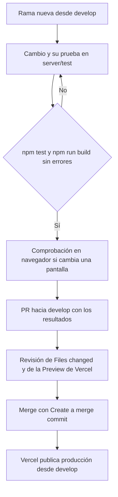

# Plan de Testing y Estrategia de Calidad (QA)

**Proyecto:** Portal Web Institucional IFTS N.º 2  
**Equipo:** 404-Solutions · Prácticas Profesionalizantes IV (IFTS N.º 29)  
**Estado del documento:** Versión 2, 7/11/2026 (reemplaza la versión inicial del 24/10/2026). Documento vivo: se actualiza cuando cambian las pruebas  
**Issues vinculadas:** `#40 [QA-01]`, `#41 [QA-02]`, `#64 [QA-03]`, `#34 [US-05]`, `#39 [US-10]`, `#62 [UI-02]`, `#63 [SETUP-03]`, `#65 [POST-03]`

---

## Contenido

1. [Propósito y enfoque](#1-propósito-y-enfoque)
2. [Arquitectura de pruebas en el repositorio](#2-arquitectura-de-pruebas-en-el-repositorio)
3. [Estado actual de la suite](#3-estado-actual-de-la-suite)
4. [Evolución de la suite](#4-evolución-de-la-suite)
5. [Matrices de casos de prueba](#5-matrices-de-casos-de-prueba)
6. [Comprobaciones en navegador y evidencias](#6-comprobaciones-en-navegador-y-evidencias)
7. [Trabajo futuro](#7-trabajo-futuro)
8. [Ejecución y criterios para PR](#8-ejecución-y-criterios-para-pr)

---

## 1. Propósito y enfoque

Este documento describe cómo se realizan las pruebas del portal, qué funcionalidades se verificaron y qué aspectos quedan pendientes.

El objetivo de las pruebas es que el portal sea **estable** (cada cambio se integra sin romper lo que ya funcionaba) y que los resultados sean **reproducibles** (cualquier integrante obtiene el mismo resultado al ejecutarlas). También incluyen controles de **seguridad**, como los permisos por rol y el bloqueo de inicio de sesión, aunque no garantizan que no haya vulnerabilidades: la sección 7 registra los hallazgos de seguridad pendientes.

En lugar de postergar las pruebas para el cierre del proyecto, el equipo adopta un enfoque de **pruebas continuas y escalonadas** (*Shift-Left Testing*): las pruebas se escriben junto con el desarrollo y la suite crece con cada funcionalidad (sección 4).

El equipo trabaja con estos criterios:

1. **Pruebas junto al desarrollo:** las pruebas no se dejan para el final. Las funcionalidades nuevas se acompañan de pruebas automáticas en el mismo PR. Los cambios visuales y de interacción también se comprueban en navegador.
2. **Sin servicios externos:** `npm test` no necesita MongoDB Atlas, un servidor de correo, Cloudinary ni la API de Meta. En las pruebas, cada servicio externo se reemplaza por un repositorio en memoria o por un servicio simulado (sección 2). La suite completa tarda unos segundos: el 8/11/2026 tardó 5,1 s en la computadora de una integrante (Windows, Node.js 24.15.0) y 20 s en el entorno de revisión (Linux, Node.js 22.22.0).
3. **Datos simulados con la estructura de las respuestas de Instagram:** las publicaciones de prueba se arman dentro de cada archivo con los mismos campos que devuelve la Graph API (`id`, `caption`, `media_type`, `media_url`, `thumbnail_url`, `permalink`, `timestamp`, `children`). Incluyen casos difíciles: carruseles con videos, videos sin miniatura y publicaciones sin archivo descargable.
4. **Comprobaciones en navegador:** en los PR recientes, lo visual se comprobó además con un navegador automatizado, fuera del repositorio (sección 6).

---

## 2. Arquitectura de pruebas en el repositorio

El servidor recibe sus dependencias como parámetros en `crearApp({ config, usuarios, eventos, correo, fotosEventos, buscarFotoDeInstagram, horarios, llamados, mesas, contenido, hoy, ... })` (`server/src/app.js`). En producción, `server.js` (local) y `api/index.js` (Vercel) le pasan los repositorios de MongoDB que arma `server/src/arranque.js`. En las pruebas se le pasan repositorios en memoria y servicios simulados.

En la tabla, las rutas de archivos son relativas a `server/src/`, salvo `server/test/ayuda.js`.

| Componente | En producción / Preview | En la suite de pruebas (`npm test`) |
| :--- | :--- | :--- |
| **Ejecutor y aserciones** | — | `node:test` + `node:assert/strict` + `supertest`; `t.mock` de `node:test` para simular o silenciar funciones |
| **App de prueba** | `crearApp` con los repositorios de `arranque.js` | `appDePrueba()` de `server/test/ayuda.js`: repositorio de usuarios en memoria con un Administrador y un usuario de Bedelía, y bcrypt con costo 4 para que las pruebas sean rápidas |
| **Persistencia de datos** | MongoDB Atlas (`repos/*.mongo.js`) | Repositorios en memoria (`repos/*.memoria.js`): usuarios, eventos, académica, publicaciones, contenido y convocatorias |
| **Feed y estado de Instagram** | Colección `InstagramSync` en MongoDB (`services/instagram/feed.js`) | Objeto `repoFeed` simulado en cada prueba (`loadFeed`, `saveFeed`, `loadDeletedPostIds`, `loadSyncStatus`, `saveSyncStatus`) |
| **Envío de correos** | Nodemailer por SMTP, Gmail por defecto (`services/correo.smtp.js`) | Correo simulado (`services/correo.memoria.js`) o transporte falso inyectado en `crearCorreoSmtp(config, { transporte })` |
| **Fotos de eventos cargadas desde el panel** | Cloudinary, carpeta `ifts2/eventos` (`services/media/fotosEventos.js`) | Servicio `fotosEventos` simulado que registra subidas y borrados, y puede fallar a pedido |
| **Foto de una publicación de Instagram cargada con su enlace** | `crearBuscadorDeFoto()` (`services/instagram/fotoDePublicacion.js`): lee la página pública de la publicación y descarga la imagen | `buscarFotoDeInstagram` simulado en `crearApp`, o `crearBuscadorDeFoto({ fetch })` con respuestas armadas en la prueba |
| **Archivos de la sincronización con Instagram** | Cloudinary, carpeta `ifts2/instagram` (`services/media/cloudinary.js`) | `mediaService.guardarMedioDeInstagram` simulado; las opciones de subida se prueban con `opcionesDeSubidaDeInstagram` |
| **API de Instagram** | Meta Graph API `v26.0` (`services/instagram/meta.js`) | `fetchFn` inyectado en `sincronizarInstagram`, que devuelve respuestas armadas en la prueba |
| **Fecha del día** | `diaEnArgentina()` (`services/archivo.js`) | Parámetro `hoy` de `crearApp`, fijado en cada prueba |
| **Configuración** | `leerConfig()` lee `process.env` (`config.js`) | `leerConfig({})` con un objeto armado en la prueba |

Notas:

- `dotenv` se carga en `server.js`, `server/src/index.js` y `server/scripts/seed-admin.js`. Ningún archivo de prueba los importa, así que las pruebas no leen `.env`.
- Algunas pruebas importan módulos del cliente sin React (`client/src/eventos.js`, `ingreso.js`, `confirmaciones.js`, `documentos.js`, `academica.js`, entre otros) y prueban su lógica directamente.
- Otras leen el código fuente del cliente y del servidor y controlan su texto con expresiones regulares (por ejemplo, que no haya fechas escritas a mano, estilos en línea o voseo en los mensajes del sistema). No reemplazan una comprobación en navegador.
- La carpeta `server/test/fixtures/` contiene `instagram-seed.json`, pero ninguna prueba lo lee (sección 7).

---

## 3. Estado actual de la suite

Medición sobre `develop` (commit `c898dfe`, con el PR #139 integrado): **548 pruebas en 41 archivos `server/test/*.test.js`, 548 aprobadas, 0 fallidas**. El conteo por archivo es el que informa `node --test` al ejecutar cada archivo por separado; la suma coincide con el total de `npm test`. En `permisos.test.js`, 7 llamadas a `test(` dentro de recorridos por las rutas generan 141 pruebas.

| Módulo | Archivo (pruebas) | Cobertura |
| :--- | :--- | :--- |
| **Autenticación y usuarios** (33) | `auth.test.js` (12), `usuarios.test.js` (18), `passwords.test.js` (3) | Login con JWT, bloqueo por cuenta tras 5 intentos fallidos, ABM de usuarios solo para Administración y política de contraseñas con hash |
| **Contacto y correo** (44) | `contacto.test.js` (14), `contacto.limite.test.js` (10), `correo.mensaje.test.js` (9), `correo.smtp.test.js` (11) | Validación del formulario, honeypot, límite de envíos por visitante, destinatarios según el motivo y envío por SMTP con sus errores |
| **Eventos** (108) | `eventos.test.js` (8), `eventos.edicion.test.js` (10), `eventos.formulario.test.js` (11), `eventos.fotos.test.js` (15), `eventos.galeria.test.js` (26), `eventos.instagram.test.js` (18), `eventos.sitio.test.js` (16), `visor.test.js` (4) | Alta, edición, ocultar y mostrar; subida de fotos a Cloudinary con limpieza ante errores; edición de la galería (hasta 20 fotos); alta con el enlace de una publicación de Instagram; tarjetas, detalle, agrupación por año y visor de fotos |
| **Instagram** (44) | `instagram.test.js` (19), `instagram.sincronizacion.test.js` (12), `instagram.sin-conexion.test.js` (7), `instagram.bloque.test.js` (6) | Título y descripción de cada publicación, clasificación por `#eventosIFTS2`, sincronización con reintentos y prevención de subidas y eventos duplicados, bloqueo sin credenciales y textos del estado en el panel |
| **Información académica: horarios** (28) | `academica.test.js` (22), `alumnos.test.js` (6) | Carga, publicación, retiro y reutilización de períodos, PDF público y de vista previa, filtros por año y turno en Alumnos y documentos de prácticas |
| **Mesas de examen** (25) | `mesas.test.js` (19), `mesas.panel.test.js` (3), `mesas.celular.test.js` (3) | Llamados y mesas, publicación como copia, anuncios sin mesas, PDF, permisos, textos del panel y tabla accesible en celular |
| **Archivado y avisos de vigencia** (17) | `archivo.test.js` (12), `finalizados.test.js` (5) | Archivado por fecha sin borrar (eventos, horarios y mesas), «Mostrar en el sitio», aviso de período anterior y de turno finalizado |
| **Ingreso** (31) | `ingreso.test.js` (24), `ingreso.historial.test.js` (7) | Convocatoria editable con validaciones, estado de la preinscripción, cronograma, preguntas frecuentes e historial de convocatorias |
| **Contenido institucional, carrera y plan** (39) | `contenido.test.js` (10), `contenido.cliente.test.js` (7), `plan.test.js` (17), `enlaces.test.js` (5) | Secciones editables con permisos y validación, carga en el cliente, plan de estudios contra la resolución, documentos y enlaces útiles |
| **Permisos por rol** (141) | `permisos.test.js` (141) | Recorre todas las rutas de la API sin sesión, con Bedelía y con Administración, y comprueba que el servidor rechace con 401 o 403 solo lo que corresponde. Es la tabla de `docs/matriz-de-permisos.md` |
| **Panel e inicio** (15) | `admin.inicio.test.js` (8), `confirmaciones.test.js` (7) | Inicio del panel con datos reales por perfil y ventanas de confirmación propias del panel |
| **Textos y otros** (23) | `textos.test.js` (4), `salud.test.js` (2), `config.test.js` (5), `arranque.test.js` (7), `seed.test.js` (2), `publicacion.test.js` (3) | Criterio de los textos (sin voseo en los mensajes del sistema, «N.º», hora en 24 h); `/api/salud` y 404 en JSON; dirección del sitio y detección de Vercel; arranque sin memoria en producción; administrador inicial; archivos que se publican en Vercel |
| **Total** | **41 archivos** | **548 pruebas** |

---

## 4. Evolución de la suite

### 4.1. Línea base (Sprint 1): 81 pruebas

La versión inicial de este documento (24/10) registró 81 pruebas en 9 archivos. Ese total se alcanzó al integrar el PR #58 (22/10):

- `salud.test.js` (PR #53): `/api/salud` y rutas inexistentes con 404 en JSON.
- `auth.test.js`, `usuarios.test.js`, `passwords.test.js` (PR #54): login con JWT; el mismo mensaje para un correo inexistente y para una contraseña incorrecta; bloqueo por cuenta al quinto intento fallido, que no se saltea cambiando `X-Forwarded-For`; ABM de `/api/users` solo para Administración (403 para Bedelía); prohibición de eliminarse a sí mismo o cambiarse el propio rol, con lo que siempre queda al menos un administrador; política de contraseñas (8 o más caracteres, con una mayúscula y un número) y hash con `bcryptjs`.
- `seed.test.js` (PR #57): comprueba que `asegurarAdminInicial()` (`server/src/services/seed.js`) crea el administrador inicial cuando la base está vacía y están cargadas las variables `SEED_ADMIN_*`, y que sin ellas no crea ningún usuario. No prueba el script `server/scripts/seed-admin.js`, que todavía tiene credenciales de reserva (sección 7).
- `contacto.test.js`, `contacto.limite.test.js`, `correo.mensaje.test.js`, `correo.smtp.test.js` (PR #58): validaciones del formulario, honeypot, límite de envíos y armado y envío del correo.

### 4.2. PR integrados después de la línea base

Total de pruebas en `develop` después de cada merge. La diferencia entre filas es neta: algunos PR también modificaron pruebas existentes.

| Tema | PR (fecha del merge) | Total después del merge |
| :--- | :--- | :---: |
| Parser y sincronización de Instagram (`instagram.test.js`) | #67 (25/10) | 93 |
| CRUD de eventos (`eventos.test.js`) | #71 (25/10) | 101 |
| Horarios, arranque y configuración (`academica`, `arranque`, `config`) | #77 (25/10; integrado con un merge manual en `develop`) | 133 |
| Fotos de eventos en Cloudinary (`eventos.fotos`) | #80 (26/10) | 150 |
| Edición de eventos y de sus fotos (`eventos.edicion`, `eventos.formulario`, `eventos.galeria`) | #82, #83 (26/10) | 165, 197 |
| Confirmaciones del panel | #85 (26/10) | 204 |
| Visor de fotos del detalle | #87 (27/10) | 208 |
| Sincronización de Instagram: reintentos, estado y sin credenciales | #88 (30/10), #89, #90 (31/10) | 217, 223, 230 |
| Inicio del panel con datos reales | #92 (31/10) | 235 |
| Mesas de examen | #93 (31/10) | 260 |
| Enlaces útiles | #95 (1/11) | 265 |
| Contenido institucional | #96 (1/11) | 282 |
| Plan de estudios | #97 (1/11), #98 (2/11) | 294, 298 |
| Eventos por año | #99 (2/11) | 314 |
| Ingreso editable, convocatoria anterior y panel de ingreso | #100, #101, #102 (2/11) | 325, 327, 338 |
| Documentos de la carrera publicados en Vercel | #103 (2/11) | 342 |
| Alumnos: «Todos los años» y documentos de prácticas | #104 (3/11) | 348 |
| Archivado por fecha | #105 (3/11) | 360 |
| Historial de convocatorias de ingreso | #106 (3/11) | 367 |
| Avisos de período anterior y turno finalizado | #107 (3/11) | 372 |
| Mesas en celular | #108 (3/11) | 375 |
| Matriz de permisos por rol (`permisos.test.js`) | #114 (4/11) | 516 |
| Alta de eventos con el enlace de una publicación de Instagram (`eventos.instagram.test.js`) | #133 (7/11) | 532 |
| Título y descripción de las publicaciones sincronizadas (CP-IG-04 actualizado, CP-IG-13 a CP-IG-19) | #134 (7/11) | 540 |
| Eventos repetidos entre la carga con enlace y la sincronización | #135 (7/11) | 544 |
| Corrección de textos y mensajes (`textos.test.js`) | #136 (7/11) | 548 |

Algunos PR no cambiaron el total de pruebas:

- **Hasta el 31/10:** #59, #68, #72 a #76 y #79.
- **4 y 5/11:** #66, #110 a #112, #115 a #122 y #130. Son de documentación, del menú lateral del panel y del cartel de sesión del sitio.
- **6 y 7/11:** #131 (capturas de la base de datos), #132 (Manual Técnico), #137 (aviso de Contacto y pie con la sesión iniciada, comprobado en navegador; sección 6), #138 (esta versión del plan de testing) y #139 (actualización del Manual Técnico).

Todos los totales de esta tabla se midieron ejecutando la suite en el commit de merge de cada PR: desde el #131, el 7/11/2026, y los anteriores, el 8/11/2026. Los números de PR y las fechas se verificaron con el historial de `develop`.

### 4.3. Diferencias con la versión inicial

La versión inicial de este documento planificaba las pruebas por sprint. Esta versión registra lo que efectivamente se hizo. Lo que se había planificado y cambió o no se hizo:

| Planificado en la versión inicial | Situación actual |
| :--- | :--- |
| Publicaciones de prueba tomadas de la cuenta `@proyecto.404solutions.ifts2`, en `server/test/fixtures/instagram-edge-cases.json` | Ese archivo no existe. Las publicaciones de prueba se arman dentro de cada archivo, con la estructura de la Graph API (sección 1). En `server/test/fixtures/` solo está `instagram-seed.json`, que ninguna prueba usa (sección 7). |
| Dos categorías, `#ifts2novedades` e `#ifts2eventos` | Hay una sola categoría, con el hashtag `#eventosIFTS2` (CP-IG-01 a CP-IG-03). |
| Cloudinary con las carpetas `ifts29/events` e `ifts29/instagram`, transformaciones `q_auto,f_auto` y miniatura de video generada | Las carpetas son `ifts2/eventos` e `ifts2/instagram`. Las fotos cargadas desde el panel se achican en el navegador antes de enviarlas (`client/src/fotos.js`: lado mayor de hasta 1600 px; una foto chica y liviana se envía tal cual). Las fotos que vienen de Instagram se guardan sin recomprimir. Las direcciones que usa el sitio no aplican las transformaciones `q_auto,f_auto`. Un video sin miniatura muestra la imagen de reemplazo (CP-IG-07). |
| Detalle del evento en una ventana (modal) con desplazamiento | El detalle es una página (`/eventos/:id`) con un visor de fotos (CP-IG-04 y CP-IG-05). |
| Sincronización con respuestas 401, 429 y tiempo de espera agotado | Se prueban el error 190 y la falta de credenciales. Las respuestas 401 y 429, los cortes de conexión y los tiempos de espera agotados siguen sin pruebas específicas (CP-IG-10 y sección 7). |
| Papelera y restauración con `PUT /api/posts/:id/restore` | No se implementó: queda como trabajo futuro (#65, CP-IG-11). Ocultar y mostrar eventos desde el panel cumple una función parecida. |
| Pruebas de extremo a extremo de los carruseles en el navegador | Se hicieron comprobaciones en navegador durante los PR, fuera del repositorio (sección 6). Pasarlas al repositorio queda como trabajo futuro. |
| `auth.test.js`: resistencia a la enumeración de usuarios por tiempos de respuesta | Las pruebas comprueban que un correo inexistente y una contraseña incorrecta reciben el mismo mensaje. No miden tiempos de respuesta. |
| Commits de pruebas con el formato `test(alcance): descripción` | El equipo pasó a títulos en español que empiezan con un verbo (sección 8). |
| QA-01 con capturas de la ejecución en consola | La captura está en el reporte de pruebas, sección 1 (`docs/img-pruebas/npm-test-resultado.png`). |

---

## 5. Matrices de casos de prueba

Las matrices reúnen los principales casos de prueba. No enumeran una por una las 548 pruebas automáticas de la suite: un caso puede abarcar varias pruebas, y no todas las pruebas tienen un código CP propio.

Valores de la columna **Estado**:

- **Automatizada (archivo):** la cubre una prueba de `npm test`.
- **Comprobada en navegador:** se comprobó con el navegador automatizado durante el PR indicado (sección 6). No es repetible desde el repositorio.
- **Pendiente:** el código lo hace, pero no hay prueba automatizada ni evidencia registrada.
- **Trabajo futuro:** el código todavía no lo hace.

### 5.1. Instagram, eventos y multimedia (CP-IG)

| Caso de prueba | Entrada / estímulo | Resultado esperado (según el código) | Estado |
| :--- | :--- | :--- | :--- |
| **CP-IG-01**<br>Publicación estándar con imagen<br>Issue: `#64` | Texto con título en la primera línea, cuerpo y `#eventosIFTS2 #gastronomia` | `parseCaption` toma la primera línea como título y el cuerpo como descripción y resumen; separa los hashtags del texto; `classifyPosts` devuelve `["eventos"]`; `formatMonthYear` devuelve «Mayo 2026» | Automatizada (`instagram.test.js`) |
| **CP-IG-02**<br>Publicación sin texto<br>Issue: `#64` | `caption: null` o `""` | No lanza excepción; título «Publicación Institucional», resumen vacío y sin categorías. Sin `#eventosIFTS2`, la sincronización no la importa. Sin fecha, `formatMonthYear` devuelve «Reciente» | Automatizada (`instagram.test.js`) |
| **CP-IG-03**<br>Publicación con solo el hashtag<br>Issue: `#64` | `caption: "#eventosIFTS2"` | Título «Publicación Institucional», resumen vacío y categoría `["eventos"]`. Hay una sola categoría: no existe `#ifts2novedades` | Automatizada (`instagram.test.js`) |
| **CP-IG-04**<br>Texto extremo sin saltos de línea<br>Issue: `#62`, `#64` | 2.500 caracteres seguidos más `#eventosIFTS2` | El parser lo procesa sin bloquearse. El título se acorta a 100 caracteres y termina en «…»; la descripción conserva el texto completo; el resumen se corta en 110 caracteres más «...». En la tarjeta, título y resumen se limitan a 2 líneas (`-webkit-line-clamp: 2` en `styles.css`). El detalle es una página (`/eventos/:id`), no un modal | Parser: Automatizada (`instagram.test.js`). Tarjeta: Pendiente |
| **CP-IG-05**<br>Carrusel (`CAROUSEL_ALBUM`) con varias fotos<br>Issue: `#62`, `#64` | Publicación con 4 imágenes en `children` | Se guardan los 4 medios (`mediaCount: 4`), cada uno con nombre fijo `<id>_<n>_<idHijo>` en `ifts2/instagram`. El visor del detalle recorre las fotos con anterior y siguiente, vuelve a la primera después de la última y muestra la posición como «2 de 4» | Automatizada (`instagram.test.js`, `instagram.sincronizacion.test.js`, `visor.test.js`). Visor: Comprobada en navegador (PR #87) |
| **CP-IG-06**<br>Medio que falta o que no carga<br>Issue: `#62`, `#64` | a) Carrusel con un archivo sin `media_url` o cuya subida falla. b) En el sitio, una foto que no carga | a) La publicación no se importa incompleta: queda pendiente y la sincronización siguiente sube solo lo que faltaba. b) Se muestra la imagen de reemplazo `placeholder.svg` y esa foto deja de ofrecerse en el visor. Pedir a la ruta `/media/instagram/` un archivo inexistente devuelve la misma imagen | a) Automatizada (`instagram.sincronizacion.test.js`). Ruta: Automatizada (`instagram.test.js`). b) Comprobada en navegador (PR #87) |
| **CP-IG-07**<br>Video sin miniatura<br>Issue: `#63`, `#64` | `media_type: "VIDEO"`, `thumbnail_url: null` | `localThumbnail` queda en la imagen de reemplazo (`placeholder.svg`). No se genera miniatura con Cloudinary. Un video sin archivo descargable y con enlace a Instagram se importa como publicación incrustada | Automatizada (`instagram.test.js`, `instagram.sincronizacion.test.js`) |
| **CP-IG-08**<br>Publicación repetida<br>Issue: `#64`, `#39` | a) Lista con el mismo `id` o el mismo `permalink`; segunda sincronización de la misma publicación. b) Publicación cargada a mano con su enlace y después sincronizada, o al revés; el enlace guardado puede tener otra forma (con o sin `www`, con parámetros, `/p/` o `/reel/`) | a) `deduplicateFeed` conserva una sola instancia; la segunda sincronización no descarga ni sube archivos y no crea un segundo evento. b) La sincronización no importa una publicación que ya tiene evento, aunque esté oculto, y no descarga sus archivos (también con publicaciones guardadas de sincronizaciones anteriores). La carga con enlace responde 409 «Ya existe un evento con esta publicación de Instagram: «…». Se puede editar desde la lista de eventos.» sin descargar ni subir fotos | Automatizada (`instagram.test.js`, `instagram.sincronizacion.test.js`, `eventos.edicion.test.js`, `eventos.instagram.test.js`) |
| **CP-IG-09**<br>Evento de Instagram que la Administración no quiere mostrar<br>Issue: `#64`, `#39` | Evento importado, editado y ocultado desde el panel; nueva sincronización | El evento no se duplica, conserva el título editado (`editadoPorAdmin: true`) y sigue oculto. La sincronización también omite los ids de la lista de excluidos del feed, pero ningún botón del panel carga esa lista: el descarte con papelera es trabajo futuro (#65) | Automatizada (`eventos.edicion.test.js`; lista de excluidos en `instagram.test.js`) |
| **CP-IG-10**<br>Error de la API de Meta o sin credenciales<br>Issue: `#39`, `#40` | a) Graph API responde 400 con código 190 (token vencido). b) Faltan el token o el id de la cuenta | a) `sincronizarInstagram` devuelve `success: false` con el mensaje de Meta y conserva el feed existente. Cuando el estado guardado es «error», el panel muestra «Error de sincronización» con la última sincronización correcta. b) Responde 503 sin consultar Instagram ni crear eventos. La carga manual de eventos no depende de la sincronización (contingencia, RF13) | **Automatizada:** respuesta controlada ante el error 190 y feed conservado (`instagram.test.js`); texto del panel con el estado «error» (`instagram.bloque.test.js`); 503 sin credenciales (`instagram.sin-conexion.test.js`). **Pendiente:** respuestas 401 y 429, cortes de conexión, tiempos de espera agotados, que se guarde el estado «error» y la respuesta 502 de `POST /api/instagram/sync` |
| **CP-IG-11**<br>Restaurar desde la papelera<br>Issue: `#65` | Restaurar una publicación descartada | No existe papelera ni ruta de restauración (`PUT /api/posts/:id/restore` no existe). Hoy, ocultar y mostrar un evento desde el panel cumple una función parecida (CP-EVE-08 y CP-IG-09) | Trabajo futuro |
| **CP-IG-12**<br>Permisos de la sincronización<br>Issue: `#39` | `POST /api/instagram/sync` sin sesión, con Bedelía y con Administración | 401 sin sesión, 403 con Bedelía; con Administración pasa la autorización (en la prueba responde 503 porque no hay credenciales) | Automatizada (`instagram.test.js`) |
| **CP-IG-13**<br>Título y descripción en renglones seguidos<br>Issue: `#39` | «Jornada de cocina saludable↵Participaron estudiantes…↵También asistieron…» | El primer renglón es el título; la descripción conserva los otros renglones y sus saltos de línea | Automatizada (`instagram.test.js`) |
| **CP-IG-14**<br>Texto sin título ni puntuación<br>Issue: `#39` | Una sola oración larga sin punto | El título se acorta en una palabra, hasta 100 caracteres y con «…»; la descripción conserva el texto completo | Automatizada (`instagram.test.js`) |
| **CP-IG-15**<br>Título en la primera oración<br>Issue: `#39` | «Muestra de fin de año. Los alumnos…»; «¡Inscripciones abiertas para 2027! 🎓 …»; «…con la Lic. Gómez. …»; «Llegó el verano... y la feria…» | El título es la primera oración, sin el punto final. No corta en una abreviatura («Lic.») ni en puntos suspensivos seguidos de minúscula; un punto seguido de minúscula sí termina la oración | Automatizada (`instagram.test.js`) |
| **CP-IG-16**<br>Renglones que parecen vacíos<br>Issue: `#39` | Renglones con caracteres invisibles (U+2800, ancho cero), separadores («.») o solo emojis | Se tratan como renglones vacíos: no quedan como título ni en la descripción | Automatizada (`instagram.test.js`) |
| **CP-IG-17**<br>Primer renglón muy largo<br>Issue: `#39` | Primer renglón de más de 100 caracteres y un segundo renglón | El título se acorta con «…»; la descripción conserva todos los renglones y todas las palabras. Si el corte cae en un emoji, no lo parte | Automatizada (`instagram.test.js`) |
| **CP-IG-18**<br>Signos al final del título<br>Issue: `#39` | Títulos que terminan en «:», «.», un emoji, «!», «?» o «...» | Se eliminan el punto, los dos puntos y el emoji del final del título; se conservan «!», «?» y «...» | Automatizada (`instagram.test.js`) |
| **CP-IG-19**<br>Hashtags dentro del texto<br>Issue: `#39` | «Feria #eventosIFTS2 de panes artesanales↵↵Vení a probar. #gastronomia #ifts2» | Los hashtags no quedan en el título ni en la descripción, no dejan espacios dobles y se guardan aparte | Automatizada (`instagram.test.js`) |

Observaciones:

- `GET /api/instagram/feed` existe y tiene prueba, pero el sitio no lo usa: Inicio y Eventos leen `/api/events` (`client/src/useEventos.js`).
- La sincronización guarda el título, la descripción completa sin hashtags y el texto original de la publicación (`instagram.sincronizacion.test.js`). Si el título queda mal, se corrige desde la edición del evento.
- CP-IG-04 y CP-IG-14: el título de una publicación sincronizada tiene como máximo 100 caracteres. En cambio, un evento cargado a mano desde el panel no tiene límite de largo en el servidor (hallazgo H-68 del registro de QA).

### 5.2. Horarios (CP-HOR)

| Caso de prueba | Entrada | Resultado esperado | Estado |
| :--- | :--- | :--- | :--- |
| **CP-HOR-01**<br>Validación de un horario | Materia vacía, año 4, cuatrimestre 3, turno inexistente, sin días, hora «18», fin antes del inicio o día repetido | `validarHorario` devuelve un mensaje específico para cada caso | Automatizada (`academica.test.js`) |
| **CP-HOR-02**<br>Permisos del panel | Rutas de `/api/academic/periodos` y `/horarios` sin sesión; luego con Administración y con Bedelía | 401 sin sesión; los dos perfiles cargan (201) y publican (200) | Automatizada (`academica.test.js`) |
| **CP-HOR-03**<br>Guardar no cambia lo publicado | Período publicado; se cambia el docente | El sitio sigue mostrando el docente anterior; «Ver cambios» informa Docente: anterior → nuevo; al volver a publicar se actualiza | Automatizada (`academica.test.js`) |
| **CP-HOR-04**<br>Publicar un período vacío o mal escrito | Publicar `2026-1` sin materias; período `2026-3` | 400 «El 1.º cuatrimestre 2026 no tiene horarios cargados para publicar.»; 400 para el período inválido | Automatizada (`academica.test.js`) |
| **CP-HOR-05**<br>Retirar un período | Retirar uno publicado; retirar uno no publicado | Los alumnos dejan de verlo y no se borra nada; retirar sin publicar responde 409; volver a publicar toma lo último guardado | Automatizada (`academica.test.js`) |
| **CP-HOR-06**<br>Reutilizar un período | Reutilizar `2026-1` en `2027-1` | 201 con `{ agregadas: 2, yaEstaban: 0 }`; las materias quedan como datos de trabajo, sin publicar; reutilizar dos veces no duplica | Automatizada (`academica.test.js`) |
| **CP-HOR-07**<br>PDF público | `GET /api/academic/vigente/horarios.pdf?periodo=2026-1` antes de publicar, publicado y retirado | 404, 200 con `application/pdf` armado desde lo publicado, y 404 | Automatizada (`academica.test.js`) |
| **CP-HOR-08**<br>PDF de vista previa | Pedido con sesión de Bedelía y sin sesión | Con sesión: PDF de los datos de trabajo con la marca «Vista previa». Sin sesión: 401 | Automatizada (`academica.test.js`) |

### 5.3. Mesas de examen (CP-MES)

| Caso de prueba | Entrada | Resultado esperado | Estado |
| :--- | :--- | :--- | :--- |
| **CP-MES-01**<br>Validación de un llamado | Sin nombre; nombre de 61 caracteres; fecha `2027-02-30`; cierre anterior al inicio | Solo el nombre es obligatorio; cada error devuelve su mensaje | Automatizada (`mesas.test.js`) |
| **CP-MES-02**<br>Nombre de llamado repetido | «febrero 2027» o «FEBRERO  2027» cuando ya existe «Febrero 2027» | 409 «Ya existe un llamado con el nombre…». Si MongoDB rechaza un nombre repetido por su índice único, el servidor también responde 409 (comprobado con un error `E11000` simulado, sin una base MongoDB real) | Automatizada (`mesas.test.js`) |
| **CP-MES-03**<br>Guardar no cambia lo publicado | Llamado publicado; se cambia fecha, hora y aviso y se agrega una mesa | El sitio muestra la versión publicada; «Ver cambios» lista cada cambio; al actualizar, las mesas quedan ordenadas por fecha | Automatizada (`mesas.test.js`) |
| **CP-MES-04**<br>Llamado sin mesas | Publicar un llamado con nombre y fecha de inicio, sin mesas | Se publica como anuncio, con la lista de mesas vacía | Automatizada (`mesas.test.js`) |
| **CP-MES-05**<br>Retirar un llamado | Retirar uno publicado y luego intentar eliminarlo | Deja de verse y conserva la copia; eliminarlo responde 409 «Este llamado ya se publicó: se conserva aunque se haya retirado.» | Automatizada (`mesas.test.js`) |
| **CP-MES-06**<br>Falla al eliminar un llamado | Falla la baja de una de sus mesas | Responde 500 y el llamado sigue; al reintentar responde 204 y no quedan mesas | Automatizada (`mesas.test.js`) |
| **CP-MES-07**<br>PDF público | Sin parámetro, llamado sin publicar, publicado y retirado | 400, 404, 200 con `application/pdf` y 404 | Automatizada (`mesas.test.js`) |
| **CP-MES-08**<br>Permisos | Rutas del panel sin sesión; Bedelía crea y publica | 401 sin sesión; Bedelía puede todo lo de mesas | Automatizada (`mesas.test.js`) |

### 5.4. Archivado y avisos de vigencia (CP-ARC, RF12)

| Caso de prueba | Entrada | Resultado esperado | Estado |
| :--- | :--- | :--- | :--- |
| **CP-ARC-01**<br>Archivado de eventos por año | Hoy 3/11/2026; eventos de 2026, 2025 y 2024; uno del 1/1/2025 a las 01:00 UTC | Se archivan los de hace dos años o más. El año se mide en Argentina: el de 01:00 UTC es del 31/12/2024 y se archiva. Sin fecha válida no se archiva | Automatizada (`archivo.test.js`) |
| **CP-ARC-02**<br>Evento archivado en el sitio y en el panel | `GET /api/events`, `GET /api/events/3` y `GET /api/events/admin` | El sitio no lo lista y el enlace directo responde 404; el panel lo muestra con `archivado: true`; la base no cambia | Automatizada (`archivo.test.js`) |
| **CP-ARC-03**<br>«Mostrar en el sitio» | `PATCH /api/events/:id/visible-siempre` con Bedelía, con un valor no booleano y con Administración | 403, 400 y 200; el evento archivado vuelve a verse. Un evento oculto no aparece salvo que se envíe también `mostrar: true` | Automatizada (`archivo.test.js`) |
| **CP-ARC-04**<br>Horarios archivados | Hoy 3/11/2026; publicados 2025-2, 2026-1 y 2026-2 | Alumnos ve 2026-2 y 2026-1; el PDF de 2025-2 responde 404; el panel lo marca archivado y conserva su vista previa | Automatizada (`archivo.test.js`) |
| **CP-ARC-05**<br>Retirar el período más reciente | Hoy 1/3/2027; se retira 2026-2 | No reaparece 2026-1, que ya estaba archivado; Alumnos queda sin horarios hasta una nueva publicación | Automatizada (`archivo.test.js`) |
| **CP-ARC-06**<br>Mesas archivadas | Llamado de julio con última mesa el 4/8 | Se ve el 3/9 (día 30) y sale del sitio el 4/9 (día 31); un llamado sin fechas no se archiva | Automatizada (`archivo.test.js`) |
| **CP-ARC-07**<br>Período anterior y turno finalizado | 1.º cuatrimestre el 31/7 y el 1/8; turno con última mesa el 4/8; turno con una mesa sin fecha | El período es «anterior» desde el 1/8; el turno finaliza el 5/8; con una mesa «A confirmar» no finaliza | Automatizada (`finalizados.test.js`) |
| **CP-ARC-08**<br>Avisos en Alumnos | Hoy 20/8/2026; períodos y llamados publicados | `/api/academic/vigente` marca 2026-1 como `anterior` y «Julio 2026» como `finalizado`, calculados con la fecha del día | Automatizada (`finalizados.test.js`) |

### 5.5. Ingreso (CP-ING)

| Caso de prueba | Entrada | Resultado esperado | Estado |
| :--- | :--- | :--- | :--- |
| **CP-ING-01**<br>Sin datos guardados | `GET /api/content` con la base vacía | Etapas de modelo sin fechas, convocatoria vacía, `inicial: true` y 5 preguntas frecuentes en su propia sección | Automatizada (`ingreso.test.js`) |
| **CP-ING-02**<br>Guardar la convocatoria | `PUT /api/content/ingreso` con Bedelía y con Administración | 403 para Bedelía; 200 para Administración, el sitio la ve y el correo queda en minúsculas | Automatizada (`ingreso.test.js`) |
| **CP-ING-03**<br>Validación de fechas | `2026-02-30`, `08/06/2026`, cierre anterior al inicio, inicio y cierre el mismo día | Las tres primeras dan error con el nombre de la etapa; el mismo día es válido | Automatizada (`ingreso.test.js`) |
| **CP-ING-04**<br>Formato de la convocatoria | «2° cuatrimestre 2026», «Segundo cuatrimestre 2026», «2026» | Error «Elegir el cuatrimestre y el año de la convocatoria.». Se acepta «1.º cuatrimestre AAAA» o «2.º cuatrimestre AAAA». El campo puede quedar vacío si no hay fechas cargadas | Automatizada (`ingreso.test.js`) |
| **CP-ING-05**<br>Enlaces de las etapas | `http://…`, `javascript:alert(1)`, dirección sin esquema; texto sin dirección | Error: la dirección tiene que empezar con `https://`; texto y dirección van juntos | Automatizada (`ingreso.test.js`) |
| **CP-ING-06**<br>Estado de la preinscripción | Preinscripción del 8/6 al 28/7/2026, consultada el 7/6, 8/6, 28/7 y 29/7 | Próxima, abierta (también el primer y el último día) y finalizada | Automatizada (`ingreso.test.js`) |
| **CP-ING-07**<br>Historial de convocatorias | Guardar 2.º cuatrimestre 2026, corregirla y después guardar 1.º cuatrimestre 2027 | La corrección no pasa al historial; al cargar la nueva, la anterior se guarda completa, sin las preguntas | Automatizada (`ingreso.historial.test.js`) |
| **CP-ING-08**<br>Fallas y permisos del historial | Falla guardar la copia; consulta sin sesión, con Bedelía y con Administración | Responde 500 y la convocatoria vigente queda como estaba; el historial responde 401, 403 y 200 | Automatizada (`ingreso.historial.test.js`) |

### 5.6. Contacto (CP-CON, RF07)

| Caso de prueba | Entrada | Resultado esperado | Estado |
| :--- | :--- | :--- | :--- |
| **CP-CON-01**<br>Consulta válida | `POST /api/contact` con nombre, correo, motivo «inscripcion» y mensaje | 200 y un envío | Automatizada (`contacto.test.js`) |
| **CP-CON-02**<br>Campos obligatorios | Nombre, correo o mensaje con solo espacios | 400 y ningún envío | Automatizada (`contacto.test.js`) |
| **CP-CON-03**<br>Correo con formato inválido | `lucia@correo` | 400 «El correo no tiene un formato válido.» | Automatizada (`contacto.test.js`) |
| **CP-CON-04**<br>Honeypot | Campo oculto `sitioWeb` con contenido | 200 sin enviar nada | Automatizada (`contacto.test.js`) |
| **CP-CON-05**<br>Límite de envíos | Con un máximo de 3 en la prueba: 3 envíos y un cuarto; también 3 rechazos por validación | El cuarto responde 429; los rechazos también gastan el cupo; cambiar `X-Forwarded-For` fuera de Vercel no saltea el límite | Automatizada (`contacto.limite.test.js`) |
| **CP-CON-06**<br>Destinatario según el motivo | Motivos administrativos y motivo «otro» | Inscripción, equivalencias, horarios y trámites van a Bedelía con copia a la casilla institucional; «otro» va a la institucional con copia a Bedelía. «Responder a» es el correo de quien consulta | Automatizada (`correo.mensaje.test.js`, `correo.smtp.test.js`) |
| **CP-CON-07**<br>Falla del servidor de correo | El transporte SMTP lanza un error | 502 «No se pudo enviar la consulta. Volver a intentarlo en unos minutos.» | Automatizada (`contacto.test.js`, `correo.smtp.test.js`) |
| **CP-CON-08**<br>Producción sin correo configurado | `produccion: true` sin SMTP | 502: no confirma un envío que no se hizo | Automatizada (`contacto.test.js`) |
| **CP-CON-09**<br>Aviso de una consulta anterior | Se envía una consulta y se empieza a escribir otra; también con un error de teléfono a la vista | El aviso «Consulta enviada…» se quita al escribir o cambiar un campo, incluido el motivo; los avisos de error se mantienen hasta el próximo envío | Comprobada en navegador (PR #137) |

### 5.7. Usuarios y login (CP-USR)

| Caso de prueba | Entrada | Resultado esperado | Estado |
| :--- | :--- | :--- | :--- |
| **CP-USR-01**<br>Login correcto | Correo y contraseña válidos | 200 con token y usuario, sin `passwordHash` | Automatizada (`auth.test.js`) |
| **CP-USR-02**<br>Credenciales incorrectas | Contraseña incorrecta; correo inexistente | 401 con «Quedan 4 intentos antes del bloqueo temporal.»; el mismo mensaje para el correo inexistente | Automatizada (`auth.test.js`) |
| **CP-USR-03**<br>Bloqueo por intentos | 5 intentos fallidos y después la contraseña correcta | 429, también con la contraseña correcta, con el mensaje de 15 minutos; las demás cuentas no se bloquean | Automatizada (`auth.test.js`) |
| **CP-USR-04**<br>Intento de evitar el bloqueo | Otra IP en `X-Forwarded-For` y el correo en mayúsculas | Sigue en 429 | Automatizada (`auth.test.js`) |
| **CP-USR-05**<br>Permisos sobre usuarios | `GET` y `POST /api/users` sin sesión y con Bedelía | 401 y 403 | Automatizada (`usuarios.test.js`) |
| **CP-USR-06**<br>Alta de usuario | Alta válida; alta con un correo existente en mayúsculas | 201, contraseña guardada con hash y el nuevo usuario inicia sesión; 409 para el correo repetido | Automatizada (`usuarios.test.js`) |
| **CP-USR-07**<br>Acciones sobre la propia cuenta | Eliminarse a sí mismo; cambiarse el propio rol; con dos administradores, uno elimina al otro y después intenta eliminarse | 400 al eliminarse o cambiarse el rol a sí mismo; la baja del otro administrador responde 204. Así siempre queda al menos un administrador. El servidor además cuenta los administradores antes de eliminar o cambiar el rol de otro (`server/src/routes/usuarios.js`); esa comprobación no tiene una prueba propia | Automatizada (`usuarios.test.js`), salvo el conteo de administradores: Pendiente |
| **CP-USR-08**<br>Usuario eliminado | Baja de Bedelía y consulta de `/api/auth/yo` con su token | 204 y luego 401 | Automatizada (`usuarios.test.js`) |

### 5.8. Eventos (CP-EVE)

| Caso de prueba | Entrada | Resultado esperado | Estado |
| :--- | :--- | :--- | :--- |
| **CP-EVE-01**<br>Listado público | Eventos visibles, ocultos y en otro estado | `GET /api/events` devuelve solo los visibles y sin conteos internos; `GET /api/events/:id` de uno oculto o inexistente responde 404 | Automatizada (`eventos.test.js`) |
| **CP-EVE-02**<br>Permisos | `POST /api/events` sin sesión y con Bedelía | 401 y 403 | Automatizada (`eventos.test.js`) |
| **CP-EVE-03**<br>Datos obligatorios | Título o descripción vacíos; fecha `fecha-invalida` | 400 con el mensaje del campo | Automatizada (`eventos.test.js`) |
| **CP-EVE-04**<br>Alta con fotos nuevas | Dos fotos `data:image/...` | 201; se suben las dos y el evento guarda solo los enlaces de Cloudinary, sin base64 | Automatizada (`eventos.fotos.test.js`) |
| **CP-EVE-05**<br>Falla de la subida | Falla la subida de la segunda foto | 502; el evento no se guarda y se borra la primera foto subida | Automatizada (`eventos.fotos.test.js`) |
| **CP-EVE-06**<br>Foto no permitida | `data:text/html`, una imagen vacía o una de más de 4 MB | 400 antes de subir nada | Automatizada (`eventos.fotos.test.js`) |
| **CP-EVE-07**<br>Límite de fotos | 21 fotos al cargar y al editar | 400 «hasta 20 fotos» | Automatizada (`eventos.galeria.test.js`) |
| **CP-EVE-08**<br>Ocultar y mostrar | `PATCH /api/events/:id/estado` con `oculto` y luego `visible` | Sale del sitio y vuelve, sin borrarse; el estado `archivado` no se acepta por esta ruta (400) | Automatizada (`eventos.edicion.test.js`) |
| **CP-EVE-09**<br>Enlace de Instagram inválido | Direcciones que no son de una publicación o un reel: con `http://`, con `javascript:` o de otro sitio que contiene «instagram.com» | 400 «El enlace de Instagram no es válido. Debe ser una publicación o un reel, por ejemplo: https://www.instagram.com/p/…»; no guarda, no descarga ni sube nada. El cliente y el servidor usan la misma regla y el mismo mensaje | Automatizada (`eventos.instagram.test.js`) |
| **CP-EVE-10**<br>Enlace válido con parámetros | Enlace de una publicación con `?igsh=…` al final | Se guarda la dirección de la publicación sin los parámetros | Automatizada (`eventos.instagram.test.js`) |
| **CP-EVE-11**<br>Alta con enlace y sin fotos | Enlace de una publicación pública, sin fotos de la computadora | La foto de la publicación se guarda como una foto del panel (`ifts2/eventos`), sin recomprimir. Si no se obtiene, el evento se guarda con la publicación incrustada y el aviso «El evento se guardó, pero no se pudo obtener la imagen. Se intentará mostrar la publicación de Instagram.». Si el evento no se guarda, la foto obtenida se borra | Automatizada (`eventos.instagram.test.js`) |
| **CP-EVE-12**<br>Alta con enlace y con fotos | Enlace más fotos de la computadora; también sin almacenamiento de fotos configurado | Con fotos, no se busca la foto de la publicación. Sin almacenamiento, no se descarga nada y se guarda con el aviso | Automatizada (`eventos.instagram.test.js`) |
| **CP-EVE-13**<br>Tipo de medio y edición posterior | Alta con una y con varias fotos; evento cargado solo con el enlace al que después se le agrega una foto | El tipo de medio sale de las fotos guardadas, no del formulario; el evento se puede editar para agregarle fotos | Automatizada (`eventos.instagram.test.js`) |
| **CP-EVE-14**<br>Búsqueda segura de la foto | Redirecciones, dominios no permitidos, página sin `og:image`, respuesta 404, archivo que no es imagen, tiempo agotado | Solo pide páginas de `instagram.com` e imágenes de los CDN de Instagram; revisa cada redirección antes de seguirla (como máximo 3); reconoce JPG, PNG y WebP por sus primeros bytes; corta a los 8 segundos; ante cualquier falla devuelve `null` sin pedir otras direcciones | Automatizada (`eventos.instagram.test.js`) |

### 5.9. Textos y formatos (CP-TXT)

| Caso de prueba | Entrada | Resultado esperado | Estado |
| :--- | :--- | :--- | :--- |
| **CP-TXT-01**<br>Mensajes del sistema y del panel sin voseo | Código de `client/src`, `server/src` y `client/index.html` | La prueba busca las formas de voseo definidas en su patrón y solo permite los textos públicos de presentación de la carrera incluidos en `VOSEO_PERMITIDO` (`server/test/textos.test.js`). Un texto nuevo con voseo tiene que ser de ese tipo y sumarse a la lista | Automatizada (`textos.test.js`) |
| **CP-TXT-02**<br>«N.º» y ordinales | El mismo código | No aparece el signo de grado en «N.°» ni en ordinales como «1.°» | Automatizada (`textos.test.js`) |
| **CP-TXT-03**<br>Período académico | `{ cicloLectivo: 2027, cuatrimestre: 1 }` en el cliente y en el servidor | «1.º cuatrimestre 2027» en los dos | Automatizada (`textos.test.js`) |
| **CP-TXT-04**<br>Hora de publicación | `2026-11-07T15:42:00Z` y `2026-11-07T23:05:00Z` | 12:42 y 20:05 (hora de Argentina, formato de 24 h), sin «a. m.» ni «p. m.» | Automatizada (`textos.test.js`) |

---

## 6. Comprobaciones en navegador y evidencias

Además de `npm test`, en los PR recientes se hicieron comprobaciones con Playwright en local:

- escritorio (1280 px) y celular simulado (390 px; en algunos PR también 320 px);
- en varios PR, accesibilidad: roles y encabezados de las tablas, textos alternativos y, en las ventanas del panel, foco y teclado;
- en algunos casos, con respuestas de la API simuladas en lugar de datos reales;
- en el PR #137, el aviso de Contacto (CP-CON-09) y el pie de página con la sesión iniciada y sin ella.

**Contenido del repositorio:**

- **Los scripts de Playwright no están en el repositorio**, así que esas comprobaciones no se pueden repetir desde él. Agregar Playwright como dependencia de desarrollo requiere acuerdo del equipo.
- **Las capturas sí están en el repositorio:** `docs/capturas-cruds/` (65 imágenes) y `docs/capturas-manual/`.

**Evidencias de las issues de QA:**

| Issue | Documento | Contenido | Estado |
| :--- | :--- | :--- | :--- |
| `#40 [QA-01]` | `docs/reporte-de-pruebas.md` | Ejecución de `npm test` con el resultado por archivo y casos seleccionados con entrada, salida esperada y salida obtenida | Hecho sobre `develop` en `c898dfe` (8/11/2026, 548 pruebas), con la captura de la ejecución en consola que preveía la versión inicial de este plan |
| `#41 [QA-02]` | `docs/validacion-visual-cruds.md` | Recorrido con capturas de crear, leer, actualizar y eliminar o dar de baja en Usuarios, Horarios, Mesas, Eventos e Ingreso, y permisos del rol Bedelía | Hecho sobre `develop` en `ea8d2cc` (4/11/2026). Las capturas son anteriores a la corrección de textos del PR #136: algunos mensajes del panel pueden verse distintos en el sitio actual |

Para el informe de pruebas se separan tres niveles:

1. pruebas unitarias y de integración (`npm test`), repetibles por cualquier integrante;
2. comprobaciones automáticas en navegador, hechas en los PR recientes y fuera del repositorio;
3. pruebas manuales en el sitio publicado o en la Preview, que se registran solo con lo que efectivamente se miró. Por ejemplo, el 7/11/2026 se envió desde el sitio publicado una consulta con el motivo «Inscripción» y otra con «Horarios y mesas de examen», y las dos llegaron a Bedelía con copia a la casilla institucional (CP-CON-06), con casillas de prueba del equipo.

---

## 7. Trabajo futuro

1. **Papelera y restauración (`#65 [POST-03]`):** no hay ruta para descartar ni para restaurar una publicación. El repositorio del feed ya tiene `deletePostById` y `registerDeletedPostId`, y la sincronización respeta esa lista (CP-IG-09), pero ninguna ruta las usa. Cuando se implemente, se agregan las pruebas de CP-IG-11.
2. **Pruebas de extremo a extremo en el repositorio:** pasar a Playwright las comprobaciones de navegador más importantes (tarjetas y carrusel de Inicio, galería de Eventos, visor, foto que no carga, aviso de Contacto y pie con la sesión iniciada), si el equipo lo aprueba.
3. **Pruebas faltantes detectadas al revisar el código:**
   - sincronización con respuestas 401 y 429 de Meta, cortes de conexión, tiempos de espera agotados, guardado del estado «error» y la respuesta 502 de `POST /api/instagram/sync` (CP-IG-10);
   - tarjeta de evento con un título o un resumen largos (CP-IG-04, parte visual).
4. **Carga de eventos con un enlace real de Instagram:** las pruebas de CP-EVE-11 usan respuestas simuladas. Falta comprobar que se obtiene la foto de una publicación pública real, en un entorno de prueba sin conexión a la base institucional. El resultado depende de Instagram, que puede cambiar cómo responde.
5. **Cargas simultáneas de la misma publicación:** la búsqueda previa evita los eventos repetidos habituales (CP-IG-08), pero dos cargas exactamente al mismo tiempo de la misma publicación (dos administradores, o una carga y una sincronización) podrían crear dos eventos, porque buscar y guardar son dos pasos separados y no hay un índice único. Si pasa, se oculta uno de los dos desde el panel.
6. **Hallazgos de seguridad sin corregir:** el registro de QA tiene abiertos H-60 (`JWT_SECRET` no obligatoria en producción), H-58 (la API pública devuelve datos internos de los eventos), H-75 (`/api/instagram/status` muestra el error de Meta sin sesión) y H-68 (límites de largo). Además, `server/scripts/seed-admin.js` conserva una contraseña de reserva que conviene quitar. Cuando se corrijan, cada arreglo se acompaña de su prueba.
7. **Fixture sin uso:** `server/test/fixtures/instagram-seed.json` no lo lee ninguna prueba y usa el hashtag `#IFTS2Eventos`, que no es el vigente (`#eventosIFTS2`). Se decide si se actualiza y se usa en una prueba o se quita.
8. **Validación visual (QA-02):** volver a sacar las capturas de `docs/validacion-visual-cruds.md` con los textos actuales del panel (PR #136; sección 6).

---

## 8. Ejecución y criterios para PR

### Comandos

Requisito: Node.js 22 o superior. Las dependencias se instalan como indica el `README.md`.

```powershell
# Toda la suite automática (desde la raíz del repositorio)
npm test

# Un solo archivo de pruebas
node --test server/test/instagram.test.js

# Solo las pruebas cuyo nombre coincide con un texto
node --test --test-name-pattern="CP-IG" server/test/instagram.test.js

# Compilación del cliente
npm run build
```

### Reglas para los Pull Requests hacia `develop`

1. **Rama nueva desde `develop` actualizado**, con prefijo según el tipo de cambio (por ejemplo, `feature/`, `fix/` o `docs/`).
2. **Ningún PR rompe las pruebas existentes:** antes de abrirlo, `npm test` y `npm run build` terminan sin errores.
3. **Toda lógica nueva incluye su prueba:** cada endpoint, validación o regla nueva se acompaña de casos correctos y de error en `server/test/`.
4. **Sin secretos ni servicios reales en las pruebas:** las pruebas no leen `.env` ni usan credenciales de Meta, Cloudinary, Gmail o MongoDB Atlas. Los datos de prueba no usan credenciales reales.
5. **Commits:** una frase en español que empieza con un verbo en presente y dice qué cambia («Agrega…», «Corrige…», «Muestra…»). Si el cambio corresponde a un issue, se agrega su número entre paréntesis, por ejemplo `(#37)`.
6. **Título del PR:** si corresponde a un issue, empieza con su código entre corchetes, por ejemplo `[US-04] Adapta las mesas de examen al celular…`. La descripción indica el resultado de `npm test`, el de `npm run build` y las comprobaciones en navegador, separadas de la revisión manual.
7. **Integración:** con la opción «Create a merge commit».

### Flujo de un cambio hasta producción

Cada cambio sigue estos pasos desde que se crea la rama hasta que se publica. Si `npm test` o `npm run build` fallan, el cambio se corrige antes de abrir el PR.



---

Última actualización: 8/11/2026, sobre `develop` en `c898dfe` (con el PR #139 integrado).
