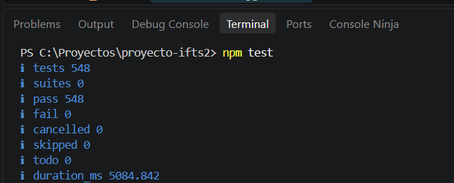

# Reporte de pruebas automáticas

**Proyecto:** Portal Web Institucional IFTS N.º 2, 404-Solutions (IFTS N.º 29, PP4)  
**Issue:** #40 [QA-01]  
**Ejecución documentada con captura:** rama `develop`, commit `c898dfe` (merge del PR #139), 8 de noviembre de 2026. La última repetición, sobre `371c066`, está al final del apartado 1  
**Entorno:** sin conexión a MongoDB Atlas, Cloudinary, Meta ni SMTP (todo con repositorios en memoria y adaptadores simulados, como describe `docs/plan-de-testing.md`)

Este reporte reemplaza al de la ejecución del 4/11/2026 sobre `ea8d2cc` (375 pruebas en 38 archivos). La evolución del total de pruebas, PR por PR, está en el plan de testing (sección 4.2).

 

## 1. Resultado

Se ejecutó `npm test` desde la raíz del repositorio en dos entornos, con el mismo resultado:

| Entorno | Pruebas | Aprobadas | Falladas | Canceladas | Omitidas | Duración |
| :-- | :-: | :-: | :-: | :-: | :-: | :-: |
| Computadora de una integrante (Windows, Node.js 24.15.0) | 548 | 548 | 0 | 0 | 0 | 5,1 s |
| Entorno de revisión (Linux, Node.js 22.22.0) | 548 | 548 | 0 | 0 | 0 | 20 s |

### Captura de la ejecución en consola

Además de la ejecución completa, en el entorno de revisión cada archivo de `server/test/` se ejecutó por separado con `node --test`. Los 41 archivos pasan y la suma de sus pruebas da las mismas 548.

**Ejecución repetida el 8/11/2026 sobre `develop` en `371c066`** (con los PR #140 a #146 integrados; el #144 y el #146 cambiaron la página de Alumnos): 548 pruebas, 548 aprobadas, 0 falladas, en la computadora de una integrante (Windows, Node.js 24.15.0, 5,0 s, sobre el commit `9b7b54c` del PR #146, con el mismo código que `371c066`) y en el entorno de revisión (Linux, Node.js 22.22.0, 23 s). Las comprobaciones de esos dos PR se agregaron dentro de pruebas existentes de la página de Alumnos y de las mesas en celular, por eso el total no cambia.

 

## 2. Pruebas por archivo

| Archivo | Pruebas | Verificación |
| :-- | :-: | :-- |
| `academica.test.js` | 22 | Validación de horarios, publicar/retirar un período, comparar con lo publicado, reutilizar un período anterior y PDF público y de vista previa |
| `admin.inicio.test.js` | 8 | Resumen del inicio del panel: horarios y llamados publicados, actividad reciente, vistas de Administrador y de Bedelía |
| `alumnos.test.js` | 6 | Filtros de año y turno en Horarios de cursada, agrupación por año en «Todos los años», franjas de la página, alto máximo con encabezado fijo y un solo PDF por llamado |
| `archivo.test.js` | 12 | Archivado automático de eventos, horarios y mesas, con fechas de Argentina |
| `arranque.test.js` | 7 | Cuándo se exige MongoDB (producción, Vercel) y cuándo se trabaja en memoria (desarrollo) |
| `auth.test.js` | 12 | Login con JWT, bloqueo tras 5 intentos fallidos, token alterado, correo sin distinguir mayúsculas |
| `config.test.js` | 5 | Dirección del sitio y detección de Vercel |
| `confirmaciones.test.js` | 7 | Ventana propia de confirmación en lugar del `confirm` del navegador |
| `contacto.limite.test.js` | 10 | Límite de envíos del formulario de contacto (429) y uso de la IP en Vercel |
| `contacto.test.js` | 14 | Validaciones del formulario, motivos, teléfono, honeypot y error de envío |
| `contenido.cliente.test.js` | 7 | Autoridades y tutoría en el sitio: orden, iniciales, fecha y consultas |
| `contenido.test.js` | 10 | Contenido institucional editable: permisos, validación y valores iniciales |
| `correo.mensaje.test.js` | 9 | A quién llega cada motivo de consulta y qué dice el correo |
| `correo.smtp.test.js` | 11 | Envío por SMTP, errores y configuración incompleta |
| `enlaces.test.js` | 5 | Enlaces externos: https, pestaña nueva, un solo lugar donde se definen |
| `eventos.edicion.test.js` | 10 | Editar, ocultar y mostrar un evento sin tocar fotos ni origen |
| `eventos.formulario.test.js` | 11 | Fecha del evento a mediodía de Argentina y campos obligatorios |
| `eventos.fotos.test.js` | 15 | Alta con fotos y qué se borra si falla la subida o el guardado |
| `eventos.galeria.test.js` | 26 | Quitar, agregar y reordenar fotos, portada, límite de 20 y videos |
| `eventos.instagram.test.js` | 18 | Alta con el enlace de una publicación de Instagram: enlace válido e inválido, foto de vista previa con límites de seguridad, publicación incrustada si no se obtiene la foto y 409 si la publicación ya tiene evento |
| `eventos.sitio.test.js` | 16 | Tarjetas de eventos en el sitio, direcciones de Instagram aceptadas |
| `eventos.test.js` | 8 | Permisos y validaciones del alta de eventos (401, 403, 400) |
| `finalizados.test.js` | 5 | Marcas de «período terminado» y «turno finalizado», y bloques por año en Eventos |
| `ingreso.historial.test.js` | 7 | Historial de convocatorias de ingreso |
| `ingreso.test.js` | 24 | Convocatoria de ingreso: fechas, etapas, enlaces, video, estado de la preinscripción |
| `instagram.bloque.test.js` | 6 | Estado de la conexión con Instagram que se muestra en el panel |
| `instagram.sin-conexion.test.js` | 7 | Comportamiento sin credenciales de Instagram (503, sin crear eventos) |
| `instagram.sincronizacion.test.js` | 12 | Sincronización: no repite descargas ni crea eventos repetidos (tampoco con publicaciones cargadas a mano con su enlace); las publicaciones incompletas se completan en la sincronización siguiente |
| `instagram.test.js` | 19 | Casos CP-IG del plan de testing: título y descripción de cada publicación, hashtags, álbumes, textos largos, repetidos y errores de Meta |
| `mesas.celular.test.js` | 3 | Fichas de mesas de examen en pantallas de celular |
| `mesas.panel.test.js` | 3 | Textos del panel de mesas y coherencia con el PDF |
| `mesas.test.js` | 19 | Llamados y mesas: alta, edición, baja, publicar, retirar y PDF |
| `passwords.test.js` | 3 | Política de contraseñas y hash |
| `permisos.test.js` | 141 | Todas las rutas de la API sin sesión, con Bedelía y con Administración (401 y 403); tokens alterados o vencidos, y usuarios eliminados o con el rol cambiado |
| `plan.test.js` | 17 | Plan de estudios: 37 instancias contra la resolución, horas y totales |
| `publicacion.test.js` | 3 | Los PDF de `client/public/docs` llegan al build de Vercel |
| `salud.test.js` | 2 | `/api/salud` y rutas inexistentes con 404 en JSON |
| `seed.test.js` | 2 | Administrador inicial, y que no se cree ninguno sin las variables `SEED_ADMIN_*` |
| `textos.test.js` | 4 | Criterio de los textos: sin voseo en los mensajes del sistema, «N.º», «1.º cuatrimestre» y hora en 24 h |
| `usuarios.test.js` | 18 | Alta, edición y baja de usuarios, permisos por rol, protección del último administrador |
| `visor.test.js` | 4 | Visor ampliado de fotos de un evento |
| **Total** | **548** | |

 

## 3. Casos seleccionados con entrada, salida esperada y salida obtenida

Son una muestra de las 548 pruebas, elegida para cubrir la autenticación, los permisos, las operaciones del panel (usuarios, eventos, horarios, mesas e ingreso) y los servicios externos. «Salida obtenida» es el resultado de la ejecución del 8/11 descrita arriba.

| ID | Archivo | Entrada | Salida esperada | Salida obtenida |
| :-- | :-- | :-- | :-- | :-- |
| QA-AUTH-01 | `auth.test.js` | Login con correo y contraseña correctos | Devuelve token y datos del usuario, sin el hash | Aprobado |
| QA-AUTH-02 | `auth.test.js` | Cinco contraseñas incorrectas seguidas y luego la correcta | Quinto intento bloquea; la correcta también se rechaza durante la ventana | Aprobado |
| QA-AUTH-03 | `auth.test.js` | Mismo bloqueo, cambiando la IP declarada o las mayúsculas del correo | El bloqueo se mantiene | Aprobado |
| QA-AUTH-04 | `auth.test.js` | Token con una modificación | Se rechaza (401) | Aprobado |
| QA-PER-01 | `permisos.test.js` | Cada ruta de la API sin sesión, con Bedelía y con Administración | 401 sin sesión y 403 sin el rol que pide la ruta; con el rol correcto, el servidor no la rechaza | Aprobado |
| QA-PER-02 | `permisos.test.js` | Token de un usuario eliminado, todavía vigente | Se rechaza | Aprobado |
| QA-USR-01 | `usuarios.test.js` | Bedelía intenta listar o crear usuarios | 403 | Aprobado |
| QA-USR-02 | `usuarios.test.js` | Administrador da de alta un usuario | Se guarda con hash y ese usuario puede iniciar sesión | Aprobado |
| QA-USR-03 | `usuarios.test.js` | Alta con un correo ya usado (otras mayúsculas) | 409 | Aprobado |
| QA-USR-04 | `usuarios.test.js` | Un administrador intenta eliminarse a sí mismo | Se rechaza | Aprobado |
| QA-USR-05 | `usuarios.test.js` | Administrador cambia la contraseña de un usuario | La anterior deja de servir y la nueva sirve | Aprobado |
| QA-EVT-01 | `eventos.test.js` | Alta de evento sin sesión | 401 | Aprobado |
| QA-EVT-02 | `eventos.test.js` | Alta de evento con usuario Bedelía | 403 | Aprobado |
| QA-EVT-03 | `eventos.test.js` | Alta sin título o sin descripción | 400 con el mensaje | Aprobado |
| QA-EVT-04 | `eventos.edicion.test.js` | Editar título, resumen, descripción y fecha | Se actualizan y no cambian fotos, origen ni estado | Aprobado |
| QA-EVT-05 | `eventos.edicion.test.js` | Ocultar y luego mostrar un evento | Sale del sitio y vuelve, sin borrar nada | Aprobado |
| QA-EVT-06 | `eventos.galeria.test.js` | Cargar o editar con más de 20 fotos | Se rechaza | Aprobado |
| QA-EVT-07 | `eventos.fotos.test.js` | Falla la subida de la segunda foto | 502, el evento no se guarda y se borra la primera foto subida | Aprobado |
| QA-EVT-08 | `eventos.instagram.test.js` | Alta con un enlace que no es de una publicación de Instagram | 400; no se guarda el evento ni se descarga o sube nada | Aprobado |
| QA-EVT-09 | `eventos.instagram.test.js` | Alta con el enlace de una publicación y sin fotos | La foto de vista previa de la publicación se guarda como una foto del panel | Aprobado |
| QA-EVT-10 | `eventos.instagram.test.js` | Alta con el enlace de una publicación que ya tiene evento | 409 sin descargar ni subir fotos | Aprobado |
| QA-EVT-11 | `eventos.instagram.test.js` | Fallas al buscar la foto de la publicación (redirecciones, respuestas inválidas, tiempo agotado) | Devuelve `null` sin pedir direcciones fuera de Instagram; el alta sigue con la publicación incrustada | Aprobado |
| QA-ACA-01 | `academica.test.js` | Agregar, corregir y eliminar una materia | Funciona; corregir no cambia el período | Aprobado |
| QA-ACA-02 | `academica.test.js` | Guardar cambios en un período publicado | Los alumnos siguen viendo la versión anterior hasta actualizar | Aprobado |
| QA-ACA-03 | `academica.test.js` | Retirar un período publicado | Los alumnos dejan de verlo, no se borra nada | Aprobado |
| QA-MES-01 | `mesas.test.js` | Alta de llamado con nombre repetido (mayúsculas y espacios distintos) | Se rechaza; por dos altas simultáneas responde 409 (comprobado con un error de base simulado) | Aprobado |
| QA-MES-02 | `mesas.test.js` | Eliminar un llamado ya publicado y retirado | No se puede eliminar | Aprobado |
| QA-MES-03 | `mesas.test.js` | Publicar un llamado sin mesas | Se publica como anuncio | Aprobado |
| QA-ING-01 | `ingreso.test.js` | Administración guarda la convocatoria de ingreso | El sitio la ve; Bedelía no puede guardarla | Aprobado |
| QA-ING-02 | `ingreso.test.js` | Enlace de una etapa con una dirección que no es https | Se rechaza | Aprobado |
| QA-ING-03 | `ingreso.historial.test.js` | Cargar una convocatoria nueva sobre otra vigente | La anterior pasa al historial; corregir la misma no la manda al historial | Aprobado |
| QA-ARC-01 | `archivo.test.js` | Evento de hace dos años o más | Se archiva y deja de mostrarse, también por enlace directo | Aprobado |
| QA-CON-01 | `contacto.test.js` | Consulta válida | Se envía y responde 200 | Aprobado |
| QA-CON-02 | `contacto.test.js` | Campo oculto (honeypot) lleno | Responde como éxito pero no envía nada | Aprobado |
| QA-CON-03 | `contacto.limite.test.js` | Se supera el límite de intentos | 429 y no se envía el correo | Aprobado |
| QA-IG-01 | `instagram.sin-conexion.test.js` | Sincronizar sin token ni id de cuenta | 503 con el motivo, sin consultar a Instagram ni crear eventos | Aprobado |
| QA-IG-02 | `instagram.sincronizacion.test.js` | Falla la descarga de un archivo de una publicación | No se importa incompleta; la próxima sincronización la completa | Aprobado |
| QA-IG-03 | `instagram.test.js` | CP-IG-04: texto de más de 2.000 caracteres sin saltos de línea | Se procesa sin bloqueo; el título se acorta a 100 caracteres con «…», la descripción conserva el texto completo y el resumen se acorta | Aprobado |
| QA-IG-04 | `instagram.sincronizacion.test.js` | Sincronizar una publicación que ya se cargó a mano con su enlace | No se vuelve a importar ni se descargan sus archivos | Aprobado |
| QA-TXT-01 | `textos.test.js` | Textos de `client/src`, `server/src` y `client/index.html` | Los mensajes del sistema y del panel no usan voseo, salvo los textos de presentación de la lista permitida | Aprobado |
| QA-ARR-01 | `arranque.test.js` | Producción sin `MONGODB_URI` | No arranca en memoria | Aprobado |
| QA-ARR-02 | `arranque.test.js` | Vercel con la base caída | 503 en JSON y reintento en la próxima petición | Aprobado |
| QA-SEED-01 | `seed.test.js` | Arranque sin las variables `SEED_ADMIN_*` | No se crea ningún usuario | Aprobado |

 

## 4. Matriz de casos de Instagram (CP-IG)

Son los casos CP-IG de la sección 5.1 de `docs/plan-de-testing.md`. Los que tienen prueba en `server/test/instagram.test.js` llevan el identificador en el nombre.

| ID | Caso | Prueba que lo cubre | Resultado |
| :-- | :-- | :-- | :-: |
| CP-IG-01 | Publicación estándar con imagen | `parseCaption` separa título y cuerpo, clasifica en eventos y formatea la fecha | Aprobado |
| CP-IG-02 | Publicación sin texto | Asigna título institucional por defecto sin lanzar excepción | Aprobado |
| CP-IG-03 | Publicación con solo hashtags | Clasifica en eventos y asigna título por defecto | Aprobado |
| CP-IG-04 | Texto de más de 2.000 caracteres sin saltos de línea | Se procesa sin bloqueo; el título se acorta y la descripción conserva el texto completo | Aprobado, con salvedad |
| CP-IG-05 | Álbum con varias fotos | Se conserva la colección completa de medios (4 en la prueba) | Aprobado |
| CP-IG-06 | Archivo de Instagram que falta o no carga | La ruta `/media/instagram/` con un archivo inexistente devuelve la imagen SVG de reemplazo (200); un carrusel con un archivo que falla no se importa incompleto | Aprobado, con salvedad |
| CP-IG-07 | Video sin miniatura | Se asigna la imagen de reemplazo | Aprobado |
| CP-IG-08 | Publicación repetida | `deduplicateFeed` no duplica por `id` ni por `permalink`; la sincronización y la carga con enlace no crean un segundo evento | Aprobado |
| CP-IG-09 | Evento de Instagram ocultado por la Administración | La sincronización no lo duplica y conserva lo editado; omite las publicaciones descartadas | Aprobado |
| CP-IG-10 | Error de la API de Meta o sin credenciales | Respuesta controlada ante el error 190, el feed existente se conserva y sin credenciales responde 503 | Aprobado, con salvedad |
| CP-IG-11 | Restaurar desde la papelera | Sin prueba: la función es posterior al MVP (issue #65) y el servidor no tiene la ruta de restauración | No aplica |
| CP-IG-12 | Permisos de la sincronización | 401 sin sesión, 403 con Bedelía; con Administración pasa la autorización | Aprobado |
| CP-IG-13 | Título y descripción en renglones seguidos | El primer renglón es el título y la descripción conserva los otros | Aprobado |
| CP-IG-14 | Texto sin título ni puntuación | El título se acorta con «…» y la descripción conserva el texto completo | Aprobado |
| CP-IG-15 | Título en la primera oración | Toma la primera oración, sin cortar en abreviaturas ni en puntos suspensivos | Aprobado |
| CP-IG-16 | Renglones que parecen vacíos | Caracteres invisibles, separadores o solo emojis se tratan como renglones vacíos | Aprobado |
| CP-IG-17 | Primer renglón muy largo | El título se acorta sin partir emojis y la descripción conserva todos los renglones | Aprobado |
| CP-IG-18 | Signos al final del título | Se quitan el punto, los dos puntos y el emoji; se conservan «!», «?» y «...» | Aprobado |
| CP-IG-19 | Hashtags dentro del texto | No quedan en el título ni en la descripción y no dejan espacios dobles | Aprobado |

### Salvedades

- **CP-IG-04.** La prueba cubre el procesamiento del texto. Que la tarjeta del sitio limite el título y el resumen a dos líneas no tiene prueba automática.
- **CP-IG-06.** La prueba automática cubre la parte del servidor. Que el navegador muestre la imagen de reemplazo sin salir del tamaño de la tarjeta se comprobó en el navegador durante el PR #87, fuera de la suite (plan de testing, sección 6).
- **CP-IG-10.** Las respuestas 401 y 429 de Meta, los cortes de conexión y los tiempos de espera agotados no tienen pruebas específicas (plan de testing, sección 7).

También cubren este módulo, fuera de la matriz, las pruebas de `instagram.sincronizacion.test.js` (sin credenciales no se consulta Instagram, un archivo que falla deja la publicación para la sincronización siguiente, no se vuelven a descargar archivos de un evento ya importado) e `instagram.sin-conexion.test.js`.

 

## 5. Alcance de la suite

La suite prueba el servidor, las reglas de negocio y algunas funciones del cliente que se ejecutan sin navegador (iniciales, fechas, textos del panel). No ejecuta un navegador, así que los carruseles, el visor de fotos y el aspecto de las pantallas no se prueban acá. Esa parte se cubre con las comprobaciones en navegador hechas durante los PR y con las capturas de la [validación visual de los CRUD](https://github.com/IFTS29/proyecto-ifts2/blob/develop/docs/validacion-visual-cruds.md) (issue #41).

Tampoco se probó contra servicios reales. La conexión con MongoDB Atlas, con Cloudinary, con Instagram y el envío real de correo dependen de credenciales que las pruebas no usan a propósito. La validación con Atlas corresponde al issue #94.

Del plan de testing, el caso CP-IG-11 (restaurar una publicación desde la papelera) es posterior al MVP y no tiene prueba; la matriz completa está en la sección 4.

 

## 6. Observaciones de la ejecución

- **Duración.** La misma suite tardó 5,1 s en la computadora de una integrante y 20 s en el entorno de revisión. La diferencia depende del equipo, no de las pruebas.
- **`npm ci` instala sin errores.** En la ejecución del 4/11 fallaba, porque el `package-lock.json` no incluía `cloudinary@2.11.0` ni `pdfkit@0.20.2`. Con el `package-lock.json` actual, `npm ci` instala las dependencias sin errores y las 548 pruebas pasan.
- **`npm audit` informa 4 vulnerabilidades** (3 moderadas y 1 alta), en `vite` y `esbuild`, que se usan solo en desarrollo, y en `react-router`. Arreglarlas con `npm audit fix --force` implica subir Vite y React Router a versiones nuevas que rompen compatibilidad, por lo que no se aplicó antes de la entrega.
